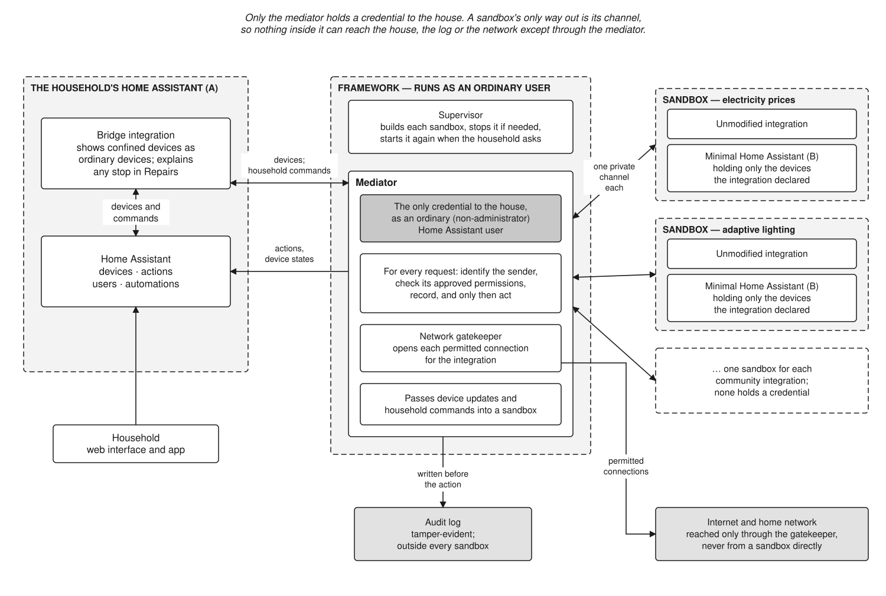
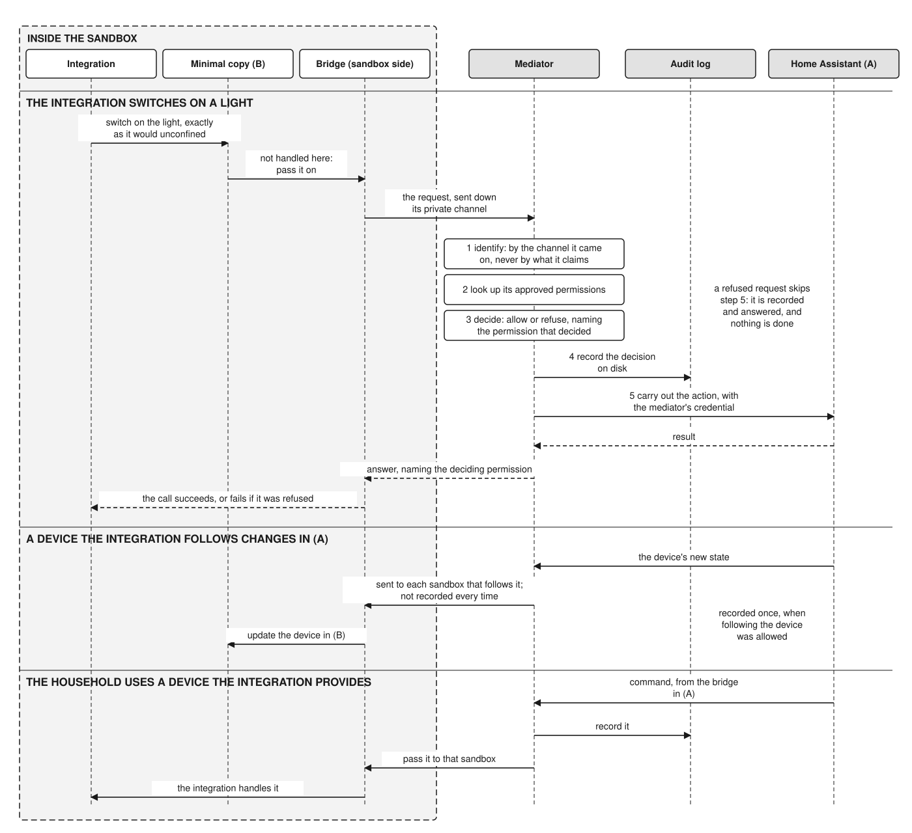

# 5 Methodology

## 5.1 Research design

The project combines an engineering method, which produces the confinement framework, with a quantitative, experimental evaluation of it. The engineering method follows a fixed order. Requirements were written first, each traced to a finding about the problem, and a threat model was written before the design, so that threats were listed independently of the controls that would later answer them. The threat model follows the risk-management process of ISO 31000, in which risks are assessed before they are treated (International Organization for Standardization [ISO], 2018), and classifies threats with the STRIDE categories of spoofing, tampering, repudiation, information disclosure, denial of service and elevation of privilege (Shostack, 2014). It identified nineteen threats, together with seven residual risks that the design accepts and states. The design was then chosen against alternatives, implemented and evaluated.

### 5.1.1 The confinement framework

The framework that this method produced has three kinds of component, shown in Figure 5.1. The household's own Home Assistant installation, referred to as (A), runs as it always has, with one addition: a bridge integration through which confined integrations publish their devices and receive the household's commands. Each community integration runs in its own sandbox, inside a minimal private copy of the platform referred to as (B). Between them sits the mediator, the only component that holds a credential to the house. It connects to (A) as an ordinary, non-administrator user, and no sandbox holds any credential at all.

**Figure 5.1**
*The confinement framework*

A copy of the platform is needed inside each sandbox because an integration is not a standalone program that could send its requests to the mediator by itself. It is written against the platform's own building blocks, such as the classes from which its devices are built and the helper that polls them, and 91% of the integrations shipped with Home Assistant use these building blocks. Without them an integration cannot even start, and imitating them would mean reproducing a large part of the platform that is not documented. Each sandbox therefore runs the platform's real code, but a private copy that starts empty: it holds only the devices the integration was granted, and anything that must reach the real house is passed on to the mediator.

The framework is easiest to follow through the life of a request, which begins before the integration runs. Its permissions are declared in a `permissions` block of the integration's existing manifest file, or in a file supplied beside it. Each service it may call is named individually, so permission to lock a door does not imply permission to unlock it. Nothing is granted until a person approves: the framework renders the permissions in plain language, listing what the integration cannot do as prominently as what it can, and an administrator can approve them in the platform's own Repairs panel, its usual place for issues that need the household's attention. The approval is bound to the integration's identity, a fingerprint of its code, its manifest and the versions of the software it depends on, so a changed integration needs a new approval.

The sandbox is then built so that what the integration must not reach is absent from its view rather than forbidden to it. Linux namespaces, kernel features that give a process its own private view of the system, show the integration only its own files and processes and give it no network route. A filter blocks the system calls that are dangerous in any setting, such as loading kernel modules, and a control group limits its memory and number of processes. The platform's secrets file and configuration store do not exist inside the sandbox, so there is nothing to ask for. The sandbox's only way out is a channel to the mediator that belongs to it alone. The supervisor creates a separate channel for each sandbox when it builds it, so the channel a request arrives on tells the mediator which integration sent it.

When the integration acts on the home, for example by switching on a light, it makes the same call it would make unconfined, and the minimal platform passes it down the channel to the mediator (Figure 5.2). The mediator then takes five steps in a fixed order. It identifies the integration from the channel the request arrived on, never from what the request claims; looks up the permissions bound to that identity; decides whether the request is permitted, naming the clause that decided; writes the decision to the audit log on disk; and only then performs the call on (A) with its own credential. A denied request is recorded and answered, and nothing is performed. Because the record is written before the act, even an action that crashes the mediator remains attributable.

**Figure 5.2**
*The life of a request*

Traffic also runs the other way, as the lower panels of Figure 5.2 show. When a declared device changes in (A), its new state is pushed into the sandbox, and when the household operates a device that the integration provides, the command passes through the mediator, which records it, to the integration's own handler. A confined integration therefore stays responsive. Network connections follow a similar path. The integration's ordinary network calls are turned into requests on the channel, and the mediator checks each one against what the integration declared. Internet services and devices on the home network are declared separately, because the home network also holds the router and every other device in the house. For an internet service, the mediator looks up the host's address itself, checks that the address is not inside the home, and connects to exactly that address. This order defeats an attack in which a permitted name is made to point at a device in the house after the check has passed. A device on the home network is reached only under its own permission, which names the port the integration uses, since the device's address is assigned by the household's router and cannot be known in advance.

Two further properties complete the design. The audit log lies outside every sandbox, and each record is chained to the one before it in two independent ways, so a record that is changed, deleted or reordered is detected. And the framework fails closed: if the mediator stops, every sandbox loses its only route out, and an integration that keeps making refused requests, more than 100 within ten seconds, is stopped rather than allowed to flood the log. When an integration is stopped, the reason is explained to the household in plain language in the Repairs panel.

### 5.1.2 Evaluation design

The evaluation is quantitative and uses a paired design. Every security and compatibility result is the difference between two arms run on the same device, with the same platform release and in the same session: in the confined arm the integration runs inside the framework, and in the unconfined arm the same integration runs as Home Assistant runs it today. Confinement is therefore the only variable between the arms. The pairing gives a negative result its meaning, because a security test that finds nothing could simply be broken; if the same attack succeeds unconfined, the test is shown to work, and its failure under confinement can be attributed to the framework.

The evaluation tests one claim: that unmodified community integrations can be confined at a cost worth paying. The claim divides into three assertions that can fail independently, that confinement is effective, compatible and affordable. Following Popper's (1959) criterion that a claim is scientific only if some observation could refute it, each assertion was given a falsifier, a result that would show it false, on 2 September 2026, before any of the measurements it covers had been run (Table 5.1). The same rule applied to every later experiment: its prediction was committed to the project's repository before it ran, and any text later found wrong was corrected by a dated note rather than rewritten.

**Table 5.1**
*The three assertions and what would falsify them*

| Assertion | Falsified if |
|---|---|
| Effective | Either published attack technique succeeds under confinement, or a platform credential can be recovered from inside a sandbox |
| Compatible | The unconfined arm shows that most of the confined failures are caused by the design rather than by the integrations or the platform |
| Affordable | The device cannot hold as many sandboxes as the average installation using the community store has community integrations (4.02), or mediation changes what the platform can do |

## 5.2 Data sources

The study has no human participants. Its data come from software and from measurements on one device, from four sources.

The first source is the community integrations themselves. Two samples were drawn from the Community Store's catalogue (HACS, n.d.), because they answer different questions (Table 5.2). The head-weighted sample is the 37 most-installed integrations, which describe what most installations run. Installation counts are published per integration name, and the catalogue lists three of these names under two repositories each, so the 40 most-installed entries in the catalogue contain 37 distinct integrations. The uniform sample, 40 repositories drawn with equal probability using a recorded random seed, describes what most integrations are. The two samples have two integrations in common, so together they contain 75 distinct integrations (37 + 40 − 2), and every integration was used exactly as published.

**Table 5.2**
*The two samples of community integrations*

| | Head-weighted | Uniform |
|---|---|---|
| Selection | The 37 most-installed integrations | 40 repositories drawn at random (seed 20260902) |
| Integrations measured | 37 | 40 |
| Median installations | 16,294 | 48 |
| Installations represented | 998,478 | 46,979 |

The second source is the attacks. The two published attack techniques by a hostile integration were reproduced: the garbage-collector technique by which one integration reaches another's data (Corno & Mannella, 2022), and the path-traversal pattern disclosed in 2021, by which an integration reads files outside its own directory (Home Assistant, 2021). A further 39 attacks were derived from the project's own threat model and built into a single hostile integration. The third source is Home Assistant's published analytics, which supply the benchmark of 4.02 community integrations per installation (Home Assistant, n.d.-b). The fourth is the test environment, held fixed throughout: a Raspberry Pi 5 with 4 GB of memory, running Raspberry Pi OS (Debian 13) and an unmodified Home Assistant 2026.8.3, with every step run as an ordinary user rather than as the system administrator.

Holding the environment fixed makes the arms comparable, but it also limits how far the results reach. They describe one platform release on one device, and neither sample covers integrations distributed outside the Community Store.

## 5.3 Data collection methods

Data were collected through three kinds of experiment, each run in both arms.

The security experiments ran the attacks from inside a sandbox and recorded one of three outcomes for each attempt: blocked, when something refused it; empty, when it succeeded but found nothing because nothing was there; and leaked, when it returned something it should not. Blocked and empty outcomes are kept apart because a refusal depends on a check that an attacker might evade, whereas an empty result depends on the resource being absent from the sandbox. Two secrets were planted outside the sandbox as canaries, so that any leak could be detected unambiguously.

The compatibility experiments loaded each of the 75 integrations and recorded whether it imported and set up cleanly, confined and unconfined. This is an upper bound on compatibility, because an integration that loads may still fail later. A stronger test, running an integration end to end with its entities and actions working, was possible only for integrations that need no account details: 26 of the 37 head-weighted integrations require an API key, password or similar before they can be configured. Thirteen integrations were run end to end and are reported by name rather than as a rate.

The performance experiments measured memory and delay. Memory was measured as the proportional set size, which divides each memory page among the processes that share it, because most of a sandbox consists of interpreter pages that the operating system shares between sandboxes. Each figure was measured in five passes over frozen code, the first three each after a fresh start of the device, and in five more passes at the final version.

The measuring instruments were themselves tested. The 29 automated test suites were run twice on the device at the final version, and 53 deliberate defects were introduced into the code to check that the suites detect them. A final full rerun of every experiment was made from a fresh copy of the code at the submitted version, with its predictions committed beforehand.

## 5.4 Data analysis methods

The analysis is descriptive, because the experiments compare two arms under controlled conditions rather than sample from a population. Security results are reported attack by attack, as the outcome in each arm. Compatibility results are reported as two numbers that are never combined, the share of integrations that load and the named set that runs end to end, so that the weaker measure cannot be read as the stronger.

Performance figures are summarised by the median across passes and the range of all passes. A figure passes if its median falls within a tolerance fixed before the first pass, 20% for timings and 5% for memory, and a figure outside it is reported as a finding rather than averaged away. Each pass also recorded its slowest cases, as the delay that 99% of requests did not exceed, because a typical figure can hide occasional long waits.

Three further rules govern how results are presented. No single score of "threats controlled" is reported, because it would merge attacks that were refused, attacks that found nothing and risks accepted by decision. Where a population is small, results are given as named cases. And the strength of each statement follows its evidence: a verified result is said to show, a qualified one to suggest, and an argued one is presented as argument.

## 5.5 Ethical considerations

The project collected no personal data about anyone other than the author. Every measurement ran on the author's own device and test installation, so no household's data were observed. Six integrations contacted live online services at their normal rates, four of them public services needing no account and two through free accounts created for the purpose, and two integrations that control devices on the home network were tested against simulated devices rather than real ones.

The security work was designed so that no third party was harmed. The attacks were reproduced with integrations written for the evaluation, not against the vulnerable versions of real integrations, so no one else's software or users were attacked. One weakness found by reading the code, through which a sandbox could have typed commands into the terminal that started the framework, was fixed but deliberately not developed into a working attack.

Credentials needed for testing, including the platform access token held by the mediator, were kept on the device with owner-only permissions. They were never placed in a conversation with the AI tool, and the project's code was scanned for them before each upload to its repository. A final consideration concerns independence: the framework and the attacks used to evaluate it were built by the same AI-assisted process, so the security results rest on the project's own attacks rather than on an independent test, a limit that Section 6.4 discusses.
