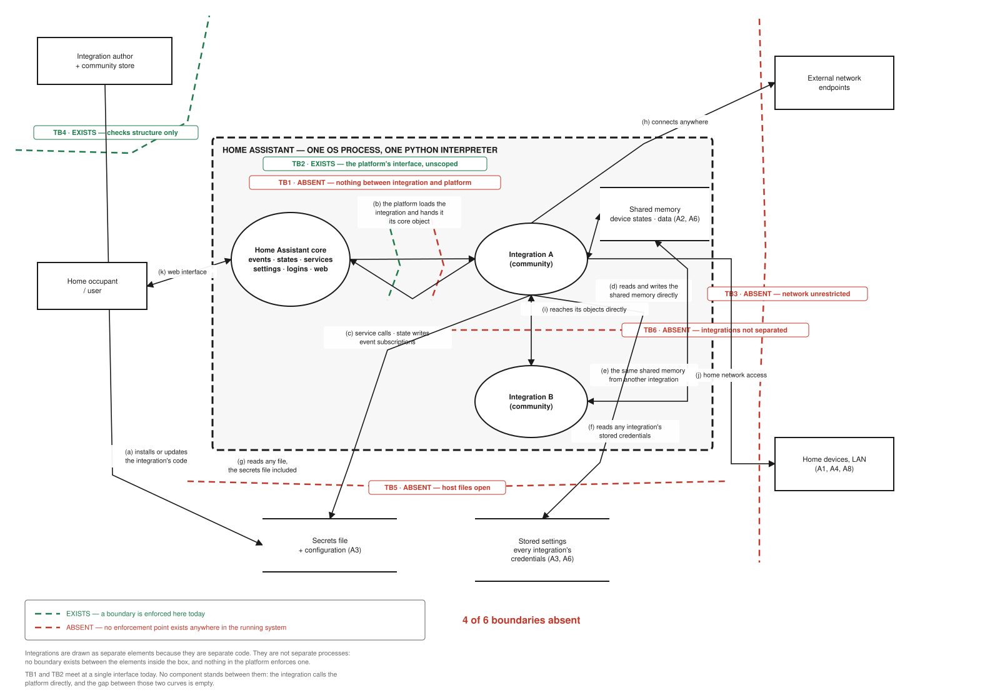

# Chapter 4 — Threat Model

## 4.1 Framework, and why two of them

This chapter uses **ISO 31000** [25] for the risk-management *process* and **STRIDE** [26] for the
risk *identification* technique. The two are complementary rather than alternatives: ISO 31000
specifies a process — establish scope and context, identify, analyse, evaluate, treat,
monitor, record — but deliberately does not prescribe a technique for identification.
STRIDE occupies that slot, supplying a systematic enumeration (spoofing, tampering,
repudiation, information disclosure, denial of service, elevation of privilege) applied here
per trust boundary.

The chapter follows ISO 31000's clause structure explicitly, and each section names the
clause it discharges, so that the process is auditable rather than merely invoked.

Two frameworks, and deliberately not more. ISO 31000 is generic by design and does not
supply impact criteria, which is the one thing it leaves conspicuously open; §4.7 derives
those from the asset valuation of §4.4 rather than importing a published generic scale.
That is a considered choice rather than an omission: no general-purpose scale contains a
rung for defeat of a life-safety function in a dwelling, and calibration to this asset
owner (§4.3) is precisely what makes the ratings mean anything.

This chapter is deliberately written **before** the architecture. Chapter 3 fixed what the
system must do; Chapter 5 will decide how. Placing the threat model between them means the
controls in Chapter 5 answer threats enumerated independently of them. Written in the other
order, a threat model becomes a justification for decisions already taken, which is a
recognisable failure mode and one an assessor is entitled to look for.

## 4.2 Scope of the assessment (ISO 31000 §6.3.2)

**In scope:** a self-hosted Home Assistant installation extended by third-party
*integrations* — Python modules loaded into the platform's process (§1.2) — together with
the assets those integrations can reach (§1.7, Table 1.2), and the trust boundaries implied
by the requirements of Chapter 3.

**Out of scope**, each for a stated reason:

| Excluded | Reason |
|---|---|
| Add-ons | Isolated as containers (§1.2.1); a different architecture with a different model |
| Home Assistant core vulnerabilities | First-party code; addressed by the project's own security programme [10] |
| Network-layer attacks on the home LAN | Adjacent problem, addressed by MUD-style work (§2.4.2) |
| Physical attacks on the gateway device | Assumed physically secure; a home with an attacker inside it has different problems |
| Multi-user authorisation | Platform assumes all users are trusted (§1.8); changing this requires core changes (C2) |

The assessment considers threats **originating from an integration**. This matches the
scoping choice of the closest prior model (§4.14) and keeps the analysis on the problem
Chapter 1 established.

## 4.3 Context (ISO 31000 §6.3.3)

**External context.** Integrations are written by volunteers, distributed through a channel
that verifies structure but not behaviour (§1.4), and installed on 56.6% of reporting
installations (§1.3). The platform explicitly places their behaviour outside its security
programme (§1.8). Informal community review exists and is effective against obvious malice
in popular integrations, but weakens across a long tail where the median integration has 20
installs (§1.6). No regulatory regime applies to a self-hosted home installation.

**Internal context.** The asset owner is a private individual, not an organisation. They
have no security team, no incident-response capability and, in the general case, no ability
to audit Python. Their risk appetite is implicit rather than stated. The platform runs
continuously and unattended on modest hardware (C4), typically controlling devices with
physical effect. Recovery from compromise is manual and, for credential compromise, may be
incomplete because the owner cannot enumerate what was taken.

This context matters for the risk criteria below: an enterprise threat model can assume
detection and response capability, and this one cannot.

## 4.4 Assets (ISO 31000 §6.3.2)

Derived from Table 1.2 and the consequences recorded there.

| ID | Asset | Why it matters |
|---|---|---|
| A1 | **Physical control of the dwelling** — locks, alarms, garage doors | Life-safety and property; irreversible in effect |
| A2 | **Occupancy and behavioural data** — presence, sleep, absence | Enables physical burglary; irreversible once disclosed |
| A3 | **Stored credentials** — `secrets.yaml`, API tokens, OAuth material | Lateral compromise beyond the home |
| A4 | **Camera and media streams** | Intimate privacy harm |
| A5 | **Platform availability** | Automations include alarms and heating; unavailability has safety consequences |
| A6 | **Other integrations' state and secrets** | Reachable in-process (§1.7, demonstrated) |
| A7 | **The audit record** | Meta-asset: its integrity determines whether any other loss is attributable |
| A8 | **The home network** | Pivot target reachable from the gateway |

### 4.4.1 Valuation

The impact criteria of §4.7 are derived from this table rather than adopted from a generic
scale, so the relative valuation is stated here and the derivation can be checked.

| Rank | Assets | Basis |
|---|---|---|
| Highest | A1 | Life-safety, and irreversible in effect: a door opened cannot be un-opened |
| High | A3, A4 | Harm crosses the boundary of the dwelling (A3) or is intimate and permanent (A4); both irreversible once realised |
| High, conditional | A5 | Ordinarily a serious loss of service; where automations include alarms or heating, unavailability becomes a life-safety matter and is valued with A1 |
| Moderate | A2, A8 | A2 is irreversible once disclosed but enabling rather than directly harmful; A8 extends reach without itself being a loss |
| Moderate, meta | A7 | No direct loss. Its value is that it determines whether any other loss can be attributed, and this owner has no other detection capability (§4.3) |
| Lower | A6 | Reachable and demonstrably so, but state written by one integration is ordinarily overwritten by the owning integration's next update |

**Reversibility is the axis that makes these commensurable.** Disclosure is permanent;
availability is normally recovered. This is what justifies placing an outage below an
exfiltration of comparable drama, and it is applied consistently in §4.7.

Every asset above must be reachable somewhere on the impact scale. That is a completeness
condition on §4.7, and applying it is what produced the criteria in their present form.

## 4.5 Actors

| ID | Actor | Capability | Evidence for plausibility |
|---|---|---|---|
| AC1 | **Malicious integration author** | Writes arbitrary code; controls releases; declares whatever manifest they wish | No documented Home Assistant case; the capability is trivially available and the analogous case is documented in other ecosystems |
| AC2 | **Compromised honest author** | As AC1, from a legitimate project with existing installed base | XZ Utils (§1.6): two years of trust-building, then a backdoor |
| AC3 | **Remote attacker via a vulnerable integration** | Exploits a bug in honest code | **Documented in this ecosystem**: 2021 disclosures, eight integrations, unauthenticated (§1.5) |
| AC4 | **Co-resident compromised integration** | Attacks other integrations in-process | **Demonstrated**: garbage-collector technique (§1.7, §2.4.1) |
| AC5 | **The user** | Installs integrations; authors or accepts declarations; misconfigures | Not an adversary, but a source of risk through action |
| AC6 | **Platform maintainers** | Full control of the platform | **Trusted.** Out of scope: if the platform is hostile, no integration-level control helps |

AC3 is the only actor with documented realisation *in this ecosystem*, and AC4 the only one
with a demonstrated technique. AC1 is the most severe and least evidenced — stated as such
rather than inflated (§1.5).

## 4.6 Trust boundaries

Six boundaries. TB1 is the critical one: **it is required by Chapter 3 and does not exist
today**, which is the whole of the problem.

| ID | Boundary | Status today |
|---|---|---|
| TB1 | Integration ↔ mediating component | **Absent.** Integration and platform share a process (§1.2); required by S1 |
| TB2 | Mediating component ↔ Home Assistant | Exists as the platform's API surface; unscoped and unauthenticated per integration |
| TB3 | Integration ↔ external network | **Absent.** Unrestricted outbound (Table 1.2); required by F2/S4 |
| TB4 | Author and distribution channel ↔ the user's machine | Exists procedurally; verifies structure not behaviour (§1.4) |
| TB5 | Integration ↔ host OS, filesystem, process table | **Absent.** Integration holds the platform's OS privileges (§1.2); required by S8 |
| TB6 | Integration ↔ other integrations | **Absent.** Demonstrated crossable (§2.4.1); required by S1 |

These six boundaries are overlaid on the system as it exists today in Figure 4.1. The
figure asserts nothing the table above does not already state; its purpose is that the
*distribution* of the absences is spatial, and a table flattens it. Three of the four
missing boundaries — TB1, TB5 and TB6 — are missing for one reason, visible in the figure
as a single enclosure: the integration and the platform occupy the same process, so there
is no location at which any of the three could be enforced. This is why §4.9 finds four
Critical risks sharing a single cause, and why no combination of controls placed *inside*
that enclosure can address them.

> **Figure 4.1 — Home Assistant as it stands today, with the six trust boundaries of §4.6
> overlaid.** Integrations are drawn as distinct elements because they are distinct code;
> they are not distinct processes. Everything within the heavy border shares one
> operating-system process and one Python interpreter, so the boundaries marked ABSENT have
> no enforcement point anywhere in the running system. Four of six do not exist. TB1 and
> TB2 are drawn as two curves with an empty gap between them: that gap is where a mediating
> component would stand, and today nothing does. Assets carry the identifiers of §4.4;
> threats are not shown and remain in the tables of §4.8. Drawn with OWASP Threat Dragon [27];
> the model and this rendering are generated by `figures/fig_4_1_current_state.py`.

Four of six boundaries do not currently exist. That is the finding of Chapter 1 restated in
the vocabulary of this chapter, and it is why the inherent risk ratings below are high.

## 4.7 Risk criteria (ISO 31000 §6.3.4)

Scales are **ordinal, not cardinal**. They order risks for treatment priority; the product
of two ordinal scales is not a quantity and is not treated as one. This is stated because a
risk matrix presented without that caveat invites arithmetic it cannot support.

**The risk owner** is the occupying householder: the party that owns the assets of §4.4,
carries the consequences, and has neither a security function nor an incident-response
capability (§4.3). The appetite below is stated on their behalf. Naming them matters
because every judgement in this section is calibrated to that owner and would be different
for an organisation.

**Impact** (calibrated to a private dwelling, per §4.3, and derived from the valuation of
§4.4.1). An earlier form of this scale laddered confidentiality harm across four levels and
gave availability a single rung, which left three assets — A5, A6 and A7 — with nowhere to
sit; §4.12 records the review that corrected it. Each level is therefore now defined across
the harm types the assets can actually suffer, and **a threat is rated at the highest level
any column matches.**

| | Level | Confidentiality | Integrity and control | Availability |
|---|---|---|---|---|
| 5 | Severe | — | Physical access to the dwelling by state change (A1) | Defeat of a life-safety function: alarm, smoke or CO response, heating in freezing conditions (A5 with A1) |
| 4 | Major | Credential compromise extending beyond the home (A3); camera or media access (A4) | Reach into other devices on the home network (A8) | Total loss of the platform while unattended (A5) |
| 3 | Moderate | Disclosure of occupancy or behavioural patterns (A2) | Undetected corruption of another integration's data (A6) | Loss of attribution: harm occurs and cannot be traced to its source (A7) |
| 2 | Minor | Disclosure of individual non-sensitive readings | Corruption that is detected, or recovered by the owning integration's next update (A6) | Partial or transient loss of function |
| 1 | Negligible | No meaningful loss | | |

**Convention: worst credible case.** A threat is rated on the most serious outcome
consistent with the actor model, not on the average one — so T14 is rated on the assumption
that credentials are in fact stored on the host, which the platform's own documentation
says is normal (§1.7). Rating on the modal case would understate exposure for precisely the
installations that have most to lose.

**Likelihood**, anchored on evidence rather than intuition:

| | Level | Anchor |
|---|---|---|
| 5 | Almost certain | Occurs by default in normal operation |
| 4 | Likely | Documented in this ecosystem, or requires no attacker skill |
| 3 | Possible | Documented in comparable ecosystems |
| 2 | Unlikely | Technically available, no documented occurrence |
| 1 | Rare | Requires capability inconsistent with the actor model |

**Evaluation bands:** Low (1–4), Medium (5–9), High (10–16), Critical (17–25).

**Risk appetite.** The owner named above has no detection or response capability, so a risk
that materialises is unlikely to be noticed and cannot be responded to. The stated appetite
is therefore: **no residual Critical risk is
acceptable; High residual risk is acceptable only where it is structural** — that is, where
no available control addresses it and the limitation is stated openly to the user.

## 4.8 Risk identification: STRIDE per boundary (ISO 31000 §6.4.2)

Threats are labelled `T01`–`T18`. The final column maps to the closest published model for
comparability (§4.14). *(2026-10-05: `T19` added, below TB1's table and in §4.9 and §4.10. It is a
risk the treatment of T18 introduced, found by measurement (§7.40.4) and treated in §7.44. Every
evaluation dated before §7.44 is against T01–T18.)*

### TB1 — Integration ↔ mediating component

| ID | STRIDE | Threat | CM |
|---|---|---|---|
| T01 | Elevation | Integration bypasses mediation by acting directly on the platform's in-process objects | T10 |
| T02 | Spoofing | Integration presents itself as another integration to obtain that integration's authority | T9 |
| T03 | Tampering | Integration modifies the mediating component or its policy in memory | T10 |
| T04 | Info. disclosure | Integration recovers the platform credential held by the mediator | T1 |
| T19 | Denial of service | Integration floods the mediator with refused requests, each a durable audit record, exhausting the decision budget every sandbox shares and the disk *(added 2026-10-05)* | T7 |

### TB2 — Mediating component ↔ Home Assistant

| ID | STRIDE | Threat | CM |
|---|---|---|---|
| T05 | Elevation | Integration induces the mediator to perform an undeclared service call — a confused deputy, since the mediator is authorised and the integration is not | T3, T10 |
| T06 | Info. disclosure | Integration reads undeclared entity states, or subscribes to a state-change stream that returns the whole installation | T1 |
| T07 | Tampering | Integration writes state for entities it does not own, corrupting another integration's data | T4 |

### TB3 — Integration ↔ external network

| ID | STRIDE | Threat | CM |
|---|---|---|---|
| T08 | Info. disclosure | Integration exfiltrates data to an undeclared host | T2 |
| T09 | Info. disclosure | Integration exfiltrates data **through a declared host** — content, not destination | T2 |
| T10 | Elevation | Integration reaches other devices on the home LAN, or loopback services on the gateway | T3 |
| T11 | Spoofing | Integration uses a declared hostname that resolves, at request time, to an internal address | T9 |

### TB4 — Author and channel ↔ the user's machine

| ID | STRIDE | Threat | CM |
|---|---|---|---|
| T12 | Tampering | A malicious update is delivered through the authorised update path to an integration already installed and trusted | — |
| T13 | Spoofing | The declaration accompanying an integration misrepresents its behaviour (over-declaration, or declaration absent) | T10 |

### TB5 — Integration ↔ host OS

| ID | STRIDE | Threat | CM |
|---|---|---|---|
| T14 | Info. disclosure | Integration reads files outside its resources — `secrets.yaml`, the state database, tokens | T1 |
| T15 | Info. disclosure | Integration reads another process's memory, environment or command line via the process table | T1 |
| T16 | Denial of service | Integration exhausts CPU, memory or disk, rendering the gateway unresponsive | T7 |

### TB6 — Integration ↔ other integrations

| ID | STRIDE | Threat | CM |
|---|---|---|---|
| T17 | Info. disclosure / Tampering | Integration reads or alters another integration's live objects and secrets | T1, T4 |
| T18 | Repudiation | Integration acts without attribution, so no record identifies which integration performed an action | T11 |

## 4.9 Risk analysis and evaluation (ISO 31000 §6.4.3–6.4.4)

**Inherent risk** is assessed against Home Assistant as it stands today, with none of
Chapter 3's requirements implemented. Likelihood reflects §4.7's anchors.

| ID | Impact | Likelihood | Inherent | Note on rating |
|---|---|---|---|---|
| T01 | 5 | 5 | **25 Critical** | No boundary exists; this is normal operation, not an attack |
| T02 | 4 | 4 | 16 High | Nothing authenticates an integration to the platform |
| T03 | 5 | 5 | **25 Critical** | Same process; demonstrated technique (§2.4.1) |
| T04 | 5 | 4 | **20 Critical** | Credential is in-process and readable |
| T05 | 5 | 5 | **25 Critical** | `lock.unlock` is an ordinary call today |
| T06 | 3 | 5 | 15 High | Reading all states is the default capability |
| T07 | 2 | 4 | 8 Medium | Demonstrated (§2.4.1); recoverable — the owning integration's next update overwrites |
| T08 | 4 | 4 | 16 High | Unrestricted egress |
| T09 | 4 | 3 | 12 High | Requires a declared host to abuse |
| T10 | 4 | 3 | 12 High | Reach into other devices on the home network (A8); documented as a consequence of gateway compromise (§1.5) |
| T11 | 4 | 2 | 8 Medium | Requires attacker-controlled DNS |
| T12 | 5 | 3 | 15 High | Documented in comparable ecosystems (XZ, §1.6) |
| T13 | 4 | 4 | 16 High | Costless for an author to do |
| T14 | 4 | 4 | 16 High | **Realised in this ecosystem in 2021** (§1.5) |
| T15 | 4 | 4 | 16 High | **No attacker skill required**: `/proc/<pid>/environ` is an ordinary file read for a same-uid process |
| T16 | 4 | 3 | 12 High | Total loss of an unattended platform (A5); no resource limits exist |
| T17 | 4 | 4 | 16 High | **Demonstrated** (§2.4.1) |
| T18 | 3 | 5 | 15 High | Loss of attribution (A7); no attribution exists, confirmed by [21] |

**Evaluation.** Four Critical and twelve High inherent risks, and the Critical ones share a
single cause: integration and platform occupy one process with no boundary between them.
This concentration is itself the finding — it means one architectural decision (TB1) governs
the majority of the risk, and that treating it is worth more than treating any number of
individual threats.

**T19, added 2026-10-05, has no inherent rating**, because it does not exist in Home Assistant as it
stands: it is a risk the treatment of T18 created, which ISO 31000 §6.5 expects of treatments. A
durable record per decision is what makes a refusal cost about 3.7 ms of the mediator's shared time.
Rated against the design before §7.44's control, its impact is 3 (other integrations' availability
and the disk, A5, with every decision still correct) and its likelihood 4 (costless, and it happened
by accident in §7.40.4): **12 High**. It is not counted in the evaluation above, which is of the
platform as it stands.

**A note on T01, T03 and T05.** Their likelihood is 5 — *almost certain*, meaning "occurs by
default in normal operation". This is not hyperbole: an integration calling `lock.unlock`
today is not exploiting anything. The risk register records ordinary platform behaviour as
Critical risk, which is exactly what Chapter 1 argued and what an assessment of this system
should surface.

## 4.10 Risk treatment (ISO 31000 §6.5)

Treatment options under ISO 31000 are: avoid, remove the source, change likelihood, change
consequence, share, or retain. This project's treatments are overwhelmingly **change
consequence** — bounding what code can do — which is the deliberate complement to the
ecosystem's existing likelihood controls (§1.6).

| ID | Treatment option | Control | Ch. 3 requirement |
|---|---|---|---|
| T01 | Change consequence | Execute the integration outside the platform's process | **S1** |
| T02 | Change consequence | Per-integration identity on every mediated request | **S1**, S7 |
| T03 | Change consequence | Mediator unreachable from the integration's address space | **S1** |
| T04 | Change consequence | Credential held only by the mediator | **S2** |
| T05 | Change consequence | Manifest-checked service calls, default deny | **F3**, S5, S6 |
| T06 | Change consequence | Mediate reads *and* subscriptions | **S3** |
| T07 | Change consequence | Writes restricted to declared entities | F3, S6 |
| T08 | Change consequence | Per-integration egress allow-list | **S4** |
| T09 | **Retain** | — structural; see R5 | — |
| T10 | Change consequence | Deny non-public destinations; egress via mediator | S4 |
| T11 | Change consequence | Resolve and check the destination address, not the name | S4 |
| T12 | Change consequence | Confinement applies to whatever version runs; declaration re-checked per version | F3, S6 |
| T13 | **Retain** (partially) | Declaration made visible; enforcement bounded to it | F4; see R1 |
| T14 | Change consequence | Filesystem isolation to declared resources | **S8** |
| T15 | Change consequence | Process-table isolation | **S8** |
| T16 | Change consequence | **Resource limits — no requirement existed; see §4.10.1** | **S9 (new)** |
| T17 | Change consequence | Separate process removes shared heap | **S1** |
| T18 | Change consequence | Tamper-evident, attributed decision log | **S7** |
| T19 | Change consequence | Refusals counted per integration; past 100 in 10 s, one record, the integration stopped until a user restarts it, never with more authority (§7.44) *(added 2026-10-05)* | S7, S9 |

*(2026-10-05.)* **A residual within T14, found by measurement.** The sandbox's filesystem is built
by binding host directories at their host paths (the interpreter and its libraries) and by fixed
mount points whose sources `/proc/self/mountinfo` lists (the integration's own two directories). A
confined integration can therefore read the host's directory layout along those paths, including
the user's name where the runtime is installed under a home directory. It cannot read any content
outside its grant. Likelihood 5, because it happens by construction. Impact 1, *negligible*: the
author's judgement, with level 2 (*"disclosure of individual non-sensitive readings"*) considered and
not chosen, because a user name and directory names give a confined integration no capability it
does not already hold and disclose no secret or reading. **5, Medium**, retained. The remedy is a
deployment step, installing under a neutral prefix (§6.4's dated note, §8.6.3 #18). Rated at 2 it
would be 10, High, and §4.7's appetite would then require that remedy rather than permit retaining
the risk.

### 4.10.1 A requirement generated by this chapter

Chapter 3 contained **no requirement addressing resource exhaustion**, because nothing in
Chapters 1 or 2 justified one and the traceability discipline (§3.1) forbade inventing it.
T16 now supplies the justification: availability is a security property (A5), automations
include alarms and heating, and the closest published model treats gateway "resource
saturation up to a frozen state" as an explicit threat (§4.14). T16 is rated High, not
Medium (§4.9), so the requirement rests on a risk the register ranks alongside credential
theft rather than on a marginal one.

**S9 — The framework shall bound an integration's consumption of CPU, memory and disk.**
*Derivation:* T16, this chapter.
*Verification:* an integration deliberately exhausting each resource is shown not to render
the gateway unresponsive.

This is recorded as a demonstration that the ordering works. The requirement is derived from
an identified threat rather than from an implementer's instinct, and it arrived at the point
in the process where ISO 31000 says it should.

## 4.11 Residual risk statement (ISO 31000 §6.5.3)

Six risks remain after treatment. Each is stated with why it is retained, because a residual
risk that is not written down has been ignored rather than accepted.

**R1 — The over-declaring manifest.** *From T13.* An author may declare more authority than
they need, and nothing forces anyone to review the declaration. Confinement bounds behaviour
to the declaration; it does not make the declaration minimal.
*Retained because:* structural. The browser-extension precedent (§2.2) has the identical
limit after fifteen years. **Residual: High.** The mitigation is that authority becomes
*visible* (F4) and *bounded*, replacing a silent-full-trust default — which is the honest
claim, and smaller than "the manifest makes integrations safe".

**R2 — Abuse of legitimately declared authority.** *From T05, T13.* An integration that
legitimately declares `lock.unlock` may unlock the door at 03:00. Manifest confinement
cannot distinguish this from correct operation.
*Retained because:* structural; addressing it requires contextual integrity (ContexIoT,
§2.3), which is a different mechanism with its own usability costs. **Residual: High,
structural** — and explicitly within the risk appetite of §4.7 only because it is stated to
the user rather than concealed.

**R3 — The mediator holds an unscoped credential.** *From T04's treatment.* Home Assistant
issues long-lived access tokens with no read-only or per-domain variant, so the mediator
must hold full authority in order to mediate at all. Compromise of the mediator is therefore
total compromise.
*Retained because:* **this is an upstream platform limitation, not a design flaw here.** It
cannot be fixed without changing Home Assistant (C2). **Residual: High.** It should be
reported to the platform as the single change that would most improve any confinement
scheme.

> **Corrected 2026-10-06 (verification finding F45, §7.45.11).** The platform fact is wrong as
> stated: a long-lived token carries its user's permissions, Home Assistant has a read-only group,
> and an entity policy by domain is enforced. What is true is narrower: such a policy can only be
> written by hand, and it does not cover services without an entity target or the entity registry.
> The mediator held full authority because this project's bridge admitted only admins. It now runs as
> an ordinary user, so its compromise gives control of every entity, not of the house's users,
> integrations and configuration. The residual rating is revisited in phase R. This pointer covers
> the R3 rows in Chapter 5's tables as well.

**R4 — A local audit log cannot be authoritative against whoever controls the machine.**
*From T18's treatment.* Hash-chaining provides tamper-*evidence*, not tamper-proofing, and an
unkeyed chain can be rebuilt wholesale by an adversary with write access. It also says
nothing about events never recorded: **integrity is not completeness.**
*Retained because:* external anchoring is a different project. **Residual: Medium**, reducible
by keying the chain.

**R5 — Exfiltration through a declared host.** *From T09.* An integration permitted to reach
`api.vendor.com` may send anything to it. Destination control cannot become content control
without inspecting payloads, which is both a privacy problem in itself and defeated by TLS.
*Retained because:* structural. **Residual: High.**

**R6 — The user is not equipped to evaluate a declaration.** *From T13, AC5.* F4 makes
authority visible; §3.7 excludes user comprehension as a human-factors question.
*Retained because:* out of scope, and honestly so. **Residual: Medium.** Note that the
mechanism does not depend on the user reading the manifest — enforcement is automatic, and
visibility is additive.

> **R7 — I/O bandwidth is unbounded. Added by §7.22.2 (2026-09-04); this section is otherwise
> left as written.** *From T16.* The framework bounds a sandbox's memory, CPU, process count and
> disk **space**, and cannot bound its **I/O bandwidth**: cgroup v2's `io` controller is present on
> the host and **not delegated to a user manager** — `+io` to the delegated subtree fails with
> `ENOENT` — so the unprivileged supervisor §5.7.4 chose cannot enforce it at any effort. A sandbox
> can therefore saturate the device while staying inside every limit it declared.
> *Retained because:* **inherited, not structural.** The fix is a privileged installer step or an
> upstream delegation change, and §8.7 #9 prices it alongside the filesystem quota. **Residual:
> Medium.**
>
> This risk could not have been written here. §4.11 was drafted against the design; the
> non-delegation is a property of the host, measured in §7.22.2. **§4.10.1 records Chapter 4
> generating a requirement Chapter 3 could not have written; this is the same event one chapter
> later, and it is why §4.12 lists "new threats surface from the evaluation itself" as a review
> trigger.** The counts in the paragraph below are as of 2026-08-22 and are not restated: with R7
> there are **seven** residual risks, four of them High and three Medium.

**Summary against appetite.** No residual Critical risk remains. Four residual High risks
remain (R1, R2, R3, R5), each structural and each stated. This satisfies §4.7's appetite
only under its second clause, and that should be said plainly rather than presented as a
clean result.

## 4.12 Monitoring and review (ISO 31000 §6.6)

This model is a snapshot and will decay. Specific triggers for revision:

- **The platform introduces scoped tokens** → R3 changes materially and should be re-rated.
- **The *Remote Integration Execution* proposal (§1.9) is adopted** → TB1 acquires an
  official substrate; the model's boundaries survive, the implementation of the control
  changes.
- **A malicious Home Assistant integration is documented in the wild** → AC1's likelihood
  moves from 2 to at least 3, raising several ratings.
- **New threats surface from the evaluation itself.** §4.13 records that this has already
  happened once in the project's history and should be expected again.

### 4.12.1 Review of 22 August 2026

One review has already been performed and is recorded here rather than absorbed silently,
since a register that changes without a trail is worth less than one that does not change
at all.

A check of the impact criteria against the asset table found that the scale laddered
confidentiality harm across four levels while giving availability a single rung, so that
A5, A6 and A7 had no level whose text described them. Four threats — T07, T10, T16 and T18
— were consequently rated against descriptions that did not fit. The criteria were rebuilt
across three harm types and derived explicitly from the valuation now stated in §4.4.1.

Two ratings changed as a result, both upward:

| Threat | Was | Now | Reason |
|---|---|---|---|
| T15 | 12 High | 16 High | Likelihood 3 → 4. The justification given was a statement of capability, which anchors at 2, not 3; the correct anchor is level 4's "requires no attacker skill" |
| T16 | 9 Medium | 12 High | Impact 3 → 4. The threat is total loss of an unattended platform, which the previous scale could express only as "partial loss of function" |

T07, T10 and T18 retain their ratings; only their justifications changed, each now naming
the asset and level it is rated against.

The correction was prompted by scrutiny of two individual ratings rather than by a
scheduled review, which is worth stating plainly. Both changes raise risk, and one of them
strengthens a requirement (S9) rather than excusing its absence.

## 4.13 Limits of this threat model

- **It models threats originating from an integration** (§4.2). Threats originating from a
  compromised platform, a hostile LAN, or physical access are excluded by scope, not because
  they are unimportant.
- **The ratings are judgements.** Likelihood is anchored on documented occurrence where
  possible, and impact on the asset valuation of §4.4.1, so both axes can be argued against
  rather than merely disputed. Two assessors would still not produce identical numbers; the
  ordering is more robust than the values. The scale also asserts that harms of different
  kinds are commensurable at each level — that credential loss and total unavailability
  both sit at 4 — for which reversibility (§4.4.1) is the stated reason, not a proof.
- **A threat model enumerates what its author thought of.** This is not a hedge but the
  central methodological point of the chapter: testing demonstrates the absence of *known*
  failures, never the absence of failures, which is precisely why threat modelling is a
  separate activity from testing and why it is performed here before the design rather than
  after the implementation.
- **STRIDE is boundary-oriented** and is consequently weaker on threats that arise from the
  *composition* of individually-permitted actions. R2 is the clearest example, and it is
  retained rather than solved.

## 4.14 Relationship to the closest published model

Corno and Mannella [9] propose the only published threat model for extensible
smart-home gateways, validated on Home Assistant. Chapter 7 evaluates against it, so the
relationship is stated here.

Their model enumerates eleven threats across six properties: confidentiality (T1 use, T2
spread of data outside scope), integrity (T3 alter device state, T4 alter private data),
availability (T5 delay, T6 partial loss, T7 complete loss including "resource saturation up
to a frozen state", T8 physical damage), authentication (T9 impersonation), authorisation
(T10 escalation) and non-repudiation (T11 anonymous action). The mapping column in §4.8
gives the correspondence.

Two differences are worth stating.

**Their model is broader in consequence; this one is broader in mechanism.** They include
physical damage to devices (their T8) — repeated activation until a lamp burns out — which
this model does not, because it is not reachable by any control available here and would be
retained immediately. This model, in turn, separates the supply and update path (TB4) and
the host operating system (TB5) as boundaries in their own right, which their gateway-level
framing does not require.

> **Corrected by §7.26.4 (2026-09-03): the divergence is wider than this paragraph states, and
> the text is left as written.** Scoring both registers found that **three** of their eleven have
> no counterpart in §4.8's mapping column, not one — their T5 (delay) and T6 (partial loss) as
> well as T8. The defensible reading is under-mapping rather than omission: T16 is *"exhausts CPU,
> memory or disk, rendering the gateway unresponsive"*, and a gateway being exhausted delays and
> partially loses before it completely loses, so T16's `CM` entry should read **T5, T6, T7** rather
> than T7 alone. Either way this paragraph gives one example where there are three, and §7.26.4
> reports the scoring against the mapping as it stands rather than against a corrected one.

**Their notion of *scope* is defined by documentation; this project makes it enforceable.**
Their model states that a plug-in's scope is "the set of variables, files, or resources that
the plug-in can legitimately access", and that "to legitimately access a resource, the
plug-in documentation has to include its possible use". Every one of their threats is
defined relative to that scope — acting "outside its scope" is what makes an action a threat.

This is the connection between the two chapters and the sharpest available statement of what
this project contributes. **The closest published threat model presupposes a notion of scope
that has no machine-readable representation and no enforcement mechanism.** Scope exists in
prose, in documentation an author writes and a user may never read. The manifest of F3 is
that same notion of scope, made explicit, machine-checkable and enforced at runtime — which
is why their model can be used to evaluate this system directly, and why their model
motivates it.
