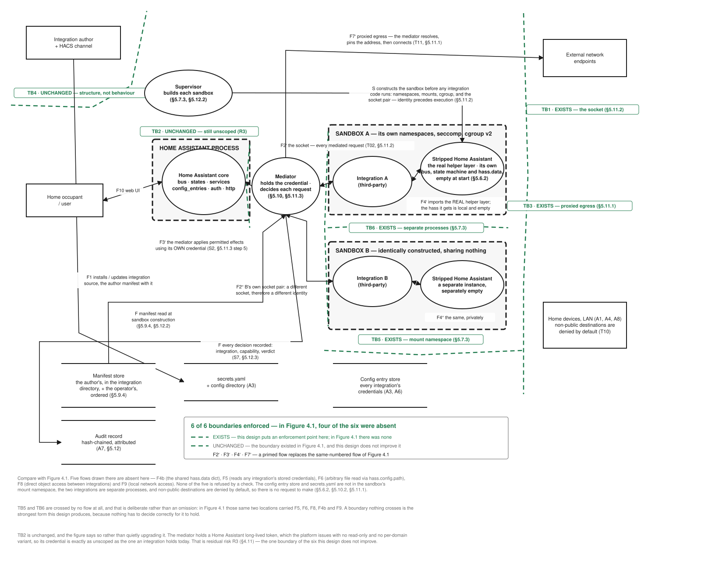

# Chapter 5 — Architecture and design rationale

## 5.1 What this chapter must settle

Chapters 3 and 4 constrain this design tightly enough that most of it is determined. Chapter
3 fixed nineteen requirements, four of them constraints; Chapter 4 enumerated eighteen threats
against a system that has none of them, found four Critical risks, and observed that those
four share a single cause. This chapter converts that into an architecture, and it is
answerable for five things:

1. **The two questions Chapter 3 deliberately left open** (§3.9): how an unmodified
   integration can execute outside the process it was written to run inside, and who authors
   the manifest given that C3 forbids assuming the author is honest.
2. **The four decisions this rebuild re-opened.** The first pass settled a platform, a
   compatibility strategy, an isolation primitive and an implemented scope. None is assumed
   here. Each must be reached by argument from evidence gathered in this pass, and where the
   argument arrives somewhere different, the divergence is followed and reported rather than
   suppressed.
3. **The manifest**, promoted from the strawman of §1.10 to a specified schema with a stated
   granularity, since S5 constrains granularity without fixing it.
4. **Two arguments promised earlier and not yet discharged**: the defence-in-depth framing of
   §1.6, and §1.9's claim that relocation without scoping does not constrain authority. §1.9
   has now been made twice; this chapter must *discharge* it, not repeat it.
5. **Traceability in the other direction.** Chapter 4 mapped each threat to a control and a
   requirement. This chapter must show where each of those controls actually lives, and
   §5.14 is where that is checked rather than asserted.

**The standard being applied.** A design chapter can be written two ways: as a description of
what was built, or as a record of what was chosen and why. The second is what is graded, and
it is also the only one that survives a viva, because a viva probes the alternatives. Options
that were considered and rejected are therefore recorded in `notes/`, and the ones that were
close are recorded in this chapter.

## 5.2 The design problem, restated precisely

Chapter 1 established that an integration can reach the assets of Table 1.2. Chapter 4
established that the four Critical risks share one cause. Neither states the mechanism at the
level of precision a design needs, so this section does.

**Home Assistant loads an integration with Python's ordinary import machinery.** The whole of
the coupling is one line of `homeassistant/loader.py`:

```python
cache[domain] = cast(ComponentProtocol, importlib.import_module(self.pkg_path))
```

The platform's own comment above it describes the function as "mostly a thin wrapper around
importlib.import_module with a dict cache". Because importing a Python module *executes* it,
the integration's code runs inside the platform's process, in the same interpreter and the
same address space, from the moment it is loaded. Two call sites then hand that code the root
object of the running system: `setup.py` passes `hass` to `async_setup`, and
`config_entries.py` passes both `hass` and the configuration entry — the object holding that
integration's stored credentials — to `async_setup_entry`.

From `hass`, the following are reachable by ordinary attribute access: the shared data
dictionary holding every integration's runtime state, the event bus, the service registry,
the state machine, the configuration directory path, the authentication manager, the HTTP
server, every integration's stored configuration, and the event loop itself. A weather
integration needs approximately one of these. It is handed all nine.

**The decisive property is that none of this is conferred by a grant that could be withheld.**
Two facts establish it. First, the root object is ambient rather than disclosed: Home
Assistant stores it in module-level state and publishes `async_get_hass()`, whose documented
purpose is to supply it to code that was not passed it. Withholding the argument would
withhold nothing. Second, and more fundamentally, code sharing an interpreter can enumerate
the objects that interpreter holds — which is the technique Corno and Mannella demonstrate to
reach another integration's live object and read and modify its private state (§2.4.1).

An integration's authority is therefore **positional**: it is a consequence of where the code
runs, not of anything handed to it. This is the single most important sentence in the
chapter, and three consequences follow immediately.

**First, no in-process control can be sound.** A permission layer living in the same
interpreter as the code it constrains is an object in that interpreter's heap, reachable by
the same technique. This is S1, and it is why S1 was called the highest-leverage requirement
in §3.8.

**Second, relocation alone changes nothing — the §1.9 discharge.** §1.9 examined the *Remote
Integration Execution* proposal, which would allow integrations to run on separate machines,
and observed that its motivation is principally reliability. The precise reason relocation is
insufficient can now be stated. Moving the code changes its position, and position is exactly
what conferred its authority — so unless the *new* position confers less, nothing has been
gained. An integration relocated to another machine must still read and write platform state
to be useful, which means it must hold a credential that Home Assistant honours. If that
credential is unscoped, the relocated integration has the same authority it had before,
exercised over a socket rather than a pointer. Relocation without scoping relocates authority
rather than reducing it. This is why S2 requires that the confined code hold no such
credential, and it is why this project is complementary to that proposal rather than
competing with it: the proposal supplies a mechanism for moving code, and what is missing
from it is the scoping.

**Third, the design target is now expressible in one sentence.** The confined integration must
be somewhere that confers no authority, while still being able to obtain — by request, subject
to a decision — exactly the authority its manifest declares. Everything remaining in this
chapter is a consequence of trying to build that while satisfying C1 and C2.

> **On the evidence for this section.** The coupling above was re-derived for this pass by
> reading Home Assistant 2026.8.3 (commit `759e465`) directly, and the method, the full
> attribute table and the line references are in `notes/ch5_evidence_ha_coupling.md`. The
> first pass had reached the same conclusion; under the evidence rule (`00_METHOD.md` §2)
> that was private knowledge and not usable here until re-derived.

## 5.3 Where enforcement can live

Given a design target, the first question is architectural rather than technical: at what
point in the system does a decision get made? Four locations are available, and three are
eliminated by requirements already fixed.

| Location | What it would mean | Verdict |
|---|---|---|
| **L1 — Inside the integration** | A wrapper, decorator or import hook in the integration's own process rejecting disallowed calls | **Eliminated by S1.** In the integration's own address space, therefore reachable by the demonstrated technique. Also fails C3: an author who does not call the wrapper is not constrained by it |
| **L2 — Inside Home Assistant core** | The platform checks a manifest before honouring a call | **Eliminated by C2.** Requires modifying core. Would be the *right* answer for the platform project to adopt, and §5.15 returns to this — but it is a proposal, not a deployable control |
| **L3 — In a separate process on the same host** | The integration runs confined; a mediator in another process holds the credential and decides | **Available** |
| **L4 — In a separate host** | As L3, across a network | **Available, and strictly weaker on C4** — it requires a second machine, which §1.1's deployment does not have |

**L1 deserves more than a table row**, because it is the design most people propose first and
because a variant of it is genuinely useful later. Python offers real interception machinery:
import hooks, audit hooks, module-level shadowing. All of it executes in the interpreter it
is trying to police. Against a buggy integration it works; against a hostile one it is an
object in a heap the adversary can enumerate. This distinction — effective against accident,
void against intent — is precisely the likelihood/impact split of §1.6, and it is why L1
reappears in §5.13 as a defence-in-depth layer and never as the boundary.

**L3 is therefore the architecture**, and the choice is forced rather than preferred: S1
requires enforcement outside the integration's execution context, C2 forbids putting it in
core, and C4 makes a second machine unavailable in the general case. The remaining design
space is *how* to build L3, not whether.

This yields the shape the rest of the chapter fills in:

- a **confined execution context** the integration runs in, conferring no ambient authority;
- a **mediator** in a separate process, holding the platform credential (S2), deciding each
  request against the manifest (F3, S6), and recording the decision (S7);
- a **channel** between them carrying per-integration identity (T02);
- a **manifest** the decisions are made against (F3, S5).

Each is settled below, in the order in which the evidence forces them.

## 5.4 Decision 1 — the platform

The first of the four re-opened decisions is which platform this work targets. It is recorded
here for completeness and because Gate G2 requires all four to be revisited, but it is settled
with less argument than the others, for a reason worth stating plainly: **this decision was
made by Chapters 1 and 2, on evidence, and re-litigating it here would be theatre.**

The evidence that made it is: an ecosystem of 4,220 community integrations installed on 56.6%
of reporting installations (§1.3); a documented incident class in this specific ecosystem, the
2021 disclosures affecting eight integrations (§1.5); a platform whose own security
documentation places third-party integration behaviour outside its security programme (§1.8);
a published threat model of this exact platform to evaluate against (§2.4.1); and a systematic
review naming a Home Assistant proof-of-concept as future work (§2.4.3). No comparable
combination of scale, documented harm, platform-acknowledged gap and published evaluation
baseline was found for any other platform during the Chapter 2 search.

**Divergence from the first pass: none.** The first pass chose Home Assistant, and this pass
re-derives it. Per `01_PLAN.md` §6, re-reaching a decision through an independent chain is
reported as confirmation rather than passed over in silence — but it is also weak
confirmation here, since Chapters 1 and 2 were written about this platform and a chain that
begins with a platform will tend to end with it. The honest statement is that the platform
choice is **not contested by this work and not independently re-tested by it**.

## 5.5 The relocation problem

This is the hardest engineering question in the project, deferred from §3.9 on purpose so
that Chapter 4 could constrain the answer before it was attempted.

**The problem.** C1 requires that integrations run unmodified — no change to their source,
counted mechanically. §5.2 established that an integration's code says `hass.states.async_set(...)`,
`hass.data[DOMAIN]`, `hass.bus.async_listen(...)`, `hass.config.path(...)`, and expects real
answers. §5.3 established that the code must run somewhere that confers no authority.

These two are in direct tension, and the tension is the whole difficulty: **the integration
must find, at the end of every one of those attribute paths, something that behaves as the
real object did — while the real object is in another process and must stay there.**

**The criteria any candidate must meet**, drawn from requirements already fixed:

| # | Criterion | Source |
|---|---|---|
| K1 | Integration source is unchanged | C1 |
| K2 | Home Assistant core is unchanged | C2 |
| K3 | The confined side holds no credential Home Assistant honours | S2 |
| K4 | Every mediated request carries the integration's identity | T02, S7 |
| K5 | Reads and subscriptions are mediated, not only writes | S3 |
| K6 | Runs within the resources of a single-board computer | C4, N1 |
| K7 | Undeclared operations fail closed | S6, N3 |

**The candidates.** Four are viable enough to be worth comparing, and a fifth is recorded
because it will be asked about.

| ID | Approach | Sketch |
|---|---|---|
| **R1** | **Proxy object** | The confined process runs the integration against a stand-in that presents the same attribute surface and forwards each access to the mediator over IPC |
| **R2** | **Minimal platform in the sandbox** | A cut-down real Home Assistant runs inside the confined process, so the integration talks to a genuine local object; only outward effects — state writes, service calls, egress — are mediated |
| **R3** | **Loader interposition** | A custom component installs an import hook so the integration is loaded with a substituted `hass`, staying inside the platform process |
| **R4** | **Wait for the RFC** | Build the scoping layer on *Remote Integration Execution*, and let the platform solve relocation |
| **R5** | **Ask authors to port** | Define an out-of-process integration API and have authors adopt it |

**R5 is eliminated by C1**, and the elimination is the finding of §2.2: Chrome could require
migration because it was a new platform with no installed base; a mechanism for 4,220 existing
volunteer-written integrations cannot. It is recorded because "why not just define a better
API?" is the most common first question, and the answer is that the entire problem is the
existing corpus.

**R3 is eliminated by S1.** Substituting `hass` inside the platform's own process leaves the
integration in the interpreter that holds everything, where the substitution is an object it
can route around — including by calling `async_get_hass()`, which returns the real one. R3 is
a *compatibility* technique that answers nothing about *authority*, and mistaking one for the
other is precisely the error §1.9 warns about.

**R4 is eliminated as a dependency, and retained as a relationship.** The proposal was
examined for this pass against Home Assistant 2026.8.3: it is not implemented — no remote
execution machinery exists in the release, and the RFC remains an open community discussion.
A capstone cannot depend on an unshipped proposal. The relationship §1.9 identified stands
unchanged: if it ships, it supplies relocation and this work supplies the scoping that §5.2
showed relocation does not provide by itself.

**That leaves R1 and R2, and they are genuinely different designs** rather than variants. The
comparison is the substance of the decision, and it is taken up in §5.6.

## 5.6 Decision 2 — how the integration runs, and what it finds

**R1 — the proxy object.** The confined process runs the integration against a stand-in for
`hass` that presents the same attribute surface and forwards each access to the mediator.
Mediation is then total by construction, because every access is already a message.

**R2 — a real, minimal platform in the sandbox.** The confined process runs a stripped Home
Assistant. The integration imports the genuine helper layer and receives a genuine `hass`
object — but a *local* one, whose state machine, service registry and event bus are private
to the sandbox and start empty. A single bridge component forwards permitted effects to the
mediator, which holds the credential and applies them to the real platform.

**The decision is R2.** Three arguments, and they are ordered by weight rather than by how
obvious they are.

### 5.6.1 What integrations are actually written against

R1's premise is that `hass` is the compatibility surface. It is not; it is the entrance to
it. To establish this rather than assert it, every integration shipped with Home Assistant
2026.8.3 was examined for what it imports and calls:

| What the integration touches | Integrations | Share |
|---|---|---|
| `homeassistant.helpers` — the helper layer | 1,356 | **91%** |
| `async_add_entities` — helper-layer entity registration | 941 | 63% |
| `DataUpdateCoordinator` — helper-layer polling | 572 | 38% |
| `hass.data` — the shared dictionary directly | 279 | 18% |
| `hass.states.async_set` — setting state directly on `hass` | **2** | **0.1%** |

*n = 1,482 integrations; method and command in `notes/ch5_working_notes.md`.* **On this denominator, because the report carries two.** `homeassistant/components/` holds 1,482 directories, which is what this measurement and §5.9.1 count, because both work over files. §8.3 quotes **1,458** for the same release: the `ast` parser behind `notes/ch5_evidence_api_surface.md` skips the 24 shipped integrations that contain no `.py` file at all — brand and translation metadata with no code. Both totals are correct for what they count and the denominators differ because the questions do.

Integrations are, overwhelmingly, not written against `hass`. They are written against Home
Assistant's **helper layer** — its entity base classes, its polling coordinator, its platform
registration. Two integrations in 1,482 write state directly on `hass`.

The consequence for R1 is structural, not incidental. The helper layer is Home Assistant's
own code; under *any* confined design it runs inside the sandbox alongside the integration,
and it expects real platform internals beneath it. Substituting `hass` therefore substitutes
the thing almost nothing uses directly, and leaves the 91% case resting on how faithfully
that layer's expectations are reproduced — a surface that is large, undocumented because it
was never intended as a public contract, and free to change every release. R1 does not remove
the compatibility problem; it relocates it to the least documented place available.

**The same measurement over the target population, which is stronger still.** The figures
above are the integrations shipped with the platform, not the community ones this work
targets — a limitation stated when they were first taken and discharged here. Repeating the
measurement over the 144 most-installed community integrations
(`notes/ch5_evidence_api_surface.md`):

| What the integration touches | Shipped | Community |
|---|---|---|
| `homeassistant.helpers` — the helper layer | 91% | **100%** |
| `async_add_entities` | 63% | **83%** |
| `DataUpdateCoordinator` | 38% | **58%** |
| `hass.states.async_set` — setting state directly | 0.1% | 6.9% |

**Every community integration measured imports the helper layer**, and the entity-publication
path runs through it in 83% of them. The dependency R1 would have to emulate is not weaker in
the population this work targets; it is universal there.

> **What this does not say.** Community integrations reach the `hass` object directly *far*
> more than shipped ones do for everything other than publishing entities — reading other
> entities' state, storing runtime data, resolving configuration paths. §5.10 is built on
> those figures. The two findings are complementary rather than in tension: **the helper
> layer is how an integration exposes itself; direct `hass` access is how it reaches
> everything else.** R2 answers the first, and the manifest answers the second.

### 5.6.2 Default denial becomes structural rather than procedural

Under R1, every read is a request that must be checked, and S6 holds exactly as long as no
path is left unchecked. Under R2, the sandbox's state machine **starts empty**. An
integration reading an undeclared entity is not refused by a check — there is nothing there
to read. Only what the manifest declares is mirrored in.

The same is true of the service registry: a sandbox whose registry holds nothing offers
`lock.unlock` to no one. S3 and S6 are then properties of the shape of the system rather than
obligations on an implementer's diligence, and a design whose safe behaviour is its default
state is stronger than one whose safe behaviour is a check that must never be forgotten.

### 5.6.3 The premise and the cost were tested before the decision was taken

R2's advantages are worthless if a real Home Assistant cannot be built small enough, or if
the helper layer does not in fact work against a locally-constructed instance. Both were
open questions, and deciding first and discovering later is the expensive order. They were
therefore measured on the target hardware — a Raspberry Pi 5 with 4 GB, the C4 device —
before this section was written. The full write-up is `experiments/r2_footprint/`.

A threshold was fixed in advance: if one sandbox cost more than roughly a fifth of the
device's memory — 809 MB — R2 would not survive C4 and the design would fall back to R1.

| Question | Result |
|---|---|
| Can a Home Assistant instance be built without `bootstrap`? | **Yes** |
| Does an ordinary integration run against it? | **Yes** — config entry reaches `LOADED` and publishes its entity |
| First sandbox | **176 MB** resident; ready in 6.1 s |
| **Each additional sandbox** | **136 MB** |
| Capacity in 60% of the device's memory | **~17 sandboxes** |

The test integration was written in the ordinary idiom — a config entry, a
`DataUpdateCoordinator`, a `SensorEntity`, `async_add_entities` — precisely the pattern
§5.6.1 found to dominate, and it ran against an instance with no HTTP server, no recorder, no
frontend and no authentication.

The marginal figure is the one quoted, and the distinction matters: most of a sandbox is the
Python interpreter and the Home Assistant library, which the operating system maps into every
sandbox from the same physical pages. Measured at six concurrent sandboxes, the sum of
resident memory was 970.8 MB while the machine actually consumed 844.6 MB, and per-sandbox
proportional memory fell from 154.7 MB at one sandbox to 136.4 MB at six as the sharing became
visible. Reporting 176 MB per sandbox would have overstated the cost of six by 126 MB.

> **2026-10-03 (§7.35.2).** The 176 MB is a cold start, taken on the run that first compiled Home
> Assistant's bytecode. With a warm cache one sandbox is 161 MB, and the base component's share is
> 52.5 MB rather than 60. The 136 MB marginal figure came from a warm run and stands, and the
> corrected start order (§6.3.3) changes none of these figures.

**One design consequence came out of the experiment rather than out of the reasoning.** The
sandbox cannot use `bootstrap`: `homeassistant/bootstrap.py` imports `.components` at module
level — the frontend and the recorder's sensor support among them — which is exactly the
weight the sandbox exists to avoid. A minimal instance is constructed directly and its
registries wired by hand. This is a property of the design, not a detail of its
implementation, and it is recorded here for that reason.

**What the experiment does not establish**, stated so that it is not later read as more than
it is: one integration was tested, and a synthetic one; the sandboxes were measured idle; and
no mediator was attached, so the bridge and the inter-process channel will add cost not
counted here. It establishes that the premise holds and the cost is affordable. It is not the
compatibility evaluation, which is Chapter 7's and is a different measurement entirely.

### 5.6.4 Divergence from the first pass — Gate G2

**The first pass built R1.** This pass reaches R2, and per `01_PLAN.md` §6 a divergence at
Gate G2 is reported prominently rather than absorbed quietly.

The divergence is genuine and it is the most substantial result of rebuilding the chain. The
first pass arrived at a proxy design by growing outward from an implementation — the shim was
built because something had to make an integration run, and the question of what integrations
are *actually written against* was never posed as a measurement. This pass posed it, and the
answer inverted the design.

**A discipline note on how this argument is allowed to be made.** The first pass's experience
of building a proxy — its size, its difficulty — is private knowledge under `00_METHOD.md` §2
and is not evidence here. It cannot appear in this chapter, and the argument above does not
rest on it: §5.6.1 is a measurement taken in this pass, and §5.6.3 is an experiment run in
this pass. Both would stand had the first pass never happened. That is the test the evidence
rule sets, and it is met.

### 5.6.5 The re-decision point, and what would trigger it

R2 is chosen on evidence that is real but partial: one integration, measured idle, without a
mediator. The honest position is that implementation can still refute it, and the fallback is
identified now rather than improvised later.

**The design reverts to R1, with a reduced scope, if any of the following holds at Gate G3
(end of October, `01_PLAN.md` §6):**

| Trigger | Why it would be decisive |
|---|---|
| Footprint with the mediator and bridge attached leaves fewer sandboxes than a realistic installation needs | C4 and N1 are not negotiable; an unadoptable control protects nobody |
| Real community integrations fail against a minimal instance for reasons a *fuller* instance would fix | Would mean the stripping, not the architecture, is what breaks compatibility — and R1 would then be no worse |
| Version coupling between sandbox and host proves unmanageable in practice | An operational cost R1 does not carry |

Reverting is not cheap, and saying so is part of the decision: the bridge would be replaced by
a proxy, and the compatibility evaluation would have to be re-run. It is cheaper than
discovering in November that the architecture does not fit, which is why the experiment was
run before the choice rather than after it.

Two considerations bound the risk. The measured margin is wide — 136 MB against a 809 MB
threshold — so the footprint trigger has room before it fires. And **60 MB of the 176 MB is
the platform's own base component**, which Chapter 6 tests first for removability; if it can
go, capacity roughly doubles. *(2026-10-03, §7.35.2: the 176 MB is a cold start; warm, the base component is 52.5 MB of 161.)*

> **Measured, 2026-08-25 — and this paragraph's last clause is wrong (§6.3.2).** The base
> component can indeed be dropped: an ordinary integration loads without it, and all that is
> lost is thirteen services the design routes through the mediator anyway. But the saving is
> **46.6 MB per sandbox**, not 60, and the budget goes from 17 to **26** — a factor of 1.53,
> not 2. The "roughly doubles" above was obtained by subtracting single-process figures, which
> is the arithmetic §5.6.3 warns against four paragraphs earlier. It is left as written,
> because Chapter 6 correcting it is worth more than this section being quietly right.

**A consequence for §5.8.** Seventeen sandboxes is sufficient but not generous, and an
installation with more integrations than that cannot have one sandbox each. The implemented
scope decision is therefore load-bearing rather than cosmetic, and it now has a number to be
decided against rather than an intuition.

## 5.7 Decision 3 — the isolation primitive

§5.6 settled what runs in the sandbox. This section settles what the sandbox *is*: the
mechanism that makes the confined process a place conferring no authority. It is the third
of the four decisions Gate G2 re-opened.

### 5.7.1 What the primitive has to deliver

Five requirements bear on it directly, and they are not equally easy to satisfy.

| Requirement | What the primitive must provide |
|---|---|
| **S1** | An execution context the mediator is not inside |
| **S2** | No path from the sandbox to a platform credential — including the process table (T15) and the filesystem (T14) |
| **S8** | Filesystem and process isolation confined to declared resources |
| **S9** | Resource limits (T16 — the one threat Chapter 4 found with no control at all) |
| **S4** | Egress attributable *per integration* |
| **C4 / N1** | Affordable at the scale §5.6.3 measured — the budget is roughly 17 sandboxes |

**S4 deserves particular attention, because it is where this project differs from its closest
prior work.** §2.4.2's gateway MUD architecture consolidates every plug-in's declaration into
a single gateway-level profile, enforced by a firewall that sees one host — so the effective
policy for any plug-in becomes the union of all of them, and attribution is impossible in
principle rather than merely unimplemented. Any primitive chosen here must give each
integration its own network identity, or this project inherits the same limitation it
identified in the prior work.

### 5.7.2 The candidates

| ID | Primitive | Verdict |
|---|---|---|
| **I1** | Linux namespaces + seccomp-BPF + cgroup v2, driven by a supervisor | **Chosen** |
| **I2** | OCI containers (Docker, Podman) | Viable, but a packaging choice built on I1 — see below |
| **I3** | gVisor — a user-space kernel intercepting syscalls | Stronger containment, unaffordable here |
| **I4** | microVMs (Firecracker, QEMU) | Strongest containment, decisively unaffordable |
| **I5** | Language-level confinement (`RestrictedPython`, sub-interpreters) | **Eliminated by S1** |
| **I6** | WebAssembly | **Eliminated by C1** |

**I5 and I6 are eliminated before cost is considered.** Language-level confinement puts the
restriction in the same interpreter as the code it restricts, which is exactly the class §5.2
showed to be unsound — and §5.3's L1 argument applies unchanged. WebAssembly cannot run
CPython integrations with native extensions unmodified, so it fails C1 at the first
integration that imports a compiled dependency; the elimination is C1's, not a judgement
about the technology.

**I3 and I4 are eliminated on cost, and the arithmetic is the argument.** §5.6.3 measured a
marginal sandbox at 136 MB using ordinary processes, against a device with 4 GB. Namespaces
add essentially nothing to that: they are kernel bookkeeping, not a runtime. gVisor adds a
user-space kernel process per sandbox and intercepts every system call — and a Python
interpreter is syscall-heavy. A microVM adds a guest kernel per sandbox. Either would consume
the margin that makes ~17 sandboxes possible, and C4 is a constraint rather than a preference.
This is a trade the design is *losing* something on, and §5.7.5 says what.

**I2 is not really a competitor.** Docker and Podman are management layers over precisely the
primitives I1 uses. Choosing them would add a daemon or a toolchain to the deployment without
adding a boundary, and Home Assistant is itself frequently deployed inside a container, which
makes nesting an operational problem rather than a convenience. The distinction worth keeping
is that **I1 is the security boundary and containerisation is a packaging question**, which
Chapter 6 may revisit without reopening this decision.

### 5.7.3 The decision, and what each primitive does

**I1: a supervisor that places each integration in its own set of namespaces, applies a
seccomp-BPF filter, and confines it to a cgroup v2 slice.**

| Mechanism | Requirement served | Effect |
|---|---|---|
| **user** namespace | S2, S8 | The sandbox's root is an unprivileged uid outside it; no privileged operation on the host |
| **mount** namespace | S8, T14 | A private filesystem view: the integration's own directory and nothing else. `secrets.yaml` is not merely unreadable, it is absent |
| **pid** namespace | S8, T15 | The sandbox sees only its own processes, closing the `/proc/<pid>/environ` read that T15 records as requiring no attacker skill |
| **network** namespace | **S4**, T10 | Each integration gets its own network stack with no route to anywhere. All egress leaves through the mediator, so the request's origin is known by construction |
| **ipc**, **uts** namespaces | S8 | Removes shared memory and hostname as side channels |
| **seccomp-BPF** | S8 | Denies syscalls outside the set an integration needs |
| **cgroup v2** | **S9** | Bounds memory, CPU and process count — the control T16 had none of |

**The network namespace is the part that matters most**, and it is worth stating plainly why.
Per-integration egress attribution (S4) is not achieved by inspecting traffic and inferring
its source, which is what a gateway-level firewall must do and why §2.4.2's design cannot
attribute. It is achieved by giving each integration a network stack whose only exit is the
mediator. Attribution becomes a property of the topology rather than a deduction from it, and
T11's resolve-then-pin requirement becomes implementable because the mediator, not the
integration, performs the resolution.

### 5.7.4 The primitives were verified on the target, not assumed

A design that assumes kernel features is only as good as the kernel it runs on, so the C4
device was probed directly (`experiments/host_isolation_probe/`, run 2026-08-24 against
Raspberry Pi OS trixie, kernel 6.12.47, on the Pi 5):

| Primitive | Result |
|---|---|
| Unprivileged user + net + pid namespaces | **Available** — created as an ordinary user; inside, uid 0, pid 1, and a single interface |
| All seven namespace types | Present |
| seccomp-BPF | Present, including `user_notif` |
| cgroup v2 with `pids`, `cpu`, `io`, `cpuset` | Available |
| cgroup v2 `memory` | **Missing** on a stock installation — see below |

Two consequences follow, and the second is a genuine constraint on deployment rather than a
detail.

**The supervisor does not need to be privileged.** Unprivileged user namespaces work on the
target, so a sandbox can be created without granting the framework root. That is worth having
for its own sake: a confinement mechanism that must run as root to confine anything enlarges
the very surface it is meant to reduce.

**S9's memory limit is not available on a default Raspberry Pi OS installation.** The probe
found `cgroup_disable=memory` on the kernel command line, which is that distribution's
default, and the memory controller is consequently absent. Bounding memory therefore requires
a boot-time configuration change and a reboot before the framework can enforce S9 at all.

This is exactly the kind of finding that is cheap now and expensive in November, and it forces
a design decision rather than merely being noted. **Under N3 the framework must refuse to
start, with a stated reason, when the memory controller is unavailable** — not start anyway
and leave T16 uncontrolled while implying protection. N3 requires a stated failure mode
precisely because §1.6's complaint about the status quo is that the user's exposure is
invisible; a framework that silently ran without the one control T16 has would reproduce that
property under a security label.

**The change was made and the limit was then verified to bite, not merely to be settable**
(re-probed 2026-08-25). With `cgroup_enable=memory cgroup_memory=1` on the boot command line,
the `memory` controller is present and delegated to the ordinary user's own subtree. A process
capped at 64 MB and asked to allocate 192 MB is killed by the cgroup OOM killer; the identical
allocation without a cap succeeds. **Both were run as an unprivileged user**, which is what
makes S9 and the unprivileged-supervisor finding above compatible rather than in tension — a
question the first probe could not answer, because the controller it needed was absent.

**One implementation constraint came out of that verification and belongs to Chapter 6.** An
unprivileged supervisor **cannot** create a cgroup and then move an existing process into it:
migration requires write access to the common ancestor of source and destination, which is
root-owned. The sandbox must therefore be placed in its cgroup **at creation**, not confined
after the fact. That is the same ordering the design already relies on elsewhere — the socket
pair exists before the sandbox does (§5.11.2), and identity is computed before any integration
code runs (§5.12.2) — and it is worth noticing that three separate mechanisms have now landed
on the same rule: **construction precedes execution, or the property is not available at all.**

> **Corrected in §6.4.1, 2026-08-25 — the finding stands, the rule drawn from it does not.**
> The paragraph above assumes that placing the sandbox at creation is permitted where moving it
> afterwards is not. It is not: `clone3(CLONE_INTO_CGROUP)` fails with the same `EACCES`, from
> the same position, because the kernel checks the common ancestor either way. The real
> constraint is about **where the supervisor runs**, not when it places the sandbox — it must
> be inside the cgroup subtree systemd delegates to its user, which an ssh session is not.
> Measured in `experiments/cgroup_placement/`. Two mechanisms land on "construction precedes
> execution", not three; this was never one of them.

### 5.7.5 What is being given up, and the residual risk

**The kernel is the boundary.** I1's confinement is enforced by the same kernel the sandboxed
code makes system calls into, so a kernel vulnerability reachable through the syscalls seccomp
still permits defeats the sandbox. I3 and I4 exist to shrink exactly this surface, and both
were rejected on cost in §5.7.2.

Stated as a residual risk rather than argued away: this design assumes the host kernel is
sound, and it is a weaker assumption than a microVM design makes. Three things bound it
without removing it — seccomp reduces the reachable syscall surface, the user namespace means
a successful escape lands on an unprivileged uid rather than root, and the alternative that
would remove it costs more than C4 permits. **A deployment where the threat model justifies
the expense should prefer I3 or I4, and the architecture does not prevent that**: the
supervisor's interface to the sandbox is process creation, and substituting a stronger
sandbox is a change of implementation, not of design.

### 5.7.6 Divergence from the first pass — Gate G2

**None: the first pass also chose namespaces and seccomp, and this pass re-derives them.**
Per `01_PLAN.md` §6 that is reported as independent confirmation.

It is worth more than the platform confirmation of §5.4, and the reason is the route. §5.4
conceded that a chain beginning with Home Assistant will tend to end there. Here the chain
arrived through criteria the first pass did not have in this form: S4's attribution
requirement, which came out of Chapter 2's reading of the gateway MUD architecture's
consolidation limitation; S9, which Chapter 4 generated itself in §4.10.1; and a measured
memory budget from §5.6.3 that made the cost comparison arithmetic rather than intuition. The
same answer reached along a different road is the case where confirmation carries weight.

The one thing the first pass did not produce is §5.7.4's finding about the memory controller,
which came from probing the target rather than from reasoning about it.

## 5.8 Decision 4 — scope

The last of the four decisions Gate G2 re-opened is scope, and the word covers two different
questions that are worth separating before either is answered:

- **Which integrations does the framework confine?** A property of the design.
- **What must the implementation demonstrate?** A property of the artifact, and the thing
  Chapters 6 and 7 are sized by.

They are answered by different evidence, and conflating them is how a proof of concept ends
up demonstrating whatever was easiest to build.

### 5.8.1 Which integrations are confined

**Third-party integrations, all of them; not the platform's own.**

The boundary is already drawn by Chapter 4. §4.2 places Home Assistant core vulnerabilities
out of scope as first-party code addressed by the project's own security programme, and §4.5
records platform maintainers as AC6 — trusted, on the ground that if the platform is hostile
no integration-level control helps. Confining the platform's own components would also be
incoherent in a second way: they *are* the platform, and the sandbox they would be confined
from is the thing they constitute.

The interesting question is whether confining *every* third-party integration is affordable,
because §5.6.3 fixed the budget at roughly 17 sandboxes on the C4 device. Chapter 1's
telemetry answers it:

| Figure | Value |
|---|---|
| Mean custom integrations per HACS-using installation, excluding HACS itself | **4.02** |
| Sandbox budget measured on the Pi 5 (§5.6.3) | **~17** |

A typical installation runs about four community integrations, against a budget of about
seventeen. **Confining all of them is affordable with roughly four times the headroom
needed**, which is what makes "confine every third-party integration" a design decision
rather than an aspiration, and what removes the need for the user to choose which of their
integrations deserve protection — a choice §3.2 says they are not equipped to make.

Three qualifications, because the margin is comfortable rather than unlimited:

- **The mean is not the distribution.** The telemetry publishes per-integration install
  counts, from which a mean follows, but not the spread across installations. Some
  installations certainly run many more than four, and this data cannot say how many exceed
  seventeen. The claim defensible from it is about the typical installation, not about all.
- **The budget is idle-state.** §5.6.3's sandboxes were measured at rest and without a
  mediator attached. Both figures will move.
- **60 MB of the 176 is the platform's base component.** If Chapter 6 finds it removable, the
  budget roughly doubles and this qualification largely dissolves. *(Measured in §6.3.2: it is
  removable, but the budget goes to **26**, not to 34. This qualification shrinks; it does not
  dissolve. The other two stand unchanged.)* *(2026-10-03, §7.35.2: the 176 MB is a cold start; warm, the base component is 52.5 MB of 161.)*

If an installation does exceed the budget, the design degrades in a way N3 already governs:
the framework states the limit and refuses to confine beyond it, rather than silently
overcommitting the device. It does not fall back to leaving integrations unconfined without
saying so.

### 5.8.2 What the implementation must demonstrate

Here the discipline of Chapter 3 pays off. §3.1 required every requirement to state **how it
will be verified**, and wrote those criteria before any design existed precisely so that the
evaluation could not be fitted to whatever got built. Scope is therefore not a judgement about
what would be impressive. It is a reading of what those criteria demand.

| Requirement | Its stated verification | What the artifact must therefore contain |
|---|---|---|
| C1 | Integrations run with **zero** source lines changed | Real, unmodified community integrations — not re-implementations |
| F1 | Entities published behave as native entities | A **sensor** path: an integration that publishes state |
| F2 | An integration polling a declared remote API completes | An **egress** path through the mediator |
| **S4** | An integration is denied a host declared only by a *different* integration | **At least two integrations**, with different declared hosts, running at once |
| **S5** | A manifest permitting a lock operation does not permit its risk-asymmetric counterpart | **A service-call path in the `lock` domain** |
| S3 | Reads and subscriptions of undeclared entities denied, against a baseline | Both a confined and an unconfined run of the same integration |
| S6 | Absent and unparseable manifests both denied all capability | Negative cases, not only positive ones |
| S8 | The 2021 file-theft pattern reproduced on a baseline and blocked under the framework | An adversarial integration, deliberately written |
| N2 | Executed end-to-end reported **separately** from imports-clean | Enough integrations for the distinction to be meaningful |

Two rows in that table settle the decision, and neither is a preference.

**S4 requires two integrations running concurrently.** Its verification is comparative —
denial of a host that *another* integration declared — so a single-integration demonstration
cannot verify it at all. This is not incidental: S4 exists because §2.4.2's prior work
consolidates declarations and therefore cannot attribute, and the whole point is to show this
design does not share that limitation. A demonstration with one integration would leave the
project's clearest differentiator unevidenced.

**S5 requires an actuator, specifically a lock.** Its verification names a lock operation and
its risk-asymmetric counterpart, because S5 derives from Tyche's published observation (§2.3)
that `lock.unlock` is not the inverse of `lock.lock` in risk terms. T05 — an integration
calling `lock.unlock` — is rated 25, Critical, at likelihood 5, and §4.10 treats it with F3,
S5 and S6. **An implementation confined to polling sensors demonstrates no control over the
highest-rated threat in the register**, and leaves S5 unverifiable by the criterion the report
itself set in advance.

**The implemented scope is therefore:**

1. **Sensor publication** — the F1 path, on real unmodified community integrations.
2. **Mediated egress with per-integration attribution** — F2 and S4, requiring at least two
   integrations with distinct declared hosts.
3. **One service-call path in the `lock` domain** — S5 and T05, sufficient to show that a
   manifest granting `lock.lock` does not grant `lock.unlock`.
4. **Adversarial cases** — S1, S2, S6, S8: the garbage-collector technique, credential
   recovery attempts, absent and malformed manifests, and the 2021 file-theft pattern.

**On the lock, one honesty note.** What is under test is the mediator's decision, not a
physical lock, so the demonstration uses a simulated lock device. The manifest check, the
denial and the audit record are identical whether the entity behind them is real or
simulated; the hardware would add realism to the demonstration and nothing to the evidence.
Stating this is better than staging a photograph of a door.

### 5.8.3 What is deliberately excluded

Beyond §3.7's non-goals, which stand unchanged:

| Excluded from the implementation | Why |
|---|---|
| Broad actuator coverage — climate, cover, media_player | One domain proves the architecture handles service calls and asymmetric granularity. A second adds coverage, not evidence |
| Config-flow and UI integration | Real work for adoption, none for the claim. The manifest's presentation (F4) is demonstrated by rendering, not by a polished flow |
| Integrations requiring local hardware discovery — Bluetooth, Zigbee, USB | The sandbox's device access is a separate problem with its own boundary questions, and Chapter 7 reports it as unsupported rather than pretending otherwise |
| Multi-host deployment | §5.3's L4. Available, but adds a network to the trust model for no gain on any requirement |

### 5.8.4 Divergence from the first pass — Gate G2

**The first pass scoped its implementation to polling sensors. This pass diverges**, adding
mediated egress with two concurrent integrations and one `lock`-domain service path.

The reason is methodological rather than a change of ambition. The first pass wrote its
evaluation after its implementation, so scope was settled by what had been built. This pass
wrote the verification criteria in Chapter 3 before any design existed, and §5.8.2 is simply
those criteria read back. Two of them — S4's comparative denial and S5's lock asymmetry —
cannot be satisfied by polling sensors, and both trace to published work rather than to
anything invented here: S4 to the consolidation limitation in the gateway MUD architecture,
S5 to Tyche.

This is the second G2 divergence, after §5.6, and it has the same shape: writing the chain in
the defensible order produced a different answer from growing outward from an implementation.

### 5.8.5 A consequence for the schedule, flagged rather than decided

`01_PLAN.md` §6 states that if Gate G3 fires at the end of October, **the actuator proof of
concept is cut first**. §5.8.2 makes that ordering questionable: cutting the actuator does not
trim a demonstration, it leaves **S5 unverified against its own stated criterion** and the
register's highest-rated threat without a demonstrated control.

The cut list was written before the scope was derived, so this is a conflict between two
working documents rather than an error in either. It is recorded here, and in
`notes/ch5_working_notes.md`, for decision at G3 rather than resolved unilaterally now —
but the candidate the evidence favours cutting first is **coverage-widening**, whose cost is
a weaker N2 number rather than an unverifiable requirement.

## 5.9 Who authors the manifest

§1.10 stated the missing mechanism as a way for authority to be "declared, enforced and
audited". Chapters 3 and 4 specified enforcement and auditing in detail and left the first
word alone: F3 requires that authority be expressed in a manifest without saying who writes
it, and §3.9 recorded the omission as deliberate. It cannot be deferred further, because C3
forbids assuming the author is honest and the obvious answer is that the author declares.

### 5.9.1 The ecosystem already declares something authority-shaped

Before arguing about who *should* write a declaration, it is worth establishing what authors
already do. Every manifest shipped with Home Assistant 2026.8.3 was examined:

| Manifest field | Integrations declaring it | Share |
|---|---|---|
| `iot_class` | 1,236 | **83%** |
| `requirements` | 1,111 | 74% |
| `dependencies` | 354 | 23% |

*n = 1,482.* `iot_class` takes values including `local_polling` (28%), `cloud_polling` (26%),
`local_push` (17%) and `cloud_push` (7%).

**`iot_class` is a statement about authority.** The difference between `local_polling` and
`cloud_polling` is precisely whether the integration reaches outside the home — the substance
of F2 and S4 — and 83% of authors supply it voluntarily, with no enforcement compelling them.

And it is enforced nowhere. Tracing its consumers through the platform: it is exposed in an
integration metadata dictionary, and it feeds `homekit_always_discover()` — a *discovery*
heuristic deciding whether a device should always be offered to HomeKit. It gates nothing an
integration may do. An integration declaring `local_polling` and then calling a remote host
is not contradicted, not warned about, and not recorded.

This is the third instance of one pattern in this project, and the repetition is the point:

| Where | The information that exists | What it is used for |
|---|---|---|
| §2.4.1 (Corno & Mannella) | A plug-in's "scope" | Prose in the documentation |
| `ch5_evidence_ha_coupling.md` §5 | `is_built_in` — which code is third-party | The wording of a log line |
| Here | `iot_class` — whether it reaches the cloud | A HomeKit discovery heuristic |

In each case the declaration exists and is never load-bearing. **The contribution of this work
is not inventing the declaration. It is making one load-bearing** — which is the sharpest
available statement of what §1.10 meant, and it now rests on three independent observations
rather than one.

The finding also settles a feasibility worry. Author declaration is not a hypothetical
behaviour that would have to be induced: at 83% it is an established habit, and a permission
manifest asks authors for something they largely already do, in a file they already ship.

### 5.9.2 What C3 actually forbids

C3 says enforcement "shall not presuppose the author's cooperation or honesty". This is
routinely misread as "the author cannot write the manifest", and the distinction matters
enough to state precisely.

**C3 forbids *trusting* a declaration. It does not forbid *asking* for one.** Its derivation
in §3.3 is the gateway MUD architecture, whose authors concede that "anyone accessing the
integrations source code could alter it" and who propose developer allow-lists in response —
that is, a design where the declaration is believed. What fails there is not that a developer
wrote the profile; it is that nothing checks the code against it.

An author-written manifest that is **enforced** and **shown to the user** does not presuppose
honesty in the way C3 prohibits:

- A narrow, honest declaration is enforced, and the integration works.
- A narrow declaration with broader behaviour is *denied at the point of use* and the denial
  is recorded (S6, S7). The author's dishonesty produces a blocked call and an audit entry,
  not a compromise.
- A deliberately broad declaration is enforced as written — but breadth is visible before
  installation (F4), and a weather integration requesting `lock.unlock` is legible as
  anomalous to a user who cannot read Python.

What remains unaddressed is an author who declares broadly, is granted it, and abuses it.
§3.7 already records that as an explicit non-goal and Chapter 4 carries it as residual risk
R1. It is the browser-extension model's limit too (§2.2), and it is a limit of the *approach*,
not a defect in this choice of author.

### 5.9.3 The candidates

| ID | Who writes it | Verdict |
|---|---|---|
| **M1** | The integration author | **Accepted, but cannot be the only source** — see C1 below |
| **M2** | The user | **Rejected.** §1.8 and §3.2: the user cannot audit Python and is the party this design exists to protect from having to |
| **M3** | Static analysis of the integration | **Accepted as a contributor, not an authority** — unsound for dynamic Python |
| **M4** | Community curation of shared manifests | **Deferred** — viable, and a governance problem rather than a design one |
| **M5** | Observation of the integration running | **Accepted as a bootstrap, under §5.9.5's constraint** |

**M1 cannot stand alone, and the reason is C1.** No integration in the existing corpus ships
an authority manifest today. A design requiring one would confine none of the 4,220 community
integrations until their authors acted, and would therefore protect nobody at the moment of
deployment. This is the same argument that eliminated R5 in §5.5: the existing corpus is the
problem, and a mechanism that works only for future, cooperating authors does not address it.

**M3 is a contributor because it is objective and works on the corpus without author action**,
and it is not an authority because Python defeats sound static analysis: attribute access
computed at runtime, `importlib`, and dynamic dispatch mean any analysis either
under-approximates — producing a manifest that breaks working integrations — or
over-approximates into uselessness. It can *propose*; it cannot *certify*.

**M4 is deferred rather than rejected.** A curated manifest repository is a reasonable
long-term answer and the architecture does not preclude it. It is out of scope here because
its hard problems are governance and Sybil resistance, which are the same problems that put
the trust layer out of scope (`notes/decision_audit_identity_and_trust_layer.md`), and because
it is a *likelihood* control — it makes a good manifest more probable — where this project
claims the impact half (§1.6).

### 5.9.4 The decision

**Manifest provenance is plural, ordered by precedence, and defaults to denial. Enforcement
is identical regardless of provenance.**

| Precedence | Source | Status |
|---|---|---|
| 1 | A manifest shipped by the author with the integration | Used as-is, marked *author-declared* |
| 2 | A manifest supplied with the installation — derived by analysis, observation, or hand | Used, marked *derived*, and requires explicit user confirmation |
| 3 | No manifest | **S6 applies: the integration receives no mediated capability** |

Two properties of this arrangement carry the argument.

**Provenance changes what the user is shown, never what the mediator does.** The mediator
receives a manifest and a request and decides; it has no notion of who wrote the manifest. The
audit record notes the provenance because attribution demands it (S7), and F4's presentation
distinguishes *the author says this integration needs X* from *this was derived by observing
it*, because those warrant different confidence. But the enforcement path is one path. This
matters for the contribution's shape: **the mechanism is enforcement, and authorship is a
policy question layered above it.** A project that entangled the two would have to defend a
position on authorship in order to defend its enforcement.

**Default-deny at precedence 3 is what makes the arrangement safe.** An absent manifest is not
an escape hatch. This is S6 verbatim, and it is why an author who declines to declare gets an
integration that cannot do anything mediated, rather than one that is unconstrained.

### 5.9.5 Observation may propose, and must never apply

M5 — running the integration and recording what it does — is the only route to a manifest for
an existing integration whose author never wrote one and whose behaviour static analysis
cannot pin down. It carries a specific and serious failure mode, and the design constraint
that answers it is stated here rather than discovered in implementation.

**A learning mode that applied its own findings would let an integration write its own
permissions.** The first run is precisely when malicious code would behave expansively to
establish a broad grant, or benignly to be granted narrowly and later fail closed in ways that
look like bugs. Either way, the adversary would be authoring the document that constrains it —
which is C3 violated in the most direct way available.

Therefore: **observation produces a *proposal*, always presented to the user for confirmation,
and never self-applying.** During observation the integration is confined to precedence 3 —
it receives nothing mediated — so what is recorded is what it *attempted*, not what it was
permitted to do. The proposal is a list of denied attempts, which is a much stronger artifact
than a log of successful ones: it says what the integration wanted and did not get.

### 5.9.6 What the manifest is bound to

A manifest authorises a specific body of code, not a name. §5.12 specifies an integration's
identity in the audit record as its name plus a content hash of the loaded source; the same
binding applies here, and it is what discharges T12 — a malicious update arriving through the
authorised update path.

**A manifest is bound to the content hash it was granted against. A version whose hash differs
does not inherit the previous version's grants**; its declaration is re-checked, and a
derived manifest is re-confirmed. This is §4.10's treatment of T12 — "confinement applies to
whatever version runs; declaration re-checked per version" — made concrete.

The limitation is inherited and stated: the hash records what was *loaded*, not what
*executed*. An integration that fetches or generates code at runtime defeats it, which is a
real limit on T12's treatment and belongs in Chapter 8 rather than being discovered there.

### 5.9.7 What this concedes

Stated plainly, because §3.7 promised it and because a viva will look for it.

This design does not guarantee the manifest is minimal, honest, or correct. It guarantees
that whatever the manifest says is what the integration gets — no more — and that every
decision is attributable and recorded. §1.10's three words divide cleanly: **enforced and
audited are claimed; declared is arranged for, not guaranteed.**

That is a smaller claim than "the manifest makes integrations safe", and it is the one the
evidence supports.

## 5.10 The manifest

F3 requires authority to be expressed in a declarative manifest and specifies its own
verification: the schema is fixed in this chapter, and **every enforcement decision must be
attributable to a manifest clause**. S5 adds that granularity is a security property rather
than a formatting choice. This section fixes both.

Every granularity decision below is answerable to the measurement in
`notes/ch5_evidence_api_surface.md`, and the test it applies is the one that measurement was
taken to serve:

- a capability nearly every integration needs **is not a permission**, it is a formality —
  granting it confines nobody;
- a capability almost nobody uses can be **denied by default at near-zero cost**;
- a capability used at one granularity and declared at another is where S5's asymmetry
  problem lives.

### 5.10.1 Where the manifest lives

Home Assistant integrations already ship a `manifest.json`, and §5.9.1 found 83% of authors
already declaring authority-shaped information in it. Putting permissions there rather than in
a new file asks authors for a change of degree rather than a change of habit.

Two properties of the platform make this safe, and both were checked in the source rather
than assumed:

**The runtime does not validate the manifest.** `loader.py` reads the file with `json_loads`
and applies `cast(Manifest, …)`, which is a static typing annotation with no runtime effect.
Unknown keys are carried, not rejected. A `permissions` block can therefore be added to a
stock installation's integration today, with no change to Home Assistant — which is C2
satisfied rather than merely claimed.

**The development-time validator would reject it.** `hassfest` validates manifests with a
voluptuous schema that defaults to `PREVENT_EXTRA`, so an unrecognised key fails there. That
tool runs in the platform's CI and on submission to community distribution, not at runtime.
The honest statement is therefore: **the design is deployable today and would require a
one-line schema addition to be adopted upstream** — a change to a linter, not to the
architecture.

This yields a placement that also carries §5.9's provenance distinction structurally:

| Provenance (§5.9.4) | Where the manifest is read from |
|---|---|
| 1 — author-declared | the `permissions` key of the integration's own `manifest.json` |
| 2 — derived | `permissions.json`, supplied alongside the integration by the installation |
| 3 — none | neither present: S6 applies, nothing mediated is granted |

**The file's location is the provenance signal.** No field has to assert who wrote a
declaration, which is the correct way to represent a fact an adversary would otherwise be
asked to self-report.

### 5.10.2 What is never declared

The measurement's sharpest finding for schema design is that the most-used capabilities are
not the dangerous ones. 94.4% of community integrations touch `hass.config_entries` and 86.1%
touch `hass.data` — but almost entirely to manage **their own** entry and **their own**
runtime storage.

A permission held by 94% of holders is not a permission. These capabilities are therefore
**ambient and structurally scoped, not declarable**:

| Capability | Community use | Why it is ambient |
|---|---|---|
| Its own config-entry lifecycle | 88.9% | Setting up and tearing down its own platforms is what being an integration *is* |
| Its own `hass.data` namespace | 86.1% | The sandbox provides a private dictionary; there is nothing else in it |
| Its own directory on disk | — | The sandbox's mount namespace contains it and nothing else (§5.7.3) |
| Registering *its own* services | 56.2% | An integration exposing its own functionality; the risk is in *calling* others', not in offering one's own |

**"Its own" is enforced by construction, not by a check.** This is §5.6.2's principle applied:
the sandbox's data dictionary starts empty, its state machine holds only what was mirrored in,
its filesystem view contains only its own directory. Scoping is what the sandbox *is*, so
these need no clause — and a manifest not cluttered with four permissions everyone holds is a
manifest a user might actually read, which is F4's concern.

### 5.10.3 The declarable capabilities

Eight, each with the measured cost of denying it by default.

| Clause | Grants | Community use | Granularity, and why |
|---|---|---|---|
| `entities.read` | Reading other entities' state and attributes | 38.9% | Entity-ID patterns, **domain required**. Blanket denial is not available at this share (S3) |
| `entities.subscribe` | State-change subscription | — | Same patterns as `read`. S3 names subscriptions explicitly because polling and watching are the same disclosure |
| `entities.write` | Setting state on entities it does not own | 6.9% | Patterns, domain required. Rare enough that the default costs almost nothing |
| `services.call` | Calling a service belonging to something else | 22.2% | **`domain.service`, exact, no wildcards** — see §5.10.4 |
| `events.subscribe` / `events.fire` | Event bus access | 48.6% touch the bus | Explicit event types. `*` is not accepted; the bus carries every state change in the home |
| `network.egress` | Outbound network | — | Hostnames, resolved and pinned by the mediator (T11). Non-public destinations require a separate explicit flag (T10) |
| `files` | Paths outside its own directory | 33.3% | Individual paths with `read`/`write`. See §5.10.5 for what cannot be granted |
| `config_entries.read_all` | Enumerating *everyone's* config entries | 41.0% | Separate clause from the ambient own-entry lifecycle, because A3 hangs on the difference |
| `http.register` | Registering routes on the running server | 19.4% | Explicit path prefixes |

> **Corrected in §7.24, 2026-09-03 — the principle stands, the schema and the enforcement
> point do not.** Measured against twelve running integrations, the `network.egress` row above is
> wrong in two ways. **It has no port**, so a grant of a host is a grant of every port on it — the same
> over-breadth §5.10.4 refuses in `services.call` — and the sample reached 8123, 6445 and
> 20086 as well as 443. And **"resolved by the mediator" names the wrong seam**: 96% of
> resolutions in the sample go through `aiodns`, not `getaddrinfo`, because the platform gives
> every client session an `AsyncDualMDNSResolver`. Resolution and connection happen in
> different libraries, so the name exists at the resolver and nowhere after it. §7.24.2 argues
> this makes resolve-then-pin *more* structural than the paragraph below claims, not less.

> **The figure in this note is corrected by §7.31.11 (2026-10-03):** the 96% was 3,048 reverse lookups from the platform's own `dhcp` discovery sweeping a `/24` LAN,
> attributed to the integrations by the recorder's phase boundary. Without it the share is 17%, in the
> original run and in a re-run. Counted by the names integrations resolved for their own APIs, four of
> six went through `aiodns` and two through `getaddrinfo`, so the conclusion that both seams must be
> interposed holds and the figure does not.

> The sample also sends **UDP**, which this clause cannot express in either direction.

`hass.auth` — 5.6%, eight integrations — **has no clause and cannot be declared.** Users and
tokens are the platform's authentication state; a design whose whole purpose is to keep
credentials away from third-party code should not offer a permission that hands them over. The
eight integrations that use it are unsupported under this framework, and Chapter 7 reports
them as such rather than the framework quietly permitting it.

### 5.10.4 The asymmetry rule, which is S5

**No wildcard is accepted in `services.call`. Every entry names one `domain.service`.**

This is the single rule S5 exists to produce. Tyche's observation (§2.3) is that physical
operations are risk-asymmetric: `lock.unlock` is not the inverse of `lock.lock` in risk terms.
A `lock.*` grant, or a domain-level grant, hands over the unlock with the lock — and T05, an
integration calling `lock.unlock`, is the register's joint-highest risk at 25, Critical.

The cost of the rule is verbosity in an uncommon clause: only 22.2% of integrations declare
any outbound service call at all, and those that do call few. The rule is therefore expensive
where it does not matter and precise where it does.

**The same rule is not applied to entity patterns**, and the asymmetry in treatment is
deliberate. An integration usually cannot know the entity IDs it will need at authoring time —
they depend on the user's devices — whereas it always knows which services it calls, because
those are written into its code. Requiring exactness where it is knowable and permitting
patterns where it is not is what keeps the manifest writable. Patterns still require a domain,
so `*` alone is never a grant.

### 5.10.5 What no grant may reach

Two constraints on `files`, both from Chapter 4 rather than from taste:

**The configuration root is not grantable, and neither is `.storage/`.** A grant of the
configuration directory would include `secrets.yaml` and the config-entry store — A3 in full —
which is precisely T14, the capability exercised in the 2021 disclosures (§1.5). Paths are
declared individually, and a declared path that encloses either location is rejected when the
manifest is parsed, not when it is first used.

**Path grants are checked after resolution.** A path is resolved before it is compared to the
grant, so `..` traversal and symbolic links cannot escape a grant. This is T11's resolve-then-
pin principle applied to the filesystem instead of the network, and both exist for the same
reason: **a name is not the thing it names, and checking the name is not checking the thing.**

*(§7.24.2 measures where the network half of this can actually be done: at the resolver, because
the name does not survive to the connection.)*

### 5.10.6 Resource limits

S9 was generated by Chapter 4 itself (§4.10.1) for T16, the one threat with no control at all.
The clause is optional, and its absence means the framework's defaults apply rather than that
no limit applies:

| Field | Bounds |
|---|---|
| `resources.memory_mb` | cgroup v2 memory limit |
| `resources.cpu_percent` | cgroup v2 CPU weight |
| `resources.max_processes` | cgroup v2 `pids` limit |

§5.7.4 recorded that the memory controller is absent on a default Raspberry Pi OS
installation, and that under N3 the framework refuses to start rather than run unable to
enforce this clause.

### 5.10.7 A worked example

A weather integration polling one API, reading one sensor for local calibration:

```json
{
  "domain": "example_weather",
  "name": "Example Weather",
  "version": "1.4.2",
  "iot_class": "cloud_polling",
  "permissions": {
    "schema_version": 1,
    "network": {
      "egress": ["api.example-weather.invalid"]
    },
    "entities": {
      "read": ["sensor.outdoor_temperature"]
    },
    "resources": {
      "memory_mb": 192,
      "max_processes": 8
    }
  }
}
```

> **The example is superseded by §7.24.3 and left as written.** The `egress` entry above names
> a host and no port, which is the form this section fixed and which measurement found
> insufficient: a host alone grants every one of the 65,535 ports on that machine. The
> implemented clause is `"api.example-weather.invalid:443"`, and `manifest.py` rejects the
> portless form at parse time. The design as built is
> `notes/decision_network_capability.md`.

What this integration **cannot** do, without any of it being written down: call any service,
write any entity, subscribe to any event, read any file outside its own directory, enumerate
anyone's config entries, register an HTTP route, or reach any host but the one named. **Eight of
the ten** declarable clauses above are denied by their absence, which is S6 — the manifest grants
two of them, `entities.read` and `network.egress`.

> **Corrected 2026-09-04 by Stage 5's read-through: this read "nine of the ten".** The example
> grants two clauses, so eight are denied, and the arithmetic was simply wrong. Recorded rather
> than repaired silently because the count is checkable from the JSON four lines above it — which
> is exactly why it is the kind of error a read-through catches and a self-test cannot. Note also
> that this chapter uses *capability* at two granularities: §5.10.3's **eight** are the top-level
> capabilities (`entities`, `services`, `events`, `network`, `files`, `config_entries`, `http`,
> `resources` — the set `manifest.py` enforces), and the **ten** here are the declarable clauses
> beneath them, excluding `resources`, which grants nothing (§8.6.3).

Note also what the declaration *reveals*. This manifest is legible to a user who cannot read
Python — one host, one sensor — and a weather integration requesting `lock.unlock` would be
equally legible. That is F4 doing its work through the schema's shape rather than through a
presentation layer.

### 5.10.8 How F3's verification is met

F3 requires that **every enforcement decision be attributable to a manifest clause**. The
schema is designed so this is mechanical rather than aspirational: each clause is addressable
by a JSON pointer, and every decision the mediator records carries one.

| Decision | Recorded as |
|---|---|
| Permitted | the pointer of the clause that permitted it, e.g. `/permissions/network/egress/0` |
| Denied by absence | the pointer of the *capability* that held no matching clause |
| Denied by rule | the constraint that rejected it, e.g. the `.storage/` exclusion of §5.10.5 |

A decision that cannot name a clause is a bug in the mediator, and Chapter 7's evaluation can
test for that condition directly rather than inspecting behaviour and inferring. Together with
§5.9.6's binding of a manifest to a content hash, this gives the audit record the two things
S7 and T18 require: **which code acted, and which clause allowed it**.

### 5.10.9 What the schema deliberately cannot express

A policy language grows until nobody can read it, and F4's whole point is a declaration a
non-programmer can evaluate. Four things were considered and left out:

| Not expressible | Why |
|---|---|
| Time-of-day or conditional grants | "May unlock, but only between 09:00 and 17:00" is an automation rule wearing a permission's clothes. It also invites the belief that a broad grant is safe because it is fenced |
| Rate limits on mediated calls | Real, and belongs to resource control (§5.10.6) rather than to authority. Bounding *how often* is a different question from bounding *what* |
| Delegation between integrations | An integration granting another its authority reintroduces the union problem §2.4.2's consolidation suffers from, in a form the user cannot see |
| Negative clauses (`deny: …`) | With default-deny, a deny clause can only contradict an allow clause. Policy languages with both are where policy bugs live |

Each is a genuine capability given up. The exchange is a schema whose meaning is the union of
its clauses, evaluable by reading it once — and that property is what F4 requires and what
§3.7's non-goal on user comprehension deliberately does not claim beyond.

## 5.11 The mediator and the channel

The manifest says what an integration may do. This section says how a request reaches a
decision, and it must satisfy T02 — per-integration identity on *every* mediated request —
without assuming that one connection means one integration.

### 5.11.1 Not everything is mediated, and that is the performance argument

A design in which every capability is checked at the moment of use would be simple to
describe and expensive to run. It is also unnecessary, because the capabilities of §5.10 are
not enforced the same way. Three mechanisms, and only one of them costs anything per request:

| Mechanism | Enforced by | Capabilities | Per-request cost |
|---|---|---|---|
| **Structural** | The kernel, at sandbox creation (§5.7.3) | Filesystem, process visibility, resource limits, and everything scoped to "its own" (§5.10.2) | **None** — the sandbox cannot express the request |
| **Mediated** | The mediator, per request | Entity reads, writes and subscriptions; service calls; events; enumerating config entries | One round trip |
| **Proxied** | The mediator, per connection | Network egress (T11's resolve-then-pin happens here) | One connection setup |

**Structural enforcement is the majority of the manifest.** An integration cannot ask to read
`secrets.yaml` and be refused; the file is not in its mount namespace, so there is nothing to
ask. This is §5.6.2's principle again, and it is why the mediated path carries only what
genuinely requires a decision.

### 5.11.2 The channel, and why identity is not a field

Each sandbox is created with **one connected Unix domain socket, inherited as a file
descriptor**. The supervisor creates the socket pair before the sandbox exists, keeps one end
for the mediator, and passes the other into the child. Nothing else crosses the boundary: the
sandbox's network namespace has no route (§5.7.3), its IPC namespace is its own, and its
mount namespace contains no path to any other socket.

**Identity is therefore a property of the channel, not a claim in the message.** The mediator
knows which integration is speaking because it created that socket for that sandbox and holds
the other end. There is no identity field to forge, no token to steal, and no authentication
step that could be bypassed — the question "who is asking?" is answered by *which file
descriptor the request arrived on*.

This is the design consequence of T02, and the alternative is worth stating in order to
reject it. A protocol in which the sandbox names itself — `{"integration": "example_weather",
…}` — asks the adversary to self-report the one fact the decision turns on. It would be
accepted by any correct implementation and defeated by a one-line change to the integration.
`notes/decision_audit_identity_and_trust_layer.md` reached the same conclusion for the audit
record; the two are the same principle in different places, and §5.12 depends on it.

**One sandbox, one socket, one integration.** The Chapter 3 note behind T02 warned against
assuming a connection maps to an integration; here that mapping is not assumed but
constructed, and the supervisor is the only party that can create it.

### 5.11.3 The protocol

Deliberately small. Length-prefixed JSON — a four-byte big-endian length followed by a JSON
object — because the message rate is modest (§5.11.4), the payloads are small, and a
human-readable wire format is worth more during evaluation than the bytes it costs. The
channel is bidirectional and carries two shapes:

| Shape | Direction | Used for |
|---|---|---|
| **Request / response** | sandbox → mediator → sandbox | `entity.read`, `entity.write`, `service.call`, `events.fire`, `config_entries.list` |
| **Push** | mediator → sandbox | A declared entity's state changing; a subscribed event firing |

> **2026-10-07 (§7.45.12).** Three of the operations in this table were designed and not built.
> A manifest may declare `events.fire`, `events.subscribe` and `config_entries.read_all`, and a
> request under any of them is decided and recorded like every other, with its clause. But nothing
> acts on a permitted one: the integration is answered `ok` and nothing happens, and no event is
> ever pushed. A grant of any of the three therefore gives nothing. That is safe, since it can only
> withhold, but it is not what the table says. Branch coverage of the suites found it (verification
> 4.12, finding F50).

Push is what makes §5.6.2's empty state machine work. The sandbox's local state machine holds
only what the mediator has mirrored into it, and the mediator mirrors only what the manifest
declares. An integration reading a declared entity therefore reads its *own local* state
machine at full speed and pays nothing, while an undeclared entity is absent rather than
refused.

**Every response carries the clause that decided it** — the JSON pointer of §5.10.8 — so
attribution is a property of the protocol rather than something reconstructed from logs
afterwards.

The mediator's handling of one request is five steps, in this order:

1. **Identity** — from the socket the request arrived on (§5.11.2).
2. **Manifest** — the manifest bound to that integration's content hash (§5.9.6).
3. **Decision** — match the request against the clauses; absent a match, deny (S6).
4. **Record** — write the decision, its clause, and the identity to the audit log (§5.12).
5. **Act** — only now, and only using the mediator's own platform credential (S2).

The order matters and is not an implementation detail: the record is written **before** the
action, so an action that succeeds and then crashes the mediator is still attributable.

> **The design stands; the implementation did not meet it until 2026-10-04 (§7.36.1).** From
> 2026-08-25, when step 5 was first implemented, the policy acted inside step 3 and the mediator
> recorded afterwards, so for every operation that acts the order was decide, act, record. The
> mediator now runs the action only after the record is durable.

### 5.11.4 What it costs

N1 requires the overhead be small enough not to change how the platform is used. Measured on
the C4 device — a Raspberry Pi 5, 20,000 iterations, `experiments/mediation_latency/`:

| Shape | median | p95 | p99 |
|---|---|---|---|
| Request / response | **30.0 µs** | 30.4 µs | 33.9 µs |
| Push (receive only) | 6.4 µs | 6.6 µs | 6.9 µs |

The distribution is tight — p99 within 13% of the median — which matters more than the median
for a system running unattended.

Put in the terms of the workload: a sandbox can make about **33,000 mediated requests per
second**, and a polling integration reading ten entities every thirty seconds spends **0.30 ms
per cycle** in mediation. Against a 30-second period that is a factor of 10⁵.

**This figure is a floor and is labelled as one.** It excludes evaluating the manifest and
writing the audit record, which Chapter 6 measures on the real path. What it establishes is
that the *channel* is not the problem — a conclusion worth having before building on it.

The comparison with the rejected design is the sharper point. Under R1 (§5.6), every attribute
access on `hass` became a round trip, and the helper layer performs many per entity update.
Under R2 only the mediated verbs cross the boundary: the coordinator's polling loop, the
entity base classes and the state machine all run locally at native speed. **The architecture
choice of §5.6, made on compatibility grounds, also removes most of the traffic** — which is
the sort of agreement between two independent criteria that suggests the decision was right
for more than one reason.

### 5.11.5 When the mediator is unavailable — N3

N3 requires a stated failure mode rather than a silent one, and the answer here is largely
structural rather than a policy that must be implemented correctly.

If the mediator stops, the socket closes. The sandbox's mediated requests fail; it can reach
nothing, because the socket was the only route out (§5.11.2). **The failure is closed by
construction** — there is no fallback path that could be taken by mistake, and no code path in
which an unavailable mediator results in an unmediated action.

What must be implemented is the visible half: the framework reports that integrations are
unconfined-and-stopped rather than merely quiet, because §1.6's complaint about the status quo
is that the user's exposure is invisible. A framework that failed silently would satisfy the
security property and reproduce the usability failure that motivated the work.

The remaining decision — whether a sandbox whose mediator has died should be terminated or
left running and failing — is deferred to Chapter 6, where it can be settled against observed
integration behaviour rather than guessed at here.

## 5.12 Identity and the audit record

S7 requires every enforcement decision to be recorded in a tamper-evident log carrying the
integration's identity, and states its own limit: tamper-*evidence* is not tamper-proofing.
T18 records the threat it answers — an integration acting without attribution — and §4.4 makes
the log asset A7 a meta-asset, whose integrity "determines whether any other loss is
attributable".

S7 says *the integration's identity* without saying what that means. This section fixes it,
and Chapter 5 is entitled to: defining the term is a design specification discharging a
requirement, not a new requirement.

### 5.12.1 What an integration's identity is

**Its domain name, plus a content hash of what was loaded.** A name alone cannot support
attribution, because the name is stable across every version an integration ever ships and T12
is precisely a malicious update arriving through the authorised path. A log naming the
integration but not the release cannot say which version misbehaved.

What is hashed is a **tuple of three components, each hashed separately and then together**:

| Component | Why it is in the identity |
|---|---|
| The integration's source tree | The code that ran |
| Its manifest, including the `permissions` block | The manifest *is* the grant (§5.10). A manifest swapped without a source change is an authority change, and an identity blind to it would miss the most direct attack on the design |
| Its declared requirements, with resolved versions | Where supply-chain change actually lands — an integration's dependencies are installed into the sandbox at setup (`requirements.py`, §5.2) |

**Keeping the three separate is the design decision worth defending.** A single composite hash
says *something changed*. Three component hashes say *what* changed — and a source change, a
permission change and a dependency change are different events warranting different responses.
The composite is what the manifest binds to (§5.9.6); the components are what makes the log
diagnostic rather than merely tamper-evident.

**The inherited limitation, stated rather than discovered:** the hash records what was
*loaded*, not what *executed*. An integration that fetches or generates code at runtime
defeats it. This bounds T12's treatment as well as the identity's meaning, and it belongs in
Chapter 8's limitations alongside the residual risks of §4.11.

### 5.12.2 When identity is computed

**Once per sandbox construction**, not per decision. Each sandbox run opens with a **run
record** carrying the full identity, the manifest's provenance (§5.9.4) and the resolved
dependency versions; every decision record then references that run by identifier.

Two consequences follow. Re-computing at construction is what makes T12's "declaration
re-checked per version" (§4.10) automatic rather than a rule someone must remember — a changed
integration is a changed identity before it has run a line. And decision records stay small,
which matters at the volumes §5.11.4 makes possible.

### 5.12.3 What is recorded, and what deliberately is not

| Record | Written when | Carries |
|---|---|---|
| **Run** | Sandbox construction | Run id, identity (§5.12.1), manifest provenance, resolved dependencies, wall-clock and monotonic time |
| **Decision** | Each mediated request | Run id, operation and target, permit/deny, the deciding clause pointer (§5.10.8), time, chain link |

**Decisions are recorded; their consequences are not.** A subscription to a declared entity is
a decision and is logged once. The state updates that subscription then delivers are not
decisions — they are a standing grant being exercised — and logging each would bury the record
that matters under traffic. S7 requires every enforcement *decision* to be recorded, and this
reading is deliberate rather than convenient: a log nobody can read has the same evidentiary
value as no log, which is §1.8's complaint about the status quo in a different form.

Every decision carries its clause pointer, so the log answers both halves of attribution
together: **which code acted, and which clause allowed it.** A decision that cannot name a
clause is a mediator bug, and Chapter 7 can test for that condition directly.

### 5.12.4 Tamper-evidence, and the adversary it is evident against

Each record includes the hash of the record before it, so the log is a chain. Modifying,
deleting or reordering any record breaks every link after it, which is what S7's verification
requires.

The interesting question is *against whom*, and the answer is stronger than "tamper-evident"
suggests:

**Against the adversary this project models, the log is not merely tamper-evident — it is
unreachable.** The sandboxed integration has no path to it. The log lives outside the
sandbox's mount namespace (§5.7.3), the sandbox's only channel is a socket carrying a fixed
verb set (§5.11.3), and no verb writes to the log. This is structural enforcement again: the
integration cannot tamper badly and be detected, because it cannot tamper.

**Against an adversary with write access to the host filesystem, the chain is evidence and not
protection.** Anything that can rewrite one record can rewrite all of them. A keyed MAC over
each link, with the key held only in the mediator's memory, raises the bar — an attacker who
can write the file but not read that memory can no longer forge a consistent chain — and it
does not survive a full host compromise either.

This is exactly S7's stated limit, and §4.2 already places host compromise out of scope. The
honest framing is therefore: **the log is authoritative against the confined integration, and
evidentiary against everything else.** That is a smaller claim than "tamper-proof audit log"
and it is the one the architecture supports.

§4.11's residual risk R4 records that external anchoring — publishing records somewhere the
local machine cannot rewrite — is a different project. Nothing here forecloses it.

### 5.12.5 Whether the user sees the hash

`decision_audit_identity_and_trust_layer.md` left this open, and the answer is **no for the
digest, yes for the change.**

A hex string means nothing to the reader F4 exists to serve, and §3.7 explicitly declines to
claim anything about user comprehension. Presenting one would be security theatre in the
literal sense — visible, and no help.

**A change in it, however, is legible and actionable**: *this integration's code has changed
since you approved its permissions* is a sentence a non-programmer can act on, and it is the
user-facing half of T12. The identity is therefore machine-facing; its delta is user-facing.

### 5.12.6 The line this section does not cross

The record is designed to support attribution on this machine. It is deliberately **not**
designed for anything off-box to consume: there is no export format, no signature over
records, no node identity, no wire protocol.

That restraint is the decision recorded in
`notes/decision_audit_identity_and_trust_layer.md`, and the reasoning is worth one sentence
here because a reader will ask why a design with content hashes stops short of distributing
them. A layer that shared per-integration behaviour across installations would be a
*likelihood* control — making a bad integration more visible — where §1.6 stakes this work on
the *impact* half, and it would raise Sybil-resistance questions this project cannot answer at
its scale. **The moment this chapter specified a format for another machine to consume, the
scope would have moved.**

What the design does buy is that the option stays open at no cost: Chapter 8 can state that
the artifact already emits the record such a layer would consume, which is a more useful
piece of future work than an unevidenced suggestion.

## 5.13 Defence in depth

§1.6 made a promise this chapter has to keep. It argued that community review and confinement
occupy **different roles in risk treatment** — review acts on *likelihood*, confinement acts on
*impact* — that the two are complementary rather than substitutes, and that the point would be
"developed as defence in depth in Chapter 5". This section is that development, and §5.13.6
states the discharge explicitly.

It is worth saying at the outset what this section is not doing. Defence in depth is the most
casually invoked phrase in security architecture, and its casual use is a coverage claim
wearing a disguise: a system with many controls is asserted to be safer than a system with
few, and the count does the arguing. This design cannot make that move. §4.11 retains four
High residual risks, and **not one of them is reduced by adding a layer** — §5.13.5 says why,
because a defence-in-depth section that omits that paragraph is the section that overclaims.

### 5.13.1 What counts as a layer

A control earns the name *layer* in this design only if it passes three tests.

1. **It has a stated failure mode.** A control whose failure conditions have not been written
   down cannot be reasoned about, and is counted at whatever strength its author assumed.
2. **Something survives its failure.** A layer with nothing behind it is a boundary, and
   should be argued as one — which §5.7.5 does for the kernel.
3. **Its failure cause is independent of the layer behind it.** Two controls that fail
   together are one layer described twice.

The third test is the one routinely skipped, and it is where most defence-in-depth arguments
quietly fail. §5.13.4 applies it to this design and finds that two of the layers below
collapse into one.

### 5.13.2 The layers, and what each survives

| # | Layer | Acts on | Fails when | What is behind it |
|---|---|---|---|---|
| **D0** | Community review of published source (§1.6) | Likelihood | The integration is in the long tail, the review predates the running release, or the malice is not blatant [4][6][8] | Everything below. **This project builds none of D0** |
| **D1** | The declaration, visible before install (§5.9, §5.10; F4) | Likelihood | The author over-declares (R1), or the user does not read it (R6) | Enforcement, which does not depend on the manifest being read |
| **D2** | Structural absence — the sandbox cannot express the request (§5.6.2, §5.10.2, §5.11.1) | Impact | The sandbox is constructed with the wrong mounts, namespaces or mirrored state | The mediator, for anything that does reach it |
| **D3** | The mediator's per-request decision (§5.10, §5.11.3; S6) | Impact | A manifest clause is evaluated wrongly, or the grant is broader than the author needed | The kernel boundary, which holds everything not routed through the mediator |
| **D4** | The kernel boundary — namespaces, seccomp, cgroup v2 (§5.7) | Impact | A kernel vulnerability is reachable through the syscalls seccomp still permits (§5.7.5) | The audit record, if the write happens before the adversary reaches it |
| **D5** | The attributed, tamper-evident record (§5.12) | Neither — it is *detective* | An event is never recorded, or whoever controls the machine rebuilds the chain (R4) | Nothing. D5 is the last layer |

**The table is ordered by the adversary each layer survives.** D0 and D1 are defeated by
intent: a hostile author writes the manifest, and chooses how visible their code is. D2, D3
and D4 do not care about intent, because none of them asks the integration anything. That
ordering is §1.6's likelihood/impact split made structural rather than asserted — **every
layer this work contributes sits on the impact side, and every layer that fails against a
determined author is one this work did not build.**

### 5.13.3 L1 returns as a layer, and never as the boundary

§5.3 eliminated L1 — enforcement inside the integration's own process — on S1. Python's
interception machinery is real (import hooks, audit hooks, module-level shadowing), but all of
it executes in the interpreter it is trying to police, which makes it an object in a heap the
adversary can enumerate; §2.4.1's garbage-collector attack is the published demonstration that
this is not a theoretical concern. **That elimination stands and is not reopened here.**

Eliminated as the boundary is not the same as worthless, and the difference is the
likelihood/impact split again at a smaller scale. Against a *careless* integration — which
§1.6 gives reason to expect is the common case, since blatant malice is the thing informal
review does catch — an in-process check is useful in a way the outer layers are not, because
it can fail *legibly*. Under D2 alone, an integration reading an entity it did not declare
receives silence: the sandbox's state machine simply has nothing there (§5.6.2), so the author
sees a wrong value rather than an error. An in-process check turns that into a diagnostic that
names the missing manifest clause.

That is a real gain and it costs the security argument nothing, **provided it is never
counted**. The discipline is stated here so that Chapter 6 cannot quietly promote it: L1
appears in no threat's treatment in Chapter 4, no requirement depends on it, and **deleting it
entirely would change no security claim in this report**. That deletion test is what separates
a convenience layer from a load-bearing one, and §5.14's traceability check will not list L1
among the places a control lives.

### 5.13.4 Two of these layers are one layer

Applying test 3 of §5.13.1 honestly: **D2 and D4 are not independent.** Structural absence
*is* the namespace. `secrets.yaml` is unreachable because it is not in the mount namespace;
the state machine starts empty because the sandbox's platform instance is a separate process
with a private one. Both properties are produced by the same act — the supervisor's
construction of the sandbox — and both are lost to the same two failures: a sandbox
constructed wrongly, or a kernel escape. Counting them separately would be counting the
supervisor's correctness twice.

The honest count is therefore not six layers but **three independent ones and a record**:

| | Independent layers | Why independent of the others |
|---|---|---|
| Likelihood | D0 and D1 | Review is other people reading the code; declaration is the author writing an intent. Neither failure causes the other |
| Impact | (D2 + D4) as one, and D3 | A mediator bug does not open the mount namespace; a namespace escape does not consult the mediator |
| Detective | D5 | Fails to under-recording and to machine-owner tampering (R4), neither of which is a preventive failure |

One relationship runs *between* the columns and is worth naming, because it is the sharpest
form of §1.6's complementarity: **D1 makes D0 cheaper.** A reviewer holding a declaration has
a specification to read the code against, which is a different and smaller task than inferring
intent from code with none stated. An impact control improves a likelihood control without
either depending on the other.

Three independent layers is a weaker claim than six, and it is the one the design supports. It
is also enough for the property that matters: **no single failure here reproduces the condition
Chapter 1 described**, in which a third-party integration silently holds the platform's full
authority. A mediator bug grants one capability too many; a construction mistake exposes one
path. Those are bounded failures where the status quo is an unbounded one — with the single
exception named in §5.7.5, where a kernel escape is unbounded and is the assumption this
design rests on.

### 5.13.5 What layering does not do

The four High residual risks of §4.11 survive every layer above, and **none of them is a
failure of enforcement.** Three share a single reason; R3 is different in kind, and §5.15.1
separates them on exactly that basis.

| Residual risk | Why no layer catches it |
|---|---|
| **R1** — the over-declaring manifest | D2 mirrors in what was declared, D3 permits what was declared, D4 sees permitted syscalls, D5 records a correct decision. Every layer works |
| **R2** — abuse of legitimately declared authority | An integration unlocking the door at 03:00 with `lock.unlock` declared is, at every layer, indistinguishable from one operating correctly |
| **R3** — the mediator's unscoped credential | Upstream: Home Assistant issues no read-only or per-domain token. Layering the mediator does not change what the token is |
| **R5** — exfiltration through a declared host | D3 pins the destination (§5.10.5, T11); it does not read the payload, and TLS means it could not |

Stated as one sentence, and true of R1, R2 and R5: **this is enforcement working exactly as
specified, on a specification that was too generous.** More layers of the same kind cannot
help, because each would reach the same verdict. Reducing R1 and R2 requires either review of
the declaration — D0, on the likelihood side, which this project does not build — or contextual
integrity, which §4.11 already identifies as a different mechanism (ContexIoT, §2.3) carrying
its own usability costs.

**R3 is not that.** It is not a specification that was too generous but a limit on what the
mediator can be given to hold, and no arrangement of layers changes what kind of credential
the platform issues. §5.15.3 names the one upstream change that would lift it.

This is not a defect in the layering. It is the boundary of what confinement is, and §3.7
drew the same line when it excluded "guaranteeing the manifest is minimal or honest" from
scope.

### 5.13.6 §1.6 discharged

§1.6's promise was that review and confinement are complementary and that neither substitutes
for the other. The design makes that concrete in three ways rather than asserting it:

1. **Every layer this work adds is on the impact side** (§5.13.2). It builds nothing that
   reduces the chance of a hostile integration being published or installed, and claims
   nothing there.
2. **The dependency runs one way only, and that way is *none*.** No enforcement in this
   design depends on review having happened: D2 is a property of how the sandbox is built,
   D3 defaults to denial (S6), and neither consults an integration's reputation, popularity
   or history. An integration nobody has ever read is confined identically to one that has
   been audited — which is precisely what §1.6's long-tail finding requires, given that
   3,095 of 4,220 custom integrations have fewer than 100 installs and the median has 20.
3. **The traffic in the other direction is a gain, not a dependency** (§5.13.4). The
   declaration gives review a specification to work from; review's absence costs enforcement
   nothing.

The closing qualification matters as much as the claim. This is complementarity, **not
sufficiency**. §1.6 observed that the impact control "does not exist at all" in this
ecosystem and this chapter specifies it; nothing here argues that review plus confinement is
enough. §4.11's residual statement — four High risks, each structural, each written down — is
the record of what remains standing after both.

## 5.14 The design drawn, and the controls checked

§5.1 made this section answerable for traceability in the direction Chapter 4 does not run.
Chapter 4 mapped each threat to a control and a requirement; it could not say where the
control would live, because the design did not exist yet. This section says where each one
actually ended up — and, more usefully, reports the four places where the answer is not the
one Chapter 4 assumed.

It does that twice: once as a picture, and once as a table. The picture is the faster of the
two and carries the argument; the table is what makes the coverage claim checkable rather
than asserted.

### 5.14.1 Figure 5.1



> **Figure 5.1 — the same system with the design of this chapter applied, drawn on Figure
> 4.1's canvas.** Every element that survives from Figure 4.1 is in the same position, so the
> two figures can be read as one before-and-after; the difference is the argument, not the
> drawing. Figure 4.1's single enclosure has become three, and the gap between TB1 and TB2
> that Figure 4.1 drew as empty is now occupied by the mediator. A primed flow — F2′, F3′,
> F4′, F7′ — replaces the same-numbered flow of Figure 4.1. Identity on F2′ is a property of
> the socket rather than a field in the message (§5.11.2), which is why B's socket is drawn
> as a separate line rather than the same line with a different label. Assets carry the
> identifiers of §4.4; threats are not shown and remain in the tables of §4.8. Drawn with
> OWASP Threat Dragon; the model and this rendering are generated by
> `figures/fig_5_1_confined.py`, which is a copy of Figure 4.1's script and asserts on each
> run that the two figures still say what this chapter claims they say.

### 5.14.2 Three things the delta shows that the prose does not

**Five flows are gone, and none of them was refused.** Figure 4.1 draws F4b (the shared
`hass.data` dict), F5 (reading any integration's stored credentials), F6 (arbitrary file read
through `hass.config.path()`), F8 (direct object access between integrations) and F9 (local
network access). Figure 5.1 has no counterpart to any of them, and no denial mechanism
appears in their place. That is §5.6.2, §5.10.2 and §5.11.1 stated spatially: the config entry
store and `secrets.yaml` are not in the sandbox's mount namespace, the two integrations are
separate processes, and non-public destinations are denied by default. There is nothing to
ask, so there is nothing to refuse.

**Two boundaries are crossed by no flow at all.** TB5 and TB6 carry no line in Figure 5.1,
and in Figure 4.1 those exact two locations carried the five flows above. This is the
strongest form a boundary takes in this design and the sharpest available illustration of
§5.13.4's point: a boundary that nothing crosses cannot be crossed incorrectly, because no
component has to decide anything for it to hold.

**One boundary did not improve, and the figure says so.** TB2 is labelled UNCHANGED, not
EXISTS: the mediator's credential is exactly as unscoped as the one an integration holds
today, which is residual risk R3 (§4.11) and is taken up with its upstream fix in §5.15.3.
Drawing it as enforced would have been the easiest and least honest edit available. A reader comparing the
two figures should be able to see what this design does *not* fix as readily as what it does.

### 5.14.3 Every Chapter 4 control, and where it actually lives

The middle column is Chapter 4's, quoted from §4.10 without editing. The right column is this
chapter's answer, and the rows marked **†** are the ones where the answer differs from what
§4.10 assumed.

| Threat | Control as stated in §4.10 | Where the design puts it |
|---|---|---|
| T01 | Execute the integration outside the platform's process | §5.3 (L3 forced by S1); §5.6 (R2); §5.7.3 |
| **T02 †** | Per-integration identity on every mediated request | §5.11.2 — **there is no per-request identity.** Identity is the socket |
| T03 | Mediator unreachable from the integration's address space | §5.7.3 (separate process, own namespaces); §5.11.2 (the socket is the only route out) |
| T04 | Credential held only by the mediator | §5.11.3, step 5 of 5 — and R3 stands (§5.14.2) |
| T05 | Manifest-checked service calls, default deny | §5.10.3; §5.10.4 (**no wildcard in `services.call`**); §5.11.3 |
| T06 | Mediate reads *and* subscriptions | §5.10.3; §5.11.1, where both are on the mediated path |
| T07 | Writes restricted to declared entities | §5.10.3; §5.10.4 |
| T08 | Per-integration egress allow-list | §5.10.3; §5.11.1 (proxied, per connection) |
| T09 | **Retain** — structural; see R5 | Nothing added, correctly. §5.13.5 restates why no layer catches it |
| T10 | Deny non-public destinations; egress via mediator | §5.10.5 |
| T11 | Resolve and check the destination address, not the name | §5.10.5; §5.11.1 |
| T12 | Declaration re-checked per version | §5.9.6 (bound to a content hash); §5.12.2 (recomputed per construction) |
| **T13 †** | Declaration made visible; enforcement bounded to it | Bounding: §5.9, §5.10. **Visibility: specified but not placed** — see below |
| **T14 †** | Filesystem isolation to declared resources | §5.7.3 — but *not* "to declared resources". Nothing about the filesystem is declared (§5.10.2) |
| T15 | Process-table isolation | §5.7.3 (PID namespace) |
| **T16 †** | Resource limits | §5.10.6; §5.7.4 — and the control has an **operational precondition** §4.10 did not state |
| T17 | Separate process removes shared heap | §5.6 (each sandbox its own platform instance); §5.7.3 |
| T18 | Tamper-evident, attributed decision log | §5.12.1–§5.12.4; R4 stands |

Sixteen of the eighteen controls landed where §4.10 expected. The value of running the check
is the other four.

### 5.14.4 What the check found

**T02 — the control is met by a mechanism its own wording rules out.** §4.10 says "per-integration
identity on every mediated request", which describes a request carrying an identity. §5.11.2
concluded that a request carrying its own identity is a request whose identity the sender
controls, and put identity in the channel instead: the supervisor creates the socket pair
before the sandbox exists, so the mediator knows who is calling by which socket the bytes
arrived on. A reader checking §4.10 word for word would mark this row unmet. It is met, and
by the stronger construction — but the threat model's phrasing anticipated the weaker one, and
saying so is cheaper than letting a viva find it.

**T13 — half of it is not placed anywhere in this chapter.** T13's control has two halves.
"Enforcement bounded to the declaration" is thoroughly placed: §5.9 says who may author the
declaration and §5.10 says what it can express. "Declaration made visible" is not. F4 requires
that the information be *available*, and it is — the manifest is a readable file with an
ordered provenance — but no section of this chapter says where a user encounters it, and
§5.12.5 explicitly deferred the related question of whether the user sees the content hash.
**This is a real gap, and it is what the traceability check is for.** It is recorded as owed by
Chapter 6 rather than repaired here by a sentence asserting coverage. Note the limit on how
much it can be repaired at all: §3.7 excludes user *comprehension* as a human-factors question,
so what Chapter 6 owes is a surface, not evidence that anyone reads it.

**T14 — the design overshot the control, and the wording should be retired.** §4.10 says
"filesystem isolation to declared resources", which presumes a manifest clause naming
filesystem paths. §5.10.2 concluded there should be no such clause: the sandbox's mount
namespace contains the integration's own directory and nothing else, so filesystem scope is
not declared, not checked, and not declinable. The control is over-satisfied — the design is
strictly more restrictive than the one Chapter 4 described — but the phrase "to declared
resources" now describes something the design deliberately does not have, and repeating it in
Chapter 7 would misdescribe the artifact.

> **Corrected in §6.6.6, 2026-08-25 — this paragraph contradicts §5.10.3 and §5.10.5, and it is
> this paragraph that is wrong.** §5.10.3 lists `files` among the eight declarable capabilities
> ("Paths outside its own directory", 33.3% of community integrations) and the whole of §5.10.5
> constrains it. What §5.10.2 makes ambient is the integration's *own* directory, not the
> filesystem. So a manifest clause naming filesystem paths does exist, §4.10's wording is
> accurate, and the obligation this paragraph placed on Chapter 7 — never to repeat that phrase
> — is withdrawn. Found by implementing the clause: §6.4.5's self-test shows a declared file
> present and read-only inside a sandbox, which nothing here could have produced.

**T16 — the control has a precondition Chapter 4 could not have known.** §4.10.1 derived S9 and
its control, resource limits, from an identified threat. §5.7.4 then probed the target and
found the cgroup v2 `memory` controller absent by distribution default. The control is placed
(§5.10.6) and the
framework refuses to start when the controller is missing rather than running unbounded — but
**on the project's own reference hardware, S9 requires a boot-time change before it can be
verified at all.** That is information flowing from Chapter 5 back into Chapter 4's treatment,
and Chapter 7's evaluation of S9 has to state it rather than quietly test on a machine where
it was already fixed.

### 5.14.5 The check in the other direction

Traceability that only runs threat-to-control will not catch a design that has grown parts
answering nothing. Running it the other way, three elements of this chapter answer no threat
in §4.8, and each has a different status.

| Element | Answers | Status |
|---|---|---|
| Manifest provenance and precedence (§5.9.4) | Not a threat — §3.9's open question 1, under C3 | Legitimate. Chapter 3 posed it; Chapter 5 was required to close it |
| The three-part identity tuple (§5.12.1) | S7, by specifying a term S7 left undefined | Legitimate. Defining a requirement's term is design, not scope growth |
| In-process checking as a diagnostic aid (§5.13.3) | **Nothing** | Declared as answering nothing, held to a deletion test, and excluded from this table by §5.13.3's own instruction |

The third row is the one worth keeping in view. It is the only element in the chapter with no
traceable source, it says so where it is introduced, and it is listed here so that the absence
is on the record in both directions rather than in only the one where it was convenient.

## 5.15 What this design does not do

Six places in this report already state a limit: §3.7's non-goals, §4.11's residual risks,
§5.6.5's re-decision point, §5.7.5's kernel assumption, §5.10.9's schema exclusions and
§5.12.6's line on distribution. A closing section that repeated them would be padding, and
this one does not.

What it does instead is sort them by the question a reader actually has, which none of the six
answers: **who could fix this, and what would it take?** That question separates limits that
are this project's to defend from limits that belong to someone else, and the separation
matters because a limitation section which presents all of them in the same voice invites the
reading that the design has an unbounded number of holes.

### 5.15.1 Three kinds of limit, and only one has an owner elsewhere

| Kind | What it means | Which limits | Who could fix it |
|---|---|---|---|
| **Structural to confinement** | No amount of engineering *of this kind* reduces it, because the limit is what confinement *is* | R1 (over-declaration), R2 (abuse of declared authority), R5 (exfiltration through a declared host) | Nobody, within this approach. A *different* mechanism — contextual integrity, §2.3 — addresses R2 at its own cost |
| **Chosen** | Could have been otherwise; the reason is scope, cost or readability, and each is recorded where it was taken | §5.8's implemented scope; §5.10.9's four excluded schema features; §5.12.6's refusal to define an off-box format; §3.7's non-goals | **This project**, at the price stated in each place. These are the ones a viva is entitled to press on |
| **Inherited** | Imposed by the platform or the host, not by this design | R3 (the unscoped token); the kernel assumption (§5.7.5); the absent memory controller (§5.7.4) | **Someone else**, and in each case the fix is nameable — see §5.15.3 |

§5.13.5 has already shown why no layer of this design catches R1, R2 or R5, and does not need
repeating. What this table adds is the consequence: **the correct response to a structural
limit is to state it, not to add mechanism** — which is why this design adds none for the
three, and why §4.11 rates them residual High rather than treating them.

The substantive claim here is the third row. Separating R3 from the other three says that one
of §4.11's four High residuals is not a property of confinement at all, and therefore has an
owner and a specific fix. §5.15.3 acts on that.

### 5.15.2 L2 — the better answer, which this project cannot give

§5.3 eliminated L2 — enforcement inside Home Assistant core — on C2, and promised to return
to it. The return is not a formality: **L2 is the better design, and this chapter should say so
plainly rather than defending its own architecture against a rival it has already excluded on
a technicality.**

A capability check in the platform's own loader and service registry would be better than this
design on every axis it is measured on:

| Axis | L2 | This design (L3) |
|---|---|---|
| Footprint | None. No second platform instance, no per-sandbox memory | 176 MB first sandbox, 136 MB marginal (§5.6.3) |
| Compatibility | Perfect by construction — integrations run where they always ran | The question Chapter 7 has to measure (N2) |
| Version coupling | None | The sandbox's platform tracks the host's (§5.6.5) |
| TB2 | **Fixable.** The platform could issue scoped credentials to itself | Not fixable here; R3 stands (§5.14.2) |
| Deployability | Requires the maintainers to adopt it | Installable by a user today |

Only the last row favours L3, and it is the row C2 is about. **C2 is not an evasion.** A
control that requires a platform's maintainers to adopt it is a proposal, not a deployable
control, and the population this work is about — the users running 4,220 community
integrations today (§1.3) — is not protected by a proposal. The distinction is between a
better design and an available one, and this project is answerable for the second.

There is a more useful thing to say than a defence, though. **This project's most durable
contribution to L2 may be the evidence L2 would need.** A platform proposal to confine
integrations has to answer three questions before anyone will adopt it: what does confinement
cost in compatibility, what should the declaration be able to express, and what threats does it
actually close. Chapter 7 measures the first, §5.10 specifies the second, and Chapter 4
supplies the third against a published model (§2.4.3). Those answers do not depend on the L3
architecture that produced them, and they transfer to L2 unchanged.

### 5.15.3 The three inherited limits, and the named fix for each

Inherited limits are worth separating precisely because each has an owner and a specific ask.
None is a wish; each is one change to one artifact.

**R3 — Home Assistant issues no scoped credential.** The mediator holds a long-lived access
token with no read-only and no per-domain variant, so compromising the mediator is total
compromise, and TB2 is drawn UNCHANGED in Figure 5.1 for this reason. **This is the single
upstream change that would most improve any confinement scheme for this platform**, this one
included — and the design is already shaped to take one: the mediator acquires its credential
in one place and uses it at step 5 of §5.11.3, so a scoped token would be a substitution
rather than a redesign. §4.11 says it should be reported to the platform, and it should.
> **Corrected 2026-10-06 (verification finding F45).** "No read-only and no per-domain variant" is
> wrong about the platform: tokens carry their user's permissions, a read-only group exists, and an
> entity policy by domain is enforced. It cannot be configured from any supported screen. The
> mediator held an admin token because the bridge this project wrote admitted only admins; it now
> runs as an ordinary user an admin designates. The design was indeed shaped to take a narrower
> credential, as this paragraph says: the change touched the bridge's gate and where the token comes
> from, and nothing in the mediator. §8.8 states what remains to ask of the platform.

**The kernel is the boundary (§5.7.5).** The fix is a stronger isolation primitive — I3 or I4,
both rejected on C4 in §5.7.2 — and §5.7.5 has already established that the architecture does
not prevent one. What belongs here is the owner: **it is the deployer, not this project.** A
deployment whose threat model justifies the expense can substitute a stronger sandbox on its
own, which is a different position from a limit nobody can act on.

**The memory controller is absent on the reference hardware (§5.7.4).** **The owner is the
distribution**, and the fix is a boot-time change the operator makes once. What matters here is
the classification: this is a precondition on deployment, not a defect in the design. The
framework refuses to start rather than running unbounded (N3), and §5.14.4 records that
Chapter 7 must state the precondition rather than evaluate S9 on a machine where it was quietly
satisfied.

### 5.15.4 The component nothing checks

One limit is not in any of the six places, and it follows from §5.13.4 rather than from a
threat: **the supervisor is trusted absolutely and verified by nothing in this design.**

§5.13.4 showed that D2 and D4 are one layer because both are produced by the supervisor
constructing the sandbox. It builds the namespaces and mounts, applies the seccomp filter and
the cgroup limits, creates the socket pair that *is* the integration's identity (§5.11.2), and
computes the identity tuple recorded in the audit log (§5.12.2). A supervisor that builds a
sandbox with one mount too many produces a system that looks correct at every other layer:
the mediator still checks the manifest, the audit record still attributes correctly, and the
extra path is simply there.

This is stated rather than treated, and three things bound it without removing it.

- **It is off the request path.** The supervisor runs once per sandbox construction and then
  has no part in any decision; the mediator handles those. The trusted component is therefore
  small and its behaviour is enumerable, which is not true of a component that participates in
  every request.
- **It is unprivileged** (§5.7.4). The supervisor does not hold root, so a supervisor that is
  compromised — or merely wrong — is bounded by an unprivileged uid rather than by nothing.
- **Its correctness is testable in a way a running policy is not.** What a constructed sandbox
  can reach is a question with a definite answer at a definite moment, which is what Chapter
  7's adversarial testing is for.

None of that is a proof, and the honest statement is the one this position always deserves:
**every confinement design has a component that constructs the boundary and is not itself
inside one.** For a hypervisor it is the VMM; for a container runtime it is the runtime. This
design's version is smaller than either and it is named here rather than left for a reader to
find.

### 5.15.5 What would show this design wrong

A design chapter that cannot say what would refute it has not made a claim. §5.6.5 already
states the conditions that would revert Decision 2 to R1; those are about one decision. The
conditions below are about the design as a whole, and each is answerable by Chapter 7 rather
than by argument.

| Observation that would refute it | What it would mean | Where it is settled |
|---|---|---|
| Real, unmodified integrations largely **fail** under confinement | The compatibility premise fails, and with it §2.8's contribution 3. The confinement would be real and the thing being confined unusable | Ch. 7, N2 |
| A realistic installation cannot afford one sandbox per confined integration | C4 fails. An unadoptable control protects nobody, whatever it enforces | Ch. 6 first (the 60 MB base component), then Ch. 7 |
| Mediated latency at realistic request rates breaks the platform's responsiveness | N1 fails. §5.11.4's 30 µs is a floor with no manifest check and no audit write in it, and the honest number is the one measured with both | Ch. 7 |
| The 2021 file-theft pattern still succeeds against the framework | The central security claim fails outright | Ch. 7's strongest single test |
| Confining an integration requires **modifying** it | C1 fails, and the work becomes a proposal to the ecosystem rather than a control for it | Ch. 6, on real integrations |

The first and the last are the two that would be fatal, and neither is settled by anything in
this chapter. **That is the correct position at the end of a design chapter** — the design is
argued from evidence gathered in Chapters 1 to 4 and from four measurements taken to settle
specific decisions, and it is not yet evaluated. §5.6.3's footprint experiment establishes that
the shape works and the cost is affordable on one synthetic integration measured idle; it is
not the compatibility evaluation and this chapter does not report it as one.

### 5.15.6 Where the chapter leaves the work

Chapter 5 set out to settle five things (§5.1) and has settled them: Chapter 3's two open
questions are closed in §5.6 and §5.9, the four re-opened decisions are settled in §5.4,
§5.6, §5.7 and §5.8 with two divergences reported as divergences, the manifest is specified in
§5.10, the two arguments promised earlier are discharged — §1.9's in §5.2 and §1.6's in §5.13 —
and §5.14 checks the controls rather than asserting them.

What it has not done is build any of it. The design's central claim — that unmodified,
pre-existing integrations can be confined at a cost worth paying — is an empirical claim, and
Chapter 6 is where it stops being an argument.

---

*Chapter 5 complete, §5.1–§5.15, and read end to end on 2026-08-25 (eight fixes, recorded in
`notes/ch5_working_notes.md` along with the section plan). Chapter 6 is next, and its first
task — the base-component measurement §5.6.5 defers to it — is done and reported in §6.3.2.*
