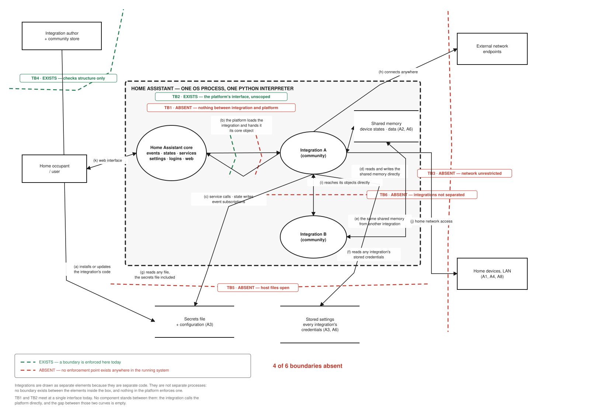

# 8. Methodology and Capstone Design

The project followed an engineering research method, in which a threat model written before the design decided what the framework had to protect, and every result was predicted before it was measured. This section describes that method, the threat model it produced, how the work was carried out, and the ethical considerations that bounded it.

## 8.1 The method

The work proceeded in a fixed order. Requirements were written first, then a threat model, then a design chosen against alternatives, then the implementation, and finally a paired evaluation that runs each integration with and without confinement (Section 11). Three rules governed this order, and each limits what a later result is allowed to mean.

The first rule is that every requirement traces to a finding about the problem, or it is cut. A requirement that comes from intuition about what a sandbox ought to do is how scope grows, and how a design comes to answer questions the problem never posed.

The second rule is that the threat model is written before the architecture. ISO 31000 places the assessment of risks before their treatment (International Organization for Standardization, 2018), and the order matters in practice. A threat model written after the design can only check the controls that already exist, so the threats that no control answers would be the ones least likely to be found.

The third rule is that a prediction is committed to the project's repository before the measurement it predicts, and the outcome is later added to the same record with its date, leaving the prediction as it was written. An expectation written after a result can always be made to fit it, so only a prediction fixed in advance can be contradicted by the measurement. Because the prediction is never edited, a reader can compare what was expected before each number arrived with what was measured. Section 11 applies the rule to the evaluation, where each claim was given in advance the result that would show it false.

## 8.2 The threat model

The threat model follows ISO 31000 for the risk-management process (International Organization for Standardization, 2018) and uses STRIDE to identify threats at each trust boundary in turn (Shostack, 2014). The two are complementary, because the standard fixes the process from context to treatment but does not prescribe how risks are identified, and STRIDE fills that step.

The system in scope is a self-hosted Home Assistant installation extended by community integrations, together with everything those integrations can reach. The risk owner is the householder: the person who owns the assets and bears the consequences, but has no security function and no means of responding to an incident. Every rating is calibrated to that owner. Three sources of threat are outside the scope: a compromised platform, a hostile home network, and physical access to the device. If the platform itself is hostile, no control at the level of an integration can help.

The model starts from what an integration can harm. Table 8.1 lists the eight assets it can reach, from the physical control of the home to the audit record that makes any other loss attributable. Reversibility makes them comparable: a disclosure cannot be undone, whereas an outage is normally recovered, so the model rates an outage below an exfiltration of similar apparent severity.

**Table 8.1**
*Assets a community integration can reach*

| ID | Asset | Why it matters |
|---|---|---|
| A1 | Physical control of the house: locks, alarms, garage doors | Life safety and property; irreversible in effect |
| A2 | Occupancy and behavioural data | Enables burglary; irreversible once disclosed |
| A3 | Stored credentials | Compromise beyond the home |
| A4 | Camera and media streams | Intimate privacy harm |
| A5 | Platform availability | Automations include alarms and heating |
| A6 | Other integrations' state and secrets | Reachable inside the shared process |
| A7 | The audit record | Decides whether any other loss can be attributed |
| A8 | The home network | Reachable from the gateway |

Six actors could threaten these assets, and the evidence for each differs; the model states that difference rather than levelling it. A remote attacker exploiting a vulnerable integration is documented in this ecosystem, through the unauthenticated flaws in several community integrations disclosed in 2021 (Home Assistant, 2021a). A compromised integration sharing the process has a demonstrated technique, since Corno and Mannella (2022) reached another integration's live objects through Python's garbage collector. A compromised honest author has a precedent outside the ecosystem in XZ Utils, where a contributor took part in maintenance for more than two years before inserting a backdoor (Przymus & Durieux, 2025). A malicious author is the most severe actor and the least evidenced, with no documented case in Home Assistant, and is stated as such. The user is a source of risk through action rather than an adversary, and the platform's maintainers are trusted.

Between these actors and the assets lie six trust boundaries, and in today's Home Assistant four of the six do not exist. Figure 8.1 shows why. The integrations and the platform share one operating-system process and one Python interpreter, so there is no point in the running system at which the boundary between an integration and the platform (TB1), the network (TB3), the host's files (TB5) or another integration (TB6) could be enforced. The two that exist, the community store's review (TB4) and the platform's programming interface (TB2), constrain how an integration is built but not what it does. The model's first finding is therefore structural: the missing boundaries are a consequence of one shared process, not of any one integration's code.

**Figure 8.1**
*Home Assistant today, with the six trust boundaries*

*Note.* Everything inside the dashed box shares one process. Boundaries marked ABSENT have no enforcement point anywhere in the running system. The letters (a) to (k) mark what an integration can do, for example (f) read every integration's stored credentials or (g) read any file, the secrets file included. Appendix C shows the confined design on the same canvas.

## 8.3 Risks and their treatment

Applying STRIDE to each boundary identified eighteen threats against the platform as it stands. Each was rated on two five-point scales: its impact, from 1 (no meaningful loss) to 5 (physical access to the home or a life-safety function defeated), and its likelihood, from 1 (rare) to 5 (occurs by default in normal operation). The product of the two places the threat in a band, Low up to 4, Medium 5 to 9, High 10 to 16 and Critical 17 to 25, and serves to order the threats for treatment rather than to measure them. Five threats are Critical, twelve High and one Medium, and all five Critical threats share one cause, the shared process. Table 8.2 summarises them, and Appendix C gives the scales in full and every rating with its justification. A nineteenth threat arose from the design itself, since writing a record of every decision lets a flood of refused requests exhaust the mediator, and it is rated against the design.

**Table 8.2**
*Threat summary (inherent risk)*

| ID | Threat | Impact | Likelihood | Risk |
|---|---|---|---|---|
| T01 | An integration bypasses mediation by acting on in-process objects | 5 | 5 | 25 Critical |
| T03 | An integration modifies the mediating component or its policy in memory | 5 | 5 | 25 Critical |
| T05 | An integration gets the mediator to call a service it did not declare | 5 | 5 | 25 Critical |
| T04 | An integration recovers the platform credential | 5 | 4 | 20 Critical |
| T07 | An integration writes state for devices it does not own, triggering the automations that act on them | 5 | 4 | 20 Critical |
| T02, T06, T08–T10, T12–T18 | Impersonation, disclosure, tampering, denial of service and denial of responsibility across the other boundaries | 3–5 | 3–5 | 12–16 High |
| T11 | Name rebinding to an address in the house | 4 | 2 | 8 Medium |

*Note.* Risk is impact multiplied by likelihood, each on a scale of 1 to 5.

The highest ratings describe ordinary platform behaviour rather than exploits. An integration that unlocks a door today exploits nothing; it uses the platform as designed, which is why the likelihood of T01, T03 and T05 is rated almost certain. Because one architectural decision governs most of the risk, treating that decision is worth more than treating any number of individual threats, and Section 9 describes the design that does so. Its treatments mostly reduce consequence rather than likelihood: they bound what an integration's code can do once installed, which complements the community store's existing review of how a repository is structured (HACS, n.d.).

The model also changed the requirements, which is the clearest evidence that writing it first mattered. No requirement on resource exhaustion existed, because neither the problem statement nor the literature justified one. The threat of an integration exhausting processor, memory or disk supplied the justification, since availability is a security property when automations include alarms and heating, and Corno and Mannella (2022) treat a gateway's resource saturation as a threat. Requirement S9, that the framework bounds an integration's use of processor, memory and disk, was therefore derived from an identified threat, at the point in the process where ISO 31000 places it.

## 8.4 Residual risks

Seven risks remain after treatment, and none of them is Critical. Four remain High, and each is stated with the reason it is kept. An integration can declare more than it needs, because a manifest bounds an integration to its declaration but cannot make the declaration minimal; Barth et al. (2010) found that 76% of the browser extensions they studied used interfaces more powerful than they needed. An integration can also misuse what it legitimately declared, so one granted permission to unlock a door may unlock it at three in the morning. The mediator's own account can still operate every device, because the platform offers no supported way to limit a user to some devices. Finally, an integration can send data out through a host it is allowed to reach, since controlling destinations does not control content.

These four are structural: no confinement of an integration could remove them. The appetite set for this owner accepts a High residual risk only when it is structural and openly stated, so the design meets that appetite under that condition, and the result should be read in that light rather than as a clean one. Appendix C gives all seven residual risks with their ratings.

## 8.5 How the work was carried out

All development and measurement took place on one reference device, a Raspberry Pi 5 running Raspberry Pi OS, at the small end of the hardware Home Assistant runs on (Section 3.3). The platform was pinned to release 2026.8.3 for the whole project and ran on Python 3.14. A full Home Assistant installation on the same device played the household's own instance, so the framework could be tested against the real platform.

Once the framework was built, every later change to it, whether to fix a defect found during evaluation or writing or to extend it, followed a fixed cycle. A prediction of the outcome was committed to the repository first. A test was then written and shown to fail on the unchanged code, so that its later success could be credited to the change. Only then was the change made, and the test suites were rerun. Where a change depended on how Home Assistant behaves, such as which commands reach a device of a given kind, the answer was read from the platform's source code at the pinned release. Section 12.4 describes how the results were themselves checked, and Section 13 describes the AI assistance used throughout the project and how its output was verified. The cycle meant that each change arrived with evidence both that it was needed and that it worked.

## 8.6 Ethical considerations

The project collected no personal data from anyone outside it. Every measurement ran on the project's own device and test installations, so no household's data were observed. Seven integrations contacted live online services at their normal rates. Two integrations that control devices on the home network were tested against simulated devices rather than real ones.

The security work was designed so that no one else was harmed. The attacks were reproduced with integrations written for the evaluation, not against vulnerable versions of real integrations, so no one else's software or users were attacked. Credentials needed for testing, including the mediator's access token, were kept on the device with owner-only permissions, and the project's repository was scanned for them before every upload. The project therefore produced its evidence without exposing any third party to the risks it studies.

## 8.7 Limits of the method

The method has three limits that bound how far its results reach. First, no independent adversary attacked the framework, so the security results rest on attacks the project wrote itself. Second, STRIDE examines one boundary at a time and is weaker on threats that arise from combining actions that are each permitted; the misuse of a legitimately declared permission is the clearest case, and it is retained rather than solved. Third, the ratings are judgements, with likelihood anchored on documented occurrence and impact on the value of each asset, so the order of the risks is more robust than their exact values. Within these limits, the method produced a design whose every requirement can be traced to a threat or a finding, and Section 9 describes that design.
