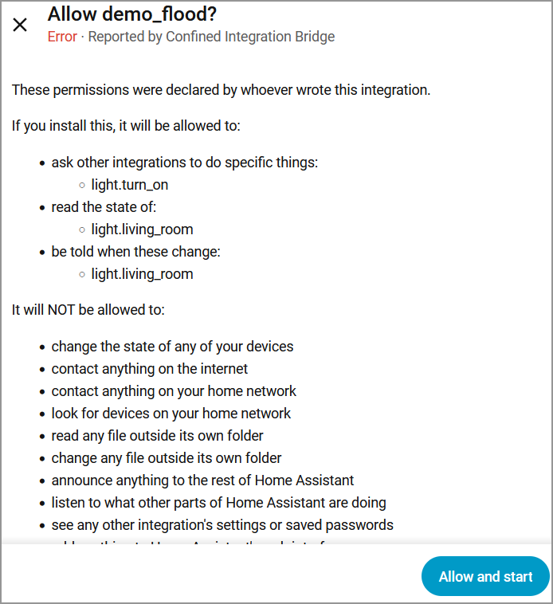
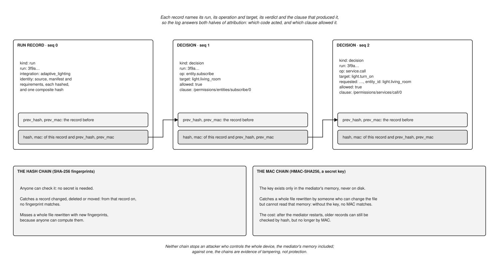

# 9. System Architecture and Technology Integration

The framework moves each community integration out of Home Assistant's process into a sandbox of its own, and places a mediator between the sandbox and the house that decides, records and performs every request that crosses. This section describes the system as built, one component at a time in the order a request meets them, and then follows one household command through the whole of it.

## 9.1 The system at a glance

A confined installation runs three kinds of process, shown in Figure 9.1, and only one of them holds any authority over the house. The household's own Home Assistant instance, called (A) here, runs as before with one addition: a bridge integration through which the devices of confined integrations appear. Each community integration runs in its own sandbox, inside a private and minimal Home Assistant runtime called (B). Between the two sits the mediator, the only process that holds a credential to (A). Each sandbox is joined to the mediator by a single channel and has no other route out.


**Figure 9.1**
*The system*

*Note.* A supervisor builds the sandboxes, and the mediator connects to (A) as an ordinary Home Assistant user. No sandbox holds a credential to the house.

Four design decisions fixed this shape. Table 9.1 states each with the alternative it displaced; the evidence for each is in the repository (Appendix A).

**Table 9.1**
*The four design decisions*

| Decision | Alternative rejected | Reason |
|---|---|---|
| Enforce outside Home Assistant's process | A permission check inside the platform | Integrations share one Python interpreter, so an integration can reach the platform's credentials (Corno & Mannella, 2022) and could bypass any check written there |
| Give each sandbox a real Home Assistant runtime that starts empty | A stand-in object that imitates the platform | All 144 of the most-installed community integrations examined build on the platform's helper layer, which expects the genuine platform beneath it |
| Build the sandbox from Linux's own isolation features | A restricted Python interpreter; WebAssembly; gVisor or a micro virtual machine; a container | In order: shares the interpreter it restricts; cannot run unmodified integrations; costs memory a home device cannot spare; uses the same kernel features, with packaging added |
| Confine every community integration, and no built-in one | Confining everything | Built-in integrations are reviewed by the platform's maintainers, whose security policy excludes community integrations (Home Assistant, n.d.-f) |

## 9.2 The sandbox

Each sandbox is built so that what an integration must not reach is absent from its view rather than forbidden. The supervisor creates seven Linux namespaces for every integration, each giving it a private copy of one part of the system, such as its users, processes, network or filesystem (Linux man-pages project, n.d.-b). A seccomp filter blocks the system calls that remain dangerous inside any namespace, such as loading kernel modules (Linux man-pages project, n.d.-d), and a control group, the kernel's unit of resource control, caps the sandbox's memory, processes and temporary storage (The kernel development community, n.d.-a). Figure 9.2 shows these layers.


**Figure 9.2**
*One sandbox*

*Note.* The control group bounds everything the sandbox runs, the namespaces decide what it can see, and the seccomp filter sits on its system calls. The channel is its only way out.

From inside, the result is a small and empty machine. The project's self-tests find that the integration is root only within its own namespace, and holds none of root's powers even there: Linux gives root in a new namespace a full set of these powers, called capabilities (Linux man-pages project, n.d.-f), and the supervisor drops every one before the integration starts. The integration sees no process but its own, has a network with no route anywhere, and can write to its data folder but not to its own code. The house's secrets file and stored configuration are not locked away; they are simply not there, because the sandbox's filesystem is assembled from only what is allowed. This removes the target of the file-theft technique used in the 2021 disclosures (Home Assistant, 2021a).

The runtime inside sets up only the platform components the integration uses, so a sandbox needs between 56.5 and 135.6 MB of memory (Section 12.3). The sandbox's contribution is a boundary that rests on the kernel and on absence, rather than on code that inspects each request.

## 9.3 The manifest

An integration's authority is exactly what its manifest declares. The manifest is a `permissions` block in the integration's `manifest.json`, or a file supplied beside the integration when it is installed, and the repository documents its full schema (Appendix A). Table 9.2 lists the clauses the evaluated integrations used.

**Table 9.2**
*The clauses used by the evaluated integrations*

| Clause | What it allows | Example |
|---|---|---|
| `entities.read`, `entities.subscribe` | Seeing one of the house's devices, once or on every change | `light.living_room` |
| `services.call` | Calling one named service | `light.turn_on` |
| `network.egress` | Connecting to one internet host on one port | `dataportal-api.nordpoolgroup.com:443` |
| `network.local.tcp`, `.udp`, `network.discover` | Reaching one port on the home network, or discovering devices | UDP port 6445 (`midea_ac_lan`) |
| `resources` | Memory, processor and process limits | `memory_mb: 192` |

Every service is named on its own, because a grant to lock a door must not imply a grant to unlock it, as a wildcard such as `lock.*` would. A real manifest shows how little an ordinary integration needs: in the functional tests, `adaptive_lighting` received the clauses below and set the declared light to a brightness computed from the sun's position.

```json
"permissions": {
  "schema_version": 1,
  "entities": { "read": ["light.living_room"], "subscribe": ["light.living_room"] },
  "services": { "call": ["light.turn_on"] }
}
```

A manifest grants nothing until a person has approved it, and the approval is bound to exactly what that person was shown. An administrator reads a plain-language account of the grant in Home Assistant's Repairs panel, the platform's own place for issues that need a user's attention (Home Assistant, n.d.-e), and approves it with a single labelled action, *Allow and start* (Figure 9.3). A screen opened before an update approves nothing, because the approval must match the code and grant it showed. The manifest thereby turns an integration's authority from something implicit into something a household has read and agreed to.



**Figure 9.3**
*Approving an integration in the Repairs panel*

*Note.* Home Assistant 2026.8.3 on the Raspberry Pi, showing the manifest above, declared in the integration's own `manifest.json`. Scrolled down, the dialog lists one more refusal and ends: "If you do not recognise it or do not want it to have these permissions, close this window: it will stay stopped."

## 9.4 The mediator and the bridge

Every request that crosses the boundary is identified, decided, recorded and only then performed, as Figure 9.4 traces. The mediator knows which integration is speaking from the channel the request arrived on, which the supervisor created for that sandbox alone, and never from anything the request says about itself. It checks the request against that integration's manifest, writes the decision to disk with the clause that produced it, and only then acts on (A). Because the record comes first, an action that succeeds and then crashes the mediator is still on record. Each round trip adds about 43 µs (Section 12.3), and not every action takes one: the integration's own processing stays inside its sandbox, and a TCP connection is checked once, when it opens, after which its data flows directly.


**Figure 9.4**
*The life of a request*

*Note.* A service call from the integration passes through the mediator's five steps, with the record written before the act. The lower panels show the two directions that run into the sandbox: a change in the house, and a household's command.

The bridge is the part of the system the household sees. When a confined integration creates a device in its sandbox, the bridge creates a device of the same kind in (A), so the household's dashboard and automations treat it like any other. When someone operates that device, (A) first checks the request and converts it into the call the device itself receives. The mediator then forwards that call only if it is one of the services listed for the device's kind and its data has exactly one of the allowed shapes. A command therefore cannot be redirected to another device, widened to another service or given extra parameters. Table 9.3 groups the 29 supported kinds by what the mediator checks, and the repository lists every service (Appendix A). A kind the bridge does not support, such as a to-do list, is refused when the integration tries to publish it.

**Table 9.3**
*The 29 kinds of device the bridge supports, by what the mediator checks*

| What the household can do | Kinds | What the mediator checks |
|---|---|---|
| Read its state only | sensor, binary sensor, event, device tracker | No command is forwarded |
| Switch it, or set one value | switch, button, text, select, number, time, siren, update, notify | One or two services; each value of the listed type, text at most 255 characters |
| Adjust several settings | light, fan, cover, climate, humidifier, water heater, valve, vacuum, remote, media player | Up to 20 services for one kind, each with its own allowed shapes |
| Operate it with a code | lock, alarm panel | The services and the code's type; the code is never written to the record |
| Ask it a question | calendar, weather | An answer of the listed shape, at most 500 items and 256 KiB |
| Ask it for a picture | camera, image | One picture of a listed type whose first bytes match that type, at most 512 KiB |

The bridge's contribution is that confinement is invisible to the household: a confined device looks and behaves like any other, while every command to it is decided and recorded.

## 9.5 Reaching the network

The sandbox has no route anywhere, so the mediator opens every connection an integration makes, in the five steps of Figure 9.5. It checks the host and port against the manifest, resolves the name itself, rejects any address that leads into the house or onto the device, connects to exactly the address it checked, and hands the open connection back.


**Figure 9.5**
*A connection, resolved and pinned*

*Note.* Inside the sandbox a name resolves only to a placeholder that leads nowhere. A name that resolves to an address in the house is refused at the third step.

This order defeats an attack known as DNS rebinding, in which whoever controls a granted name makes it resolve to a public address when the rule is checked and to a device in the house when the connection is made (Jackson et al., 2007). Because the mediator resolves, checks and connects with no gap between them, the address it checked is the address it uses, and the sandbox never holds a usable address of its own to substitute. UDP messages, which unlike a TCP connection can be redirected after it opens, are relayed and checked one by one.

The home network sits behind a separate clause, because reaching it also means reaching the router and every other device. A local clause names a port rather than an address, which changes and which an author cannot know. The contribution is that a grant to one internet service cannot be stretched to reach the house.

## 9.6 Identity and the record

A decision is attributable only if the record names the code that made the request. An integration's identity is therefore not its name, which stays the same in every release, but a fingerprint, or hash, of its code, its manifest and its installed dependencies, so a changed manifest or library produces a new identity. The identity is written in a run record when the sandbox is built, and every later decision refers to it, as Figure 9.6 shows.



**Figure 9.6**
*The audit record*

*Note.* Every record carries two links to the one before it, a hash and a keyed code, which fail independently.

Each decision record names the run, the operation, its target, the verdict and the clause that decided it, so the log answers the two questions an investigator would ask: which code acted, and what allowed it. No sandbox can reach the log, and because each record is linked to the one before it, an edit or deletion by someone with access to the device leaves evidence. The record's contribution is an account of every action an integration took on the house.

## 9.7 When something fails

The framework fails closed. If the mediator stops, every channel closes, and each sandbox can then reach nothing, because the channel was its only route out. A sandbox that floods the mediator with refused requests is stopped rather than allowed to bury the record. A restarted sandbox keeps its stored settings but receives a fresh copy of its code, so it cannot replace its approved code with code of its own.

When the framework stops an integration, it says why in plain language in the Repairs panel, with one action. A flooding integration, for example, is reported as having "kept trying to do things it does not have permission to do", and the message adds that this is usually a bug and that restarting gives it no new permissions. Restarting returns an integration to the grant it was approved for and never widens it: within Home Assistant, the only action that widens a grant is *Allow and start*, which is labelled as an approval. An administrator who confirms a failure message without reading it therefore cannot give an integration more than was approved.

## 9.8 One command, end to end

One check from the final rerun shows these parts working together. It runs against a real Home Assistant installation, with the real bridge and mediator, while the test itself plays the sandbox's end of the channel. The test published a lamp, which the bridge created in (A) as a light of its own, and a user asked (A) to set it to 50% brightness. (A) converted the percentage to Home Assistant's own brightness scale and passed the bridge the call a light itself receives: `turn_on` with a brightness of 128. The mediator found the integration that owns the lamp, checked that `turn_on` is listed for lights and that its data has an allowed shape, wrote the decision to the record, and passed the command down that integration's channel. The call succeeded, and (A) showed the lamp as on. When the lamp was then toggled, (A) worked out that toggling a light that is on means `turn_off`, and that is the command that arrived.

The refusals are just as informative. A fan preset that the device does not offer was rejected by (A) itself, so it never reached the mediator. In the mediator's own tests, commands in forms that (A) never produces, such as a raw percentage, a colour with the wrong number of values or a call redirected to another device, were refused and never reached the integration. All 194 checks of this kind passed against the real installation, and every record chain verified.

## 9.9 Limits of the architecture

Appendix E lists the architecture's eleven limits, of which three matter most. The kernel is the boundary, so a flaw in the kernel would let an integration escape every sandbox. The mediator's ordinary user can still operate every device, because the platform cannot limit a user to some devices. A local-network clause reaches every device that answers on its port, not only the one the integration was written for. None of these limits gives a confined integration a capability that its manifest withholds.

Taken together, the architecture replaces an integration's total and invisible authority with authority that is declared before installation, bounded by the kernel while it runs, and recorded each time it is used, while the household continues to see and operate its devices as before. Whether such a design can be built and run within the project's means is the subject of the next section.
