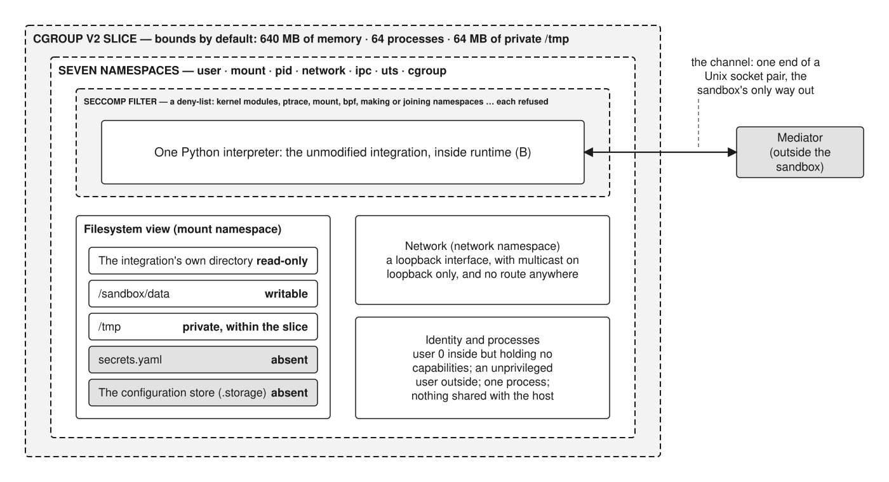

# 9. System Architecture and Technology Integration

The framework moves each third-party integration out of Home Assistant's process into a sandbox of its own, and places a mediator between the two that decides, records and performs every request that crosses. This section describes that system as it was built and follows a single request through it. Section 9.1 presents the whole system and the four decisions that fixed its shape. The remaining subsections take each component in the order a request meets it: the sandbox in which the integration runs (9.2), the manifest that states what it may ask for (9.3), the mediator that decides (9.4), the paths to the network (9.5), the record that makes each decision attributable (9.6), and the behaviour of the system when a part of it fails (9.7). Section 9.8 states what the architecture does not do. The reasoning behind each decision belongs to the method and is given in Section 8; this section describes the result.

## 9.1 The system at a glance

Three kinds of process make up a confined installation, and only one of them holds any authority over the house. Figure 9.1 shows them. The house's own Home Assistant instance, referred to here as (A), runs as it always has, with one addition: a bridge integration through which confined integrations publish their entities and receive commands. Each third-party integration runs in its own sandbox, inside a private and minimal Home Assistant runtime referred to as (B), which a supervisor constructs. Between them sits the mediator, a single process that holds (A)'s access token and is the only component able to act on (A) on an integration's behalf. Each sandbox is connected to the mediator by one channel and has no other route out.


**Figure 9.1 — The system.** The house's instance (A) with its bridge integration; the framework's one unprivileged host process, in which the supervisor builds the sandboxes and the mediator connects to (A) as the non-admin Home Assistant user `confine-mediator`; and one sandbox per third-party integration, joined to the mediator by its own channel. The only credential to the house is the mediator's token, and no sandbox holds one.

Four decisions fixed this shape, and Table 9.1 records them with the alternatives each displaced.

**Table 9.1 — The four decisions that fix the architecture**

| Decision | Chosen | Rejected | Deciding evidence |
|---|---|---|---|
| Where enforcement lives | Outside Home Assistant's process | Checks inside the platform's process | A garbage-collector walk reaches the platform's credential from any code in the same process [9] (Section 12.1) |
| What runs inside the sandbox | A minimal Home Assistant runtime per integration, whose state starts empty | A proxy object presenting the platform's attributes and forwarding each access to the mediator | Integrations are written against the platform's internal objects, not a narrow interface; an empty runtime makes an undeclared entity absent rather than refused |
| The isolation primitive | Linux namespaces, a seccomp filter and a cgroup v2 slice per integration | Language-level confinement; WebAssembly; gVisor; microVMs; containers | Language-level confinement shares the interpreter it restricts, and WebAssembly cannot run integrations with compiled dependencies; gVisor and microVMs cost memory the reference device does not have; containers package the same primitives and add no boundary |
| Scope | Every third-party integration, and none of the platform's own | Confining selected integrations, or the platform itself | The platform's own components are the platform; third-party code is the code outside its security programme [10] |

The second decision carries most of the architecture's security, because it turns a policy into a property of the system's shape. An integration inside the sandbox reads and writes a real Home Assistant state machine, exactly as it would unconfined, but that state machine holds only the entities its manifest declares. An entity it was not granted is therefore not refused when it asks; it does not exist where the integration can look. The sandbox is where this begins.

## 9.2 The sandbox

Each sandbox is built so that what an integration must not reach is absent from its view rather than forbidden to it. The supervisor creates seven Linux namespaces for every integration [33], applies a seccomp filter to its system calls [34], and places it in a cgroup v2 slice that bounds its memory, processes and temporary storage [35]. Figure 9.2 shows how these layers enclose one integration.



**Figure 9.2 — One sandbox.** The cgroup slice bounds everything the sandbox runs, the seven namespaces decide what it can see, and the seccomp filter sits on the interpreter's system-call edge. The secrets file and the configuration store are absent from the filesystem view, and the channel is the only descriptor that leaves.

The namespaces remove the host from the integration's view, and each removal answers a named threat. The user namespace maps the sandbox's root to an unprivileged user outside it, so nothing the integration does is privileged on the host. The mount namespace gives it a filesystem assembled from bind mounts and entered with `pivot_root` rather than `chroot`, which a process holding capabilities in its own user namespace can escape. Inside that view, the platform's `secrets.yaml` and its stored configuration entries are not unreadable but absent, which closes the file-theft technique used in the 2021 disclosures [4]. The pid namespace shows the integration only its own processes, so the environment of another process cannot be read; the network namespace gives it a loopback interface and no route; and the ipc, uts and cgroup namespaces remove shared memory, the hostname and the sandbox's position in the control-group tree as channels of information. The project's own self-test confirms the result from inside: the integration sees itself as user 0 and one process, a loopback interface, its own directory read-only and its data directory writable, and neither the secrets file nor the configuration store.

The seccomp filter is narrower than the design first specified, and the narrowing is deliberate. The design called for an allow-list of the system calls an integration needs, but for a full Python interpreter running Home Assistant that list runs to several hundred entries and changes with each interpreter release. The implemented filter is a deny-list of the calls that are dangerous whatever namespace they are made from, such as loading kernel modules, `ptrace`, mounting, and creating further namespaces. A deny-list is defensible in this position only because the namespaces have already removed almost everything a system call could reach.

The supervisor that builds this boundary must run inside the part of the control-group tree that systemd delegates to the user, and it checks the host before it confines anything. An unprivileged process may move another process between control groups only where it owns their common ancestor, which is true inside the delegated subtree and false in an ordinary login session. The supervisor's preflight therefore exercises each operation it depends on, creating a group, setting a memory limit and placing a process, and refuses to start, with a stated reason, if any of them fails. A framework that started anyway on a host without the memory controller would imply a protection it could not give.

Inside the boundary, the platform runtime is constructed rather than booted. Home Assistant's own start-up imports the web frontend and the recorder, which is the weight a sandbox exists to avoid, so the sandbox builds a `HomeAssistant` object directly, wires the registries that integrations reach for, and sets up only the platform components the integration declares. The cost of this arrangement, between 56 and 136 MB of memory per sandbox depending on those components, is reported in Section 12.3. What the integration may ask for beyond its own sandbox is set by its manifest.

## 9.3 The manifest

An integration's authority is exactly what its manifest declares, and no declaration can be broader than the clause that names it. The manifest is a `permissions` block in the integration's existing `manifest.json`, with eight top-level capabilities whose full schema is given in Appendix G. Table 9.2 lists the clauses the evaluated integrations used.

**Table 9.2 — The declarable clauses, and what each governs**

| Clause | Governs | Example |
|---|---|---|
| `entities.read`, `entities.subscribe` | Mirroring an entity's state into the sandbox, once or on every change | `light.living_room` |
| `entities.write` | Setting the state of an entity the integration does not own | — |
| `services.call` | Calling one named service; no wildcard is accepted | `light.turn_on` |
| `network.egress` | A connection to one host and port on the internet | `dataportal-api.nordpoolgroup.com:443` (`nordpool`) |
| `network.local.tcp`, `network.local.udp`, `network.discover` | A port on the home network, or discovery by broadcast | UDP port 6445 (`midea_ac_lan`) |
| `resources` | The sandbox's memory, processor and process limits | `memory_mb: 192` |

The service clause is the one place where the schema refuses a convenience, and the reason is that physical operations are not symmetric in risk. A grant of `lock.lock` must not imply `lock.unlock`, yet a wildcard such as `lock.*` would hand over both, and an integration calling `lock.unlock` is among the highest-rated threats in the project's register (Appendix C). Every service is therefore named individually. Entity clauses accept patterns within a domain, because an integration cannot know at authoring time which devices a user owns, but it always knows which services its own code calls. Two further limits are absolute: no file grant may enclose the configuration directory or its `.storage` store, and every path is resolved before it is compared with the grant, so that neither `..` nor a symbolic link can leave it.

A real manifest shows how little an ordinary integration needs. The functional retest gave `adaptive_lighting` the clauses below, and the integration computed a brightness from the sun's position and set the declared light to it.

```json
"permissions": {
  "schema_version": 1,
  "entities": { "read": ["light.living_room"], "subscribe": ["light.living_room"] },
  "services": { "call": ["light.turn_on"] }
}
```

The manifest can come from two sources, and enforcement does not depend on which. A manifest shipped by the integration's author is used as written; a manifest supplied with the installation, derived by analysis or by hand, is used only after the user confirms it; and an integration with neither receives no mediated capability at all. A declaration, however, is only as strong as the point that enforces it, which is the mediator.

## 9.4 The mediated request

Every request that crosses the boundary is identified by the channel on which it arrived, decided against the manifest, recorded durably, and only then performed. Figure 9.3 traces one request from the integration to the house.


**Figure 9.3 — The life of a request.** A service call from the integration passes through the mediator's five steps, with the record written before the act; the two lower panels show the directions that run into the sandbox, a state pushed after a subscription and a household's command.

Most of what an integration does never reaches the mediator, and that is the reason mediation is affordable. Three mechanisms enforce the manifest, and only one of them costs anything per request. Structural enforcement, by the kernel at sandbox creation, covers the filesystem, process visibility and resource limits; an integration cannot ask to read the secrets file, because there is nothing to ask. Mediated enforcement covers entity reads, writes and subscriptions, service calls and events, at one round trip each. Proxied enforcement covers network connections, at one decision per connection (Section 9.5). Even a declared entity is read from the sandbox's own state machine at full speed once it has been mirrored in, so the mediator sees a read once rather than at every access.

The channel itself carries the integration's identity, which is why identity cannot be forged. Each channel is one end of a Unix socket pair that the supervisor creates when it builds the sandbox [36], so the mediator knows which integration is speaking from the socket a request arrived on, and never from a field in the message. A request that names another integration is decided and recorded against the sender's identity; the name it claimed is kept beside it as a claim. Messages are framed as a four-byte length followed by a JSON object, a format chosen because the message rate is modest and a readable wire format is worth more during evaluation than the bytes it costs.

The order of the five steps is the property on which attribution rests: the record is written before the action, so that an action which succeeds and then crashes the mediator remains attributable. Every response carries the clause that decided it, as a pointer into the manifest, and since a correction made after the cut-off the record of a service call also names the devices it targeted, as the sandbox stated them (finding F54). The decision itself is still made on the service, so that the record's main target is always the field the decision was taken on.

The same channel also carries traffic towards the integration, in two forms that keep a confined integration responsive. When a subscribed entity changes in (A), the mediator pushes the new state into the sandbox; the subscription is decided and recorded once, and each delivery then costs the mediator about 11 µs and writes nothing. When a member of the household operates an entity that a confined integration owns, the command travels from the bridge in (A) through the mediator, which records it before passing it on, to the same entity in (B), where the integration's own handler runs. The user's action then succeeds or fails in (A) as it would for a native entity.

The mediator's authority over the house is narrower than an integration's was before confinement, but it is not scoped to the integration's needs. An integration loaded in Home Assistant's process holds the platform object itself and can do anything the platform can. The mediator instead connects to (A) as `confine-mediator`, an ordinary user that an administrator designates in the bridge, and Home Assistant refuses it every administrative operation, such as listing the house's users or subscribing to every service call. An ordinary user can still control every entity, however, so a compromised mediator could operate any device in the house. The confined integration itself holds no token at all. Network access follows a separate path through the mediator.

## 9.5 Reaching the network

The sandbox's network namespace provides no route anywhere, so every connection an integration makes is one the mediator opened on its behalf. A small shim inside the sandbox turns the integration's ordinary socket calls into requests on the channel, and the mediator's egress broker serves them in five steps, which Figure 9.4 shows.


**Figure 9.4 — Egress, resolved and pinned.** Inside the sandbox a name resolves only to an unroutable placeholder; the broker decides, resolves, re-checks the address, connects to exactly that address and passes the connected socket back. A name that rebinds to an address in the house is refused at step 3.

The broker's order defeats the classic attack on a name-based rule, in which a name resolves to something harmless when it is checked and to something internal when it is used. Resolution and connection happen at one call site in the mediator, with no gap between them, and the sandbox never holds a routable address at all. The re-check uses the private address ranges of RFC 1918 [28] together with the other non-public ranges. Only TCP travels as a connected socket, because a connected TCP socket cannot be pointed elsewhere; a UDP socket can, which the project tested and confirmed, so datagrams are relayed by the mediator instead of handed over.

The home network is reachable only behind a separate and more explicit permission, because reaching it also means reaching the router and every other device in the house. A local clause names a port, since a port is a constant in the integration's code while a device's address is a lease the author cannot know. The mediator accepts only private home-network addresses for these clauses and records the address it pinned, and discovery by broadcast is served by datagrams the mediator pushes into the sandbox. What this does not limit is stated in Section 9.8.

Two consequences of the shape matter for ordinary integrations. The platform's shared HTTP client starts a multicast resolver, and a new network namespace gives its loopback interface no multicast, so the sandbox enables multicast on loopback alone, with no route out; without it, no integration using the platform's recommended client could make a request at all (Section 12.2). An integration that refreshes an OAuth token does so inside its sandbox, so the new token is written to the sandbox's data directory and never passes through the mediator. Each connection the broker opens, like every other decision, enters the record.

## 9.6 Identity and the record

A decision is attributable only if the record names which code made the request and cannot be changed afterwards without detection. An integration's identity is therefore not its name, which is the same in every release, but a hash over three separately hashed components: its source tree, its manifest, and its declared requirements with the versions actually installed. A manifest changed without a source change is an authority change, and dependencies are where supply-chain changes arrive, so an identity blind to either would miss the attack most likely to reach the platform through its normal update path. The identity is computed once, when the sandbox is constructed, and written in a run record to which every later decision refers.


**Figure 9.5 — The audit record.** A run record binds an identity to a run, and each decision record names its run, operation, target, verdict and deciding clause. Every record carries two links to the one before it, a hash and a keyed MAC, which fail independently.

The record holds decisions and not their consequences, and it is out of reach of the integrations it describes. A subscription is one decision, and the state updates it delivers are not recorded, because a log buried in traffic is as useless as no log. Each decision record carries its run, its operation and target, its verdict and the clause that produced it, so the log answers both halves of attribution together: which code acted, and which clause allowed it. No sandbox can alter the log, because the log lies outside every sandbox's filesystem and no message on the channel writes to it. Against an attacker with write access to the host, the chain and the MAC provide evidence rather than protection, and the two fail independently. The record also has to survive the framework's own failures.

## 9.7 When something fails

The framework fails closed, and when it stops an integration it tells the household in plain language and offers one action that cannot widen anything. If the mediator stops, every channel closes, and each sandbox can reach nothing, because the channel was its only route out; no code path turns an unavailable mediator into an unmediated action.

A sandbox that floods the mediator with refused requests is stopped rather than allowed to drown the record. Recording every refusal is required, and dropping records under load would break that requirement, so the mediator takes the option that audit standards recognise of preventing further audited activity [30], [31], applied to one sandbox rather than to the whole system. The limit is 100 refusals within any 10 seconds, eight times the most any honest run in the project's experiments produced. At the limit the mediator writes one record, closes the integration's channels and marks it so that a respawn cannot reset the count, and the supervisor kills the sandbox through its cgroup. The bridge then raises a Repairs issue in (A) saying that the integration "kept trying to do things it does not have permission to do", that this is usually a bug, and that restarting gives it no new permissions. Its one action, Restart, registers the integration again under the same manifest, so a user who confirms without reading cannot make the house less safe.

The supervisor keeps each integration running against (A) and restarts it when the household asks. One limit applies to that restart: the runtime sets an integration up through its own configuration flow, which aborts when the data directory already holds the integration's entry, so a restarted integration cannot yet reuse its stored state. This and the architecture's other limits are stated next.

## 9.8 What the architecture does not do

The architecture inherits some limits and carries others of its own, and each is stated so that the guarantees above are read at their actual strength. Table 9.3 lists them; Section 14 prices the ones that future work could remove.

**Table 9.3 — Limits of the architecture**

| Limit | Kind | Consequence |
|---|---|---|
| The kernel is the boundary | Inherited | A kernel exploit escapes every sandbox; a stronger primitive is the deployer's choice and the architecture does not prevent one |
| The memory controller is off by default on the reference device | Inherited | A precondition on deployment; the framework refuses to start without it |
| The mediator's user still controls every entity | Inherited, narrowed | A compromised mediator can operate any device, though no administrative function |
| The supervisor is trusted and checked by nothing in the design | Structural | It runs once per sandbox, off the request path and unprivileged, which bounds it without removing it |
| A local network clause reaches any home-network host on its port | Design | An integration granted a port can reach every device that answers on it |
| Service data given as a dictionary is not forwarded | Implementation | Calls that pass structured data reach the platform without it (finding F54) |
| Three declarable operations are recorded but not performed | Implementation | `event.fire`, `event.subscribe` and `config_entries.list` are permitted and answered, and nothing acts (finding F50) |
| A command in a sandbox's first second has no effect | Implementation | It is recorded as permitted and is lost (finding F53) |
| A restarted integration cannot reuse its data directory | Implementation | It sets up afresh (Section 9.7) |

These limits bound the architecture rather than undermine it. None of them gives a confined integration a capability its manifest withholds, and the evaluation in Section 12 measures the architecture at exactly this strength.
