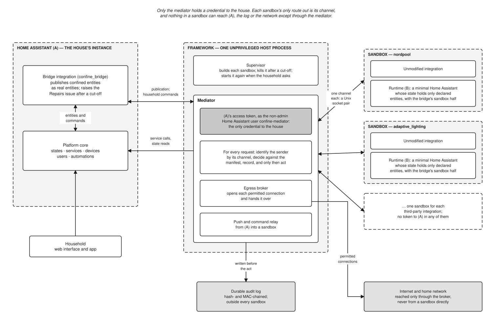
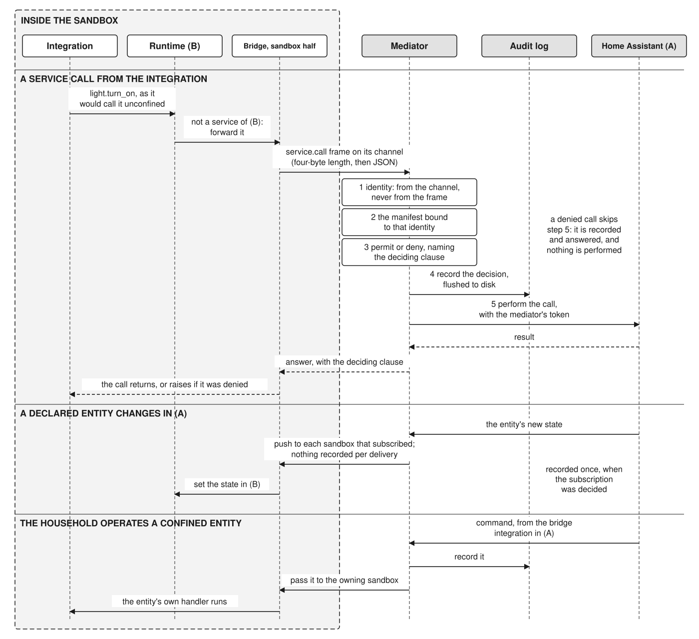
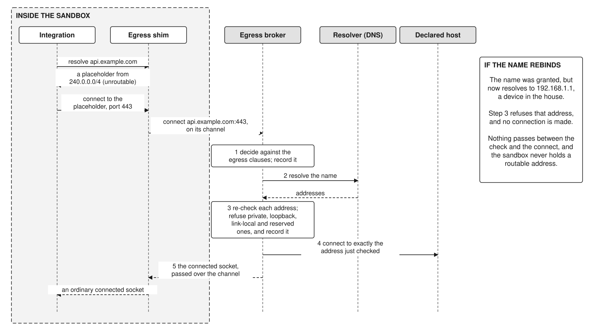

# 9. System Architecture and Technology Integration

The framework moves each community integration out of Home Assistant's process into a sandbox of its own, and places a mediator between the two that decides, records and performs every request that crosses. This section describes that system as it was built and follows a single request through it. Section 9.1 presents the whole system and the four decisions that fixed its shape. The remaining subsections take each component in the order a request meets it: the sandbox in which the integration runs (9.2), the manifest that states what it may ask for (9.3), the mediator that decides (9.4), the paths to the network (9.5), the record that makes each decision attributable (9.6), and the behaviour of the system when a part of it fails (9.7). Section 9.8 states what the architecture does not do. Section 8 gives the threat model these decisions answer; this section describes the result.

## 9.1 The system at a glance

Three kinds of process make up a confined installation, and only one of them holds any authority over the house. Figure 9.1 shows them. The house's own Home Assistant instance, referred to here as (A), runs as it always has, with one addition: a bridge integration through which confined integrations publish their entities and receive commands. Each community integration runs in its own sandbox, inside a private and minimal Home Assistant runtime referred to as (B), which a supervisor constructs. Between them sits the mediator, a single process that holds (A)'s access token and is the only component able to act on (A) on an integration's behalf. Each sandbox is connected to the mediator by one channel and has no other route out.



**Figure 9.1 — The system.** The house's instance (A) with its bridge integration; the framework's one unprivileged host process, in which the supervisor builds the sandboxes and the mediator connects to (A) as the non-admin Home Assistant user `confine-mediator`; and one sandbox per community integration, joined to the mediator by its own channel. The only credential to the house is the mediator's token, and no sandbox holds one.

Four decisions fixed this shape, and each is easiest to understand through the alternative it displaced. The paragraphs below state each decision, what it rejected, and the evidence that settled it.

The first decision places enforcement outside Home Assistant's process, because no check inside that process can be relied on. Home Assistant loads every integration into one Python interpreter, and Python offers no memory protection between pieces of code that share an interpreter. Corno and Mannella show that an integration can walk the garbage collector's list of live objects and reach anything the platform holds, including its credentials [5], and Section 12.1 reproduces this on the reference device. A permission check written inside the platform would sit in the same memory as the code it was meant to restrict, and that code could simply bypass or rewrite it. Enforcement therefore has to live in a separate process, where the operating system, rather than Python, keeps the two apart.

The second decision gives each sandbox a real but minimal Home Assistant runtime instead of an imitation of one. The alternative was a proxy object: a stand-in for the platform object that integrations receive, presenting the same attributes and forwarding every access to the mediator. A proxy makes mediation total by construction, but it rests on the assumption that integrations are written against that one object, and they are not. Of the 1,482 integrations shipped with Home Assistant 2026.8.3, 91% import the platform's helper layer (its entity base classes, polling coordinator and registration functions), and only two set state directly on the platform object. The helper layer expects genuine platform internals beneath it, so a proxy would have to reproduce a large and undocumented surface faithfully. A real runtime satisfies those expectations by being the real code, with one difference: its state machine starts empty and holds only the entities the manifest declares. This decision carries most of the architecture's security, because it turns a policy into a property of the system's shape. An entity the integration was not granted is not refused when it asks; it does not exist where the integration can look.

The third decision builds each sandbox from Linux's own isolation primitives: namespaces, a seccomp filter and a cgroup v2 slice. Five alternatives were rejected, for three different reasons. Language-level confinement, such as a restricted Python interpreter, fails for the same reason as the first decision, because the restriction shares an interpreter with the code it restricts. WebAssembly cannot run an unmodified integration that imports a compiled dependency, and the framework's premise is that integrations run unmodified. gVisor and microVMs would add a genuine second boundary, a kernel in user space or a guest kernel behind a hypervisor, but each costs memory per sandbox that the reference device cannot spare when several integrations run at once. Containers such as Docker and Podman were not rejected on cost, because they are not a different kind of isolation. A container is an ordinary process configured with the same namespaces, cgroups and seccomp filter, wrapped in an image format and a management daemon. Adopting one would change how the sandbox is packaged without placing any further barrier between the integration and the kernel. Home Assistant is also commonly deployed inside a container itself, so a container per integration would mean nesting one inside another. The namespaces are the boundary in either case, and the framework drives them directly.

The fourth decision confines every community integration and none of the integrations that ship with Home Assistant. The line follows the platform's own security boundary. Integrations merged into Home Assistant's repository are reviewed by its maintainers and covered by its vulnerability disclosure process, whereas the project's security policy explicitly excludes "attacks that require the user to install a malicious other software, like a third-party integration" [9]. Community integrations are therefore exactly the code that no one else checks, and it is where the 2021 disclosures found the vulnerabilities that exposed a house's files, its secrets among them [3]. Some shipped components could not be confined in any case: the web server, the WebSocket API and the authentication system are the interface through which the mediator itself acts on (A), and confining them would leave nothing outside the sandbox to mediate. The sandbox in which a community integration runs is where a request begins.

## 9.2 The sandbox

Each sandbox is built so that what an integration must not reach is absent from its view rather than forbidden to it. The supervisor creates seven Linux namespaces for every integration [17], applies a seccomp filter to its system calls [18], and places it in a cgroup v2 slice that bounds its memory, processes and temporary storage [19]. A control group, or cgroup, is the kernel's unit of resource control. The kernel arranges every process on the machine into a single tree of such groups, the control-group tree, and a limit set on one group applies to every process in it and in the groups beneath it. A slice is one group in that tree, created for one sandbox. Figure 9.2 shows how these layers enclose one integration.


**Figure 9.2 — One sandbox.** The cgroup slice bounds everything the sandbox runs, the seven namespaces decide what it can see, and the seccomp filter sits on the interpreter's system-call edge. The secrets file and the configuration store are absent from the filesystem view, and the channel is the only descriptor that leaves.

The namespaces remove the host from the integration's view, and each removal answers a named threat. The user namespace maps the sandbox's root to an unprivileged user outside it, so nothing the integration does is privileged on the host. The pid namespace shows the integration only its own processes, so the environment of another process cannot be read. The network namespace gives it a loopback interface and no route anywhere. The ipc and uts namespaces remove shared memory and the host's name as channels of information, and the cgroup namespace hides where the sandbox's group sits in the host's control-group tree, so that its own group appears to it as the root of the tree. The project's own self-test confirms the result from inside: the integration sees itself as user 0 and one process, a loopback interface, its own directory read-only and its data directory writable, and neither the secrets file nor the configuration store.

The mount namespace needs a longer explanation, because the obvious way to give a process a restricted filesystem does not confine it. Linux offers two ways to change what a process sees as the top of its filesystem, `chroot` and `pivot_root`, and they differ in what they change. `chroot` changes only the directory from which the calling process resolves paths that begin with `/`; every filesystem remains mounted, and the process is merely pointed at a corner of them. Its own manual states that it is not intended for any security purpose [46]. A process that holds the privilege to call `chroot` can leave it: it calls `chroot` again on a subdirectory while its working directory stays outside, and then follows `..` upwards from that working directory to the real top of the filesystem, an escape the same manual describes [46]. The sandbox's process holds exactly that privilege, because the user namespace that makes it root inside the sandbox also gives it a full set of capabilities within that namespace, `CAP_SYS_CHROOT` among them [47]. A sandbox built with `chroot` would therefore look identical from the inside and would not be a boundary. `pivot_root` instead changes the mount namespace itself. The supervisor assembles a new root from bind mounts of only what is allowed, makes it the root of the namespace, and moves the old root to a directory beneath the new one, which it then unmounts [48]. After that step the host's filesystem is not mounted anywhere in the sandbox's namespace, so no path, `..` included, leads back to it. Inside that view, the platform's `secrets.yaml` and its stored configuration entries are not unreadable but absent, which closes the file-theft technique used in the 2021 disclosures [3]. The seccomp filter described next also refuses `chroot`, as a second layer rather than the first.

The seccomp filter is narrower than the design first specified, and the narrowing is deliberate. The design called for an allow-list of the system calls an integration needs, but for a full Python interpreter running Home Assistant that list runs to several hundred entries and changes with each interpreter release. The implemented filter is a deny-list of the calls that are dangerous whatever namespace they are made from, such as loading kernel modules, `ptrace`, mounting, and creating further namespaces. A deny-list is defensible in this position only because the namespaces have already removed almost everything a system call could reach.

The supervisor that builds this boundary must have permission to arrange part of the control-group tree, and it checks that it has before it confines anything. On a modern Linux system the tree belongs to systemd, the service manager, which creates a group for each service and each login session. An ordinary user may not create groups or move processes between them, unless systemd delegates a subtree to that user; within a delegated subtree, the user may create groups and set their limits. The kernel adds one further rule: a process may move another process from one group to another only if it may write to the group that is the common ancestor of both [19]. In an ordinary login session that common ancestor lies above anything delegated to the user, so the move that places an integration in its own slice fails. The framework is therefore started inside a unit that systemd delegates to the user, a scope, where the common ancestor is the user's own. The supervisor's preflight exercises each operation it depends on, creating a group, setting a memory limit and placing a process, and refuses to start, with a stated reason, if any of them fails. A framework that started anyway on a host without the memory controller would imply a protection it could not give.

Inside the boundary, the platform runtime is constructed rather than booted. Home Assistant's own start-up imports the web frontend and the recorder, which is the weight a sandbox exists to avoid, so the sandbox builds a `HomeAssistant` object directly, wires the registries that integrations reach for, and sets up only the platform components the integration declares. The cost of this arrangement, between 56 and 136 MB of memory per sandbox depending on those components, is reported in Section 12.3. What the integration may ask for beyond its own sandbox is set by its manifest.

## 9.3 The manifest

An integration's authority is exactly what its manifest declares, and no declaration can be broader than the clause that names it. The manifest is a `permissions` block in the integration's existing `manifest.json`, with eight top-level capabilities whose full schema is given in Appendix G. Table 9.1 lists the clauses the evaluated integrations used.

**Table 9.1 — The declarable clauses, and what each governs**

| Clause | Governs | Example |
|---|---|---|
| `entities.read`, `entities.subscribe` | Mirroring an entity's state into the sandbox, once or on every change | `light.living_room` |
| `entities.write` | Setting the state of an entity the integration does not own | — |
| `services.call` | Calling one named service; no wildcard is accepted | `light.turn_on` |
| `network.egress` | A connection to one host and port on the internet | `dataportal-api.nordpoolgroup.com:443` (`nordpool`) |
| `network.local.tcp`, `network.local.udp`, `network.discover` | A port on the home network, or discovery by broadcast | UDP port 6445 (`midea_ac_lan`) |
| `resources` | The sandbox's memory, processor and process limits | `memory_mb: 192` |

The granularity of these clauses comes from a measurement of what community integrations actually use. Following the method of Li et al. [41], the source code of the 144 most-installed integrations and of 40 drawn at random from the catalogue was analysed for each platform interface it uses. Nearly all use the interfaces an integration needs merely to exist, such as its own configuration entry, while those that widen its reach are rarer, and rarer still in the random sample. Authority is therefore granted per operation rather than per interface, since an integration that manages its own configuration entry seldom needs to list everyone else's. Calls to other integrations' services are refused unless declared, which asks a declaration of only one randomly drawn integration in eight.

The service clause is the one place where the schema refuses a convenience, and the reason is that physical operations are not symmetric in risk. A grant of `lock.lock` must not imply `lock.unlock`, yet a wildcard such as `lock.*` would hand over both, and an integration calling `lock.unlock` is among the highest-rated threats in the project's register (Appendix C). Every service is therefore named individually. Entity clauses accept patterns within a domain, because an integration cannot know at authoring time which devices a user owns, but it always knows which services its own code calls. Two further limits are absolute: no file grant may enclose the configuration directory or its `.storage` store, and every path is resolved before it is compared with the grant, so that neither `..` nor a symbolic link can leave it.

A real manifest shows how little an ordinary integration needs. The functional retest gave `adaptive_lighting` the clauses below, and the integration computed a brightness from the sun's position and set the declared light to it.

```json
"permissions": {
  "schema_version": 1,
  "entities": { "read": ["light.living_room"], "subscribe": ["light.living_room"] },
  "services": { "call": ["light.turn_on"] }
}
```

No integration ships such a manifest today: the `permissions` block is this framework's addition, and none of the 75 integrations in the project's two corpora declares one. A manifest therefore reaches the framework by one of two routes. An author can declare one in the integration's own `manifest.json`, which Home Assistant does not check against a schema for community integrations, so the addition breaks nothing; or a manifest can be supplied with the installation, as a file beside the integration, written by hand or derived by analysis. The file's location records which route it took, because an author ships only the integration's own directory and cannot place a file beside it. Every manifest used in the evaluation took the second route.

Neither route grants anything until a person has approved it, and the approval is bound to exactly what that person was shown. The mediator registers a sandbox only if the most recent approval on record matches both the integration's current identity, the hash of its code, manifest and requirements described in Section 9.6, and the grant actually loaded. The approver reads the framework's rendering of the grant, which marks a derived manifest as not declared by the author, lists what the integration cannot do at the same weight as what it can, and warns when the code or the grant has changed since the last approval. That rendering reaches the approver by one of two paths. The operator of the device reads it at the command line, and an administrator of (A) reads it in the Repairs panel, Home Assistant's own channel for issues that need a user's attention [49], where a refused integration appears with a single action, *Allow and start*. The screen carries the identity and grant from which it was rendered, and an approval is recorded only if both still match when the action is taken; a screen read before an update therefore approves nothing. An author-declared manifest is gated as strictly as a derived one, because its author is the party the threat model constrains, and an update that changes the code or widens the grant is refused until it is approved again. An integration with no manifest needs no approval, because it receives no mediated capability at all. Approval decides what a sandbox may hold, but only the mediator decides what it may do, and Section 9.4 turns to that point of enforcement.

## 9.4 The mediated request

Every request that crosses the boundary is identified by the channel on which it arrived, decided against the manifest, recorded durably, and only then performed. Figure 9.3 traces one request from the integration to the house.



**Figure 9.3 — The life of a request.** A service call from the integration passes through the mediator's five steps, with the record written before the act; the two lower panels show the directions that run into the sandbox, a state pushed after a subscription and a household's command.

Most of what an integration does never reaches the mediator, and that is the reason mediation is affordable. Three mechanisms enforce the manifest, and only one of them costs anything per request. Structural enforcement, by the kernel at sandbox creation, covers the filesystem, process visibility and resource limits; an integration cannot ask to read the secrets file, because there is nothing to ask. Mediated enforcement covers entity reads, writes and subscriptions, service calls and events, at one round trip each. Proxied enforcement covers network connections, at one decision per connection (Section 9.5). Even a declared entity is read from the sandbox's own state machine at full speed once it has been mirrored in, so the mediator sees a read once rather than at every access.

The channel itself carries the integration's identity, which is why identity cannot be forged. Each channel is one end of a Unix socket pair that the supervisor creates when it builds the sandbox [50], so the mediator knows which integration is speaking from the socket a request arrived on, and never from a field in the message. Every request also carries a field in which the sandbox names the integration it claims to be, and that field is never believed. A request that arrives on one integration's channel while naming another is decided against the manifest of the integration that owns the channel and recorded under that integration's name, with the claimed name stored beside it. A mismatch between the two is therefore preserved as evidence of an impersonation attempt rather than either trusted or discarded. The project's channel self-test exercises exactly this case: two sandboxes send identical requests that both claim the same name, and only the one whose channel carries the grant is permitted. Messages are framed as a four-byte length followed by a JSON object, a format chosen because the message rate is modest and a readable wire format is worth more during evaluation than the bytes it costs.

The order of the five steps is the property on which attribution rests: the record is written before the action, so that an action which succeeds and then crashes the mediator remains attributable. Every response carries the clause that decided it, as a pointer into the manifest, and since a correction made after the cut-off the record of a service call also names the devices it targeted, as the sandbox stated them (finding F54). The decision itself is still made on the service, so that the record's main target is always the field the decision was taken on.

The same channel also carries traffic towards the integration, in two forms that keep a confined integration responsive. When a subscribed entity changes in (A), the mediator pushes the new state into the sandbox; the subscription is decided and recorded once, and each delivery then costs the mediator about 11 µs and writes nothing. When a member of the household operates an entity that a confined integration owns, the command travels from the bridge in (A) through the mediator, which records it before passing it on, to the same entity in (B), where the integration's own handler runs. The user's action then succeeds or fails in (A) as it would for a native entity.

The mediator's authority over the house is narrower than an integration's was before confinement, but it is not scoped to any one integration's needs. Home Assistant places every user in one of three groups: administrators, ordinary users, and a read-only group that cannot call services at all. The first two may control every entity, and they differ only in a set of administrative functions reserved to administrators, such as managing the house's users, subscribing to every service call, and restarting the platform. The mediator connects to (A) as `confine-mediator`, an ordinary user that an administrator designates in the bridge, and the evaluation confirmed that Home Assistant refuses it each of these functions. It cannot be narrowed further, because the read-only group could not perform the calls the mediator permits, and the platform provides no supported way to give a user a policy covering only some entities. A compromised mediator could therefore still operate any device in the house, though no longer administer the platform. An integration loaded in Home Assistant's process, by contrast, holds the platform object itself and can do both, while a confined integration holds no token at all. Network access follows a separate path through the mediator.

## 9.5 Reaching the network

The sandbox's network namespace provides no route anywhere, so every connection an integration makes is one the mediator opened on its behalf. A small shim inside the sandbox turns the integration's ordinary socket calls into requests on the channel, and the mediator's egress broker serves them in five steps, which Figure 9.4 shows.



**Figure 9.4 — Egress, resolved and pinned.** Inside the sandbox a name resolves only to an unroutable placeholder; the broker decides, resolves, re-checks the address, connects to exactly that address and passes the connected socket back. A name that rebinds to an address in the house is refused at step 3.

The broker's order exists to defeat a specific attack on any rule written in terms of names, known as DNS rebinding [51]. A manifest grants a host name, such as `api.example.com`, because an integration's author knows the name of the service it uses but not the addresses behind it, which change. Whoever controls a name, however, also controls what it resolves to, and can change the answer at any moment. An attacker who controls a granted name can therefore have it resolve to a public address when the rule is checked and to an address inside the house, such as the router's, when the connection is made, so that a check passed for one destination is used for another. The defence is to leave no interval between the two. The broker resolves the name itself, judges each address the resolution returned, and connects to that same address in the next line of code, so the address that was checked is the address that is used. The sandbox takes no part in either step. When the integration resolves a name, the shim answers with a placeholder from 240.0.0.0/4, a reserved range that routes nowhere, and remembers which name it stands for; when the integration then connects to the placeholder, the shim translates it back into the name and asks the mediator. The placeholder is needed because the platform's HTTP client resolves names in one library and connects in another, so by the time a connection is made the name has usually been replaced by an address, and the placeholder carries the name across that gap. The sandbox therefore never holds a routable address, and has nothing it could substitute.

The re-check refuses addresses that lead into the house or onto the host rather than to the internet. These are the private ranges of RFC 1918 [31] (10.0.0.0/8, 172.16.0.0/12 and 192.168.0.0/16), which home routers assign to the devices on the home network, together with loopback addresses, which reach services on the host itself, link-local, multicast and reserved addresses, and the unspecified address. It also refuses the shared address space of RFC 6598 [32], 100.64.0.0/10, which internet providers use for carrier-grade NAT and overlay networks such as Tailscale use for their devices. Python's address library classifies that range as neither private nor public, so the first version of the check accepted it, and a granted name could have reached the reference device through its own Tailscale address (finding F58). An IPv6 address that merely wraps an IPv4 one, such as `::ffff:192.168.1.1`, is unwrapped before it is judged, because the platform's own discovery was observed producing exactly that form. A grant of a public host therefore cannot be stretched to reach a device in the house, which requires the separate permission described below.

Once a TCP connection is open, the broker hands the connected socket itself to the sandbox rather than relaying its bytes. A Unix socket can carry an open file descriptor from one process to another [50], so the integration receives an ordinary connected socket and reads and writes it at full speed, with the mediator out of the path. This is safe for TCP because a connected TCP socket stays bound to its destination for its lifetime: the sandbox can send on it but cannot point it anywhere else. A UDP socket gives no such guarantee: on Linux, a datagram sent with an explicit address on a connected UDP socket is delivered to that address, whatever the socket is connected to, and the project's socket-pinning test confirmed this. Datagrams are therefore relayed by the mediator, which checks the destination of each one, instead of being handed over.

The home network is reachable only behind a separate and more explicit permission, because reaching it also means reaching the router and every other device in the house. A local clause names a port, since a port is a constant in the integration's code while a device's address is a lease the author cannot know. The mediator accepts only private home-network addresses for these clauses and records the address it pinned, and discovery by broadcast is served by datagrams the mediator pushes into the sandbox. What this does not limit is stated in Section 9.8.

Two consequences of the shape matter for ordinary integrations. The platform's shared HTTP client starts a multicast resolver, and a new network namespace gives its loopback interface no multicast, so the sandbox enables multicast on loopback alone, with no route out; without it, no integration using the platform's recommended client could make a request at all (Section 12.2). An integration that refreshes an OAuth token does so inside its sandbox, so the new token is written to the sandbox's data directory and never passes through the mediator. Each connection the broker opens, like every other decision, enters the record.

## 9.6 Identity and the record

A decision is attributable only if the record names which code made the request and cannot be changed afterwards without detection. An integration's identity is therefore not its name, which is the same in every release, but a hash over three separately hashed components: its source tree, its manifest, and its declared requirements with the versions actually installed. A manifest changed without a source change is an authority change, and dependencies are where supply-chain changes arrive, so an identity blind to either would miss the attack most likely to reach the platform through its normal update path. The identity is computed once, when the sandbox is constructed, and written in a run record to which every later decision refers.


**Figure 9.5 — The audit record.** A run record binds an identity to a run, and each decision record names its run, operation, target, verdict and deciding clause. Every record carries two links to the one before it, a hash and a keyed MAC, which fail independently.

The record holds decisions and not their consequences, and it is out of reach of the integrations it describes. A subscription is one decision, and the state updates it delivers are not recorded, because a log buried in traffic is as useless as no log. Each decision record carries its run, its operation and target, its verdict and the clause that produced it, so the log answers both halves of attribution together: which code acted, and which clause allowed it. No sandbox can alter the log, because the log lies outside every sandbox's filesystem and no message on the channel writes to it. Against an attacker with write access to the host, the chain and the MAC provide evidence rather than protection, and the two fail independently. The record also has to survive the framework's own failures.

## 9.7 When something fails

The framework fails closed, and when it stops an integration it explains why in plain language, in the Repairs panel, with one action. Only one such action can widen a grant: *Allow and start*, which is an approval and is labelled as one. Every other action leaves the integration's permissions as they were, so a household member who confirms without reading cannot make the house less safe. If the mediator stops, every channel closes, and each sandbox can reach nothing, because the channel was its only route out; no code path turns an unavailable mediator into an unmediated action.

A sandbox that floods the mediator with refused requests is stopped rather than allowed to drown the record. Recording every refusal is required, and dropping records under load would break that requirement, so the mediator takes the option that audit standards recognise of preventing further audited activity [30], [29], applied to one sandbox rather than to the whole system. The limit is 100 refusals within any 10 seconds, eight times the most any honest run in the project's experiments produced. At the limit the mediator writes one record, closes the integration's channels and marks it so that a respawn cannot reset the count, and the supervisor kills the sandbox through its cgroup. The bridge then raises a Repairs issue in (A) saying that the integration "kept trying to do things it does not have permission to do", that this is usually a bug, and that restarting gives it no new permissions. Its one action, Restart, registers the integration again under the same manifest.

A restarted integration keeps what it stored, but nothing it could run. Home Assistant persists each integration's configuration as a configuration entry and sets every stored entry up again when it starts [52]; an integration that refreshes an OAuth token writes the new token into that entry. The sandbox's data directory, however, is also the configuration directory from which Home Assistant loads the integration's code, and the integration can write to it. If that directory were kept across starts, an integration could replace the link to its approved code with code of its own, and the next start would load it while the approval check, which reads the unchanged copy on the host, still passed. Each start therefore receives a fresh configuration directory. Only Home Assistant's data store, the `.storage` folder that holds entries and registries as data, is kept, mounted from a folder that survives restarts of the sandbox, the supervisor and the device. A start that finds a stored entry sets it up as Home Assistant's own start-up does [52], rather than running the configuration dialog again. Before each start, the kept folder is measured against the integration's disk limit. Above the limit, the integration is not started, and the household sees a Repairs issue explaining why. Its one action measures the folder again and starts the integration only if the folder is back within the limit, so it grants neither permissions nor space. Each start's fresh directory is deleted as soon as its sandbox has gone, because on the reference device it occupies memory. The design keeps the stored entry and token across restarts, while what can be executed stays exactly what was approved. Three limits remain, and Section 9.8 states them with the architecture's others. The size is checked only at start. A change stored in the last second before a sandbox is killed can be lost. And an integration that logs in through OAuth cannot complete its first login under the supervisor, because that login sends a person's browser to the provider [53], and the supervisor has no browser to send.

## 9.8 What the architecture does not do

The architecture inherits some limits and carries others of its own, and each is stated so that the guarantees above are read at their actual strength. Table 9.2 lists them; Section 14 prices the ones that future work could remove.

**Table 9.2 — Limits of the architecture**

| Limit | Kind | Consequence |
|---|---|---|
| The kernel is the boundary | Inherited | A kernel exploit escapes every sandbox; a stronger primitive is the deployer's choice and the architecture does not prevent one |
| The memory controller is off by default on the reference device | Inherited | A precondition on deployment; the framework refuses to start without it |
| The mediator's user still controls every entity | Inherited, narrowed | A compromised mediator can operate any device, though no administrative function. Future work: the platform's policy engine can express a per-entity policy, and its auth store loads custom groups, but nothing in its interface creates one; a supported policy limited to the entities the installed manifests name would bound the mediator to their union |
| The supervisor is trusted and checked by nothing in the design | Structural | It runs once per sandbox, off the request path and unprivileged, which bounds it without removing it |
| A local network clause reaches any home-network host on its port | Design | An integration granted a port can reach every device that answers on it |
| Service data given as a dictionary is not forwarded | Implementation | Calls that pass structured data reach the platform without it (finding F54) |
| Five declarable clauses are accepted but not acted on | Implementation | `events.fire`, `events.subscribe` and `config_entries.read_all` are permitted and answered, and nothing acts (finding F50); a `files` grant is validated but not mounted, and `http.register` is matched against no request (finding F63). Each fails closed |
| A command in a sandbox's first second has no effect | Implementation | It is recorded as permitted and is lost (finding F53) |
| Any administrator of (A) can approve a grant | Design | A compromised administrator account can approve a wider grant, but such an account already controls every device in the house. Home Assistant admits only administrators to a Repairs action [54] and does not tell the action which administrator took it, so the record names the role |
| An integration that logs in through OAuth cannot be set up under the supervisor | Implementation | Its first login needs a person's browser [53]; once it is set up, its entry and token survive restarts (Section 9.7) |
| The kept data store is checked against its limit only at start | Implementation | Within one run it can grow past the limit, and the next start refuses |

These limits bound the architecture rather than undermine it. None of them gives a confined integration a capability its manifest withholds, and the evaluation in Section 12 measures the architecture at exactly this strength.
