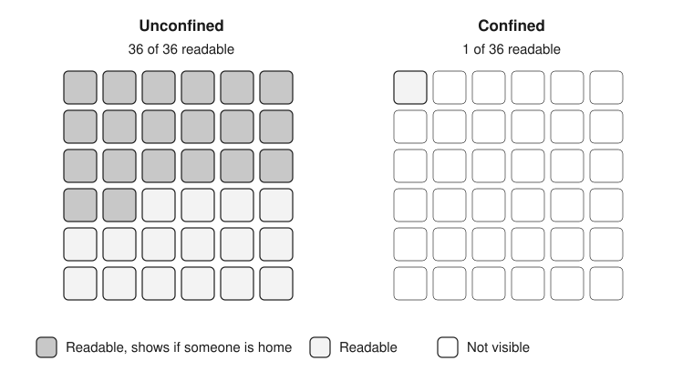
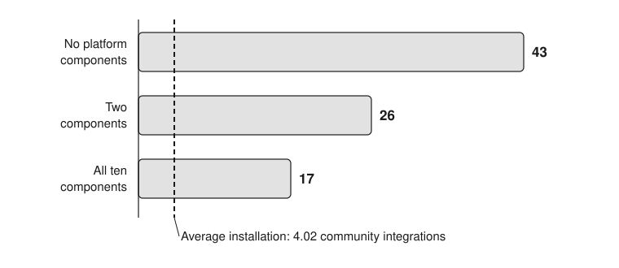

# 12. Simulations, Results and Interpretation

This section answers three questions in turn: whether confinement protects the household (Assertion A), whether integrations still work when confined (Assertion B), and whether a home device can afford it (Assertion C). Each question was given a test before any measurement was made, which named the result that would show the answer to be no (Section 11). Every security and compatibility result compares a confined run with an unconfined run on the same device and the same Home Assistant release, 2026.8.3, so any difference comes from the framework. Unless stated otherwise, the figures come from the final rerun of 1 November 2026, which repeated every experiment on the finished code. Appendix [R] gives the detailed results.

## 12.1 Does confinement protect the household?

Four attacks were run from inside an integration, once unconfined and once confined. The first two are the published techniques that motivated the project, and the other two read what a hostile integration would most want. Table 12.1 shows that all four worked unconfined and that none of them obtained anything it had not been granted when confined.

**Table 12.1**
*Four attacks, unconfined and confined*

| Attack | Unconfined | Confined |
|---|---|---|
| The garbage-collector technique, aimed at another integration's credential (Corno & Mannella, 2022) | Credential reached | Nothing found |
| The 2021 path-traversal pattern, aimed at two planted secrets (Home Assistant, 2021a) | 2 of 2 recovered | 0 of 2 |
| Reading another process's environment variables | Contents read | Nothing to read |
| Reading devices the integration was not granted | 36 of 36 | Only the 1 declared |

The first attack is the one the design was built to defeat. Python gives every program a list of all the objects alive in its process, and when all integrations share one process, that list includes the other integrations' credentials. The test's own output shows what happened in each run:

```
UNCONFINED — victim integration and adversary in one process
  victim's token reached by the heap walk : YES — 7 live objects held it

CONFINED — credential in the mediator, adversary in a sandbox
  adversary's heap                        : 8942 objects, all its own
  token reached by the heap walk          : no
  same token live in the mediator process : yes (7 refs)
```

The confined attack ran without any error, examined 8,942 objects and found only its own. The last line matters most, because it shows that the credential existed throughout, in a separate process that the attack could not see. There was therefore no check for an attacker to get around, since the credential was simply not there to be found.

For a household, the fourth attack matters most. Figure 12.1 shows every device in the test home. Unconfined, one request returned all 36, including all 20 that reveal whether someone is at home. Confined, the integration saw only the one device it had declared, and none of the 20.



**Figure 12.1**
*Devices of the test home that one integration can read*

The project's own threat model was tested in the same way, with a suite of 39 attacks from inside a sandbox, and neither planted secret was recovered. The result is that an integration installed to show electricity prices can no longer read the household's stored passwords, and it can learn when the house is empty only if it has been granted the sensors that show it. What an integration may reach thus becomes a declaration that a person can read before installing it.

## 12.2 Do integrations still work?

The simplest test is whether an integration loads at all. Two samples were used: the 37 most-installed community integrations, and 40 drawn at random from the community catalogue. Table 12.2 gives the results.

**Table 12.2**
*Integrations that load cleanly*

| Sample | Integrations | Unconfined | Confined | Failures caused by confinement |
|---|---|---|---|---|
| Most installed | 37 | 31 (84%) | 31 (84%) | 0 |
| Drawn at random | 40 | 37 (92%) | 37 (92%) | 0 |

The two runs failed on exactly the same integrations, with the same error messages, so confinement caused none of the failures. The 84% figure therefore describes the integrations and the platform release, not the framework. The random sample was predicted to do worse, because less popular integrations are less well maintained, but it did 8 points better. A typical integration in that sample needs less from the platform, so it has less that can go missing.

Loading is not the same as working, so fifteen integrations were also run from start to finish. Each was set up through its own unmodified configuration steps and given a task whose correct result was predicted beforehand. All fifteen worked confined. Table 12.3 shows five of them, and Appendix [R] gives all fifteen. They are reported by name rather than as a rate because most integrations need an account or a physical device before they can do anything, with or without confinement.

**Table 12.3**
*Five of the fifteen integrations run end to end*

| Integration | Task | Confined result |
|---|---|---|
| `thermal_comfort` | Calculate the dew point from temperature and humidity | 9.96 °C, as unconfined |
| `scheduler` | Turn on a light at a set time | Light on at the scheduled second, as unconfined |
| `alarmo` | Arm and disarm a home alarm | Armed after its exit delay and disarmed, as unconfined |
| `nordpool` | Fetch electricity prices from an online service | Same price as unconfined |
| `trakt_tv` | Renew an expired login to an online account | Renewed inside the sandbox; the integration then worked |

Each integration that uses the network was also run with its network permission removed, and its requests were then refused and recorded. This third run shows that the working runs reached their services through the declared permission and not around it.

A confined integration is useful only if its devices reach the household, which is the job of the bridge. After the interim report, the bridge was extended from 11 kinds of device to 29, such as lights, locks and cameras, and it now covers the device kinds of 36 of the 37 most-installed integrations. The fifteen were then run against a real Home Assistant installation, and all 65 devices they published appeared there, each as a device of its own kind and in the correct state. The result is that no integration tested stopped working inside its sandbox, and the devices of the fifteen reached a real household installation. The main exception, live video, is described in Section 12.5.

## 12.3 Can a home device afford it?

The reference device is a Raspberry Pi 5 with 4 GB of memory. The test was whether it can hold as many sandboxes as the average installation has community integrations, 4.02 (Home Assistant, n.d.-d), without slowing what the platform does. Table 12.4 gives the main costs. The reported figures were measured in ten passes on fixed code, and the final rerun confirmed them within the limits set before it ran, with memory 3–5% higher.

**Table 12.4**
*The cost of confinement on the reference device*

| Quantity | Reported | Final rerun |
|---|---|---|
| Memory per sandbox, using no platform components | 56.5 MB | 59.1 MB |
| Memory per sandbox, using all ten components measured | 135.6 MB | 141.2 MB |
| Delay added to one request | 43 µs | 42.1 µs |
| Writing the decision record to disk | 3.67 ms | 3.69 ms |
| A change in the house reaching an integration | 0.5–0.9 ms | 0.49 ms |
| A household command reaching an integration | 11–16 ms | 12.5 ms |

Memory decides how many integrations can be confined. Figure 12.2 assumes that 60% of the device's memory is set aside for sandboxes. It then holds at least 17, even if every integration uses all ten platform components, which is four times what the average installation needs.



**Figure 12.2**
*Sandboxes that fit in 60% of the device's memory, by how much of the platform each one uses*

Delay is not a constraint either. Writing each decision to disk is the slowest step, and it limits the mediator to about 269 decisions per second. A generous estimate of real demand is about four per second, so the mediator runs about sixty times clear of it. The delays a person could notice are a change reaching an integration in under a millisecond and a command reaching it in between one and two hundredths of a second. The result is that a household running the typical four community integrations on a Raspberry Pi could confine all of them and would not notice the delay.

## 12.4 How the results were checked

These results are only as good as the evaluation behind them, so the evaluation was tested too. Pass criteria were committed before each experiment ran, and all the experiments were repeated in full twice on tagged code, the second time on the finished version. In that rerun, all 35 test suites passed twice, and every step met its criterion. To check that the tests themselves could fail, 92 defects were planted in the code one at a time, and the tests caught 90. The other two change nothing the code does, so no test could detect them. This work produced 71 findings, listed in Appendix F, of which one was critical. All but four are resolved, and none changed the three answers above. The AI-specific checks are described in Section 13.

## 12.5 Limits of the results

Each answer has limits that the results do not remove. The security result rests on attacks written within the project, because no independent tester has attacked the framework. A line-by-line reading of the code found a route out of the sandbox that no automated test had detected. That route was closed, but its discovery suggests that attacks the builders did not anticipate may remain. Confinement also controls where an integration connects, not what it sends, and it honours a permission the user has approved, even an over-broad one.

The compatibility result is complete for loading but checked in depth for only fifteen named integrations. Coverage by kind also does not mean full function. Cameras are confined to still pictures, so three integrations, `frigate`, `eufy_security` and `tapo_control`, lose live video, which is their main use. Appendix [R] lists the smaller limits of other device kinds.

The affordability result rests on an average, because the platform does not publish how the number of integrations varies between installations, and on memory measured while integrations were at rest. All the results come from a single release of Home Assistant on one device, and the reproduction guide has not yet been followed on a freshly installed device.

## 12.6 Interpretation

Within those limits, the central claim holds, because none of the results named in advance as a failure occurred. Confinement defeats the published attacks that motivated the design, costs no integration its ability to load, and fits on a home device with a wide margin. What changes is the nature of an integration's authority. Authority that was total and invisible becomes declared before installation, bounded while the integration runs, and recorded each time it is used. Each limit above also points to work that would extend the result, which Section 15 sets out.
