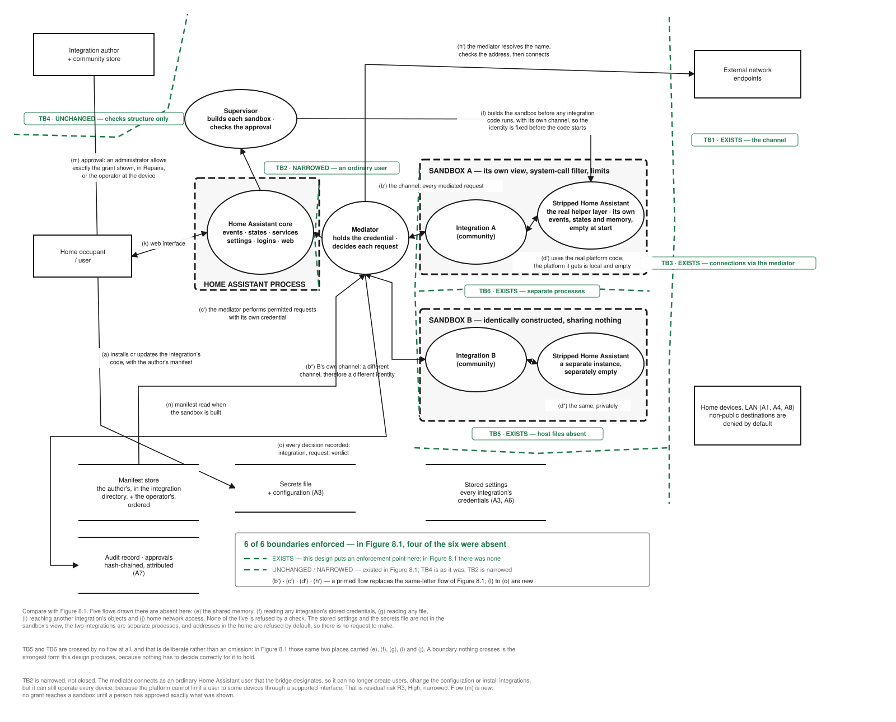

# Appendices

## Appendix A — Open-source repository and artifact index

| | |
|---|---|
| Framework | `v2/framework/confine/` — standard library plus `ctypes`, no third-party dependencies, no override flag |
| Self-tests | **29 suites**, all passing on the test hardware (Appendix E). `selftest.py` and `selftest_*.py` in the same directory; `experiments/selftests/suites_all.sh` runs them |
| Experiments | `v2/experiments/` — each with its script, its raw result file and a readable write-up |
| Figures | `v2/figures/` — each figure and its threat model generated from one source, so they cannot drift |
| Corpora | `hacs_corpus_manifest.json` — both corpora, redrawable; the uniform draw records its seed (20260902) |
| Working notes | `v2/notes/` — decision records, evidence write-ups and the pre-registered predictions |
| Test hardware | Raspberry Pi 5, 4 GB, Raspberry Pi OS trixie. **Every measurement in this report was taken on it** |
| Version | Tag `final-2026-10`, at which every measurement, mutant, suite and fault was rerun; the fault scripts at `fix-2026-10-f61` (F61). The framework's code is identical at both. Results in `v2/experiments/verify/results/final_20261016/` |
| Reproduction | `v2/REPRODUCE.md`, followed from a fresh clone; following it on a freshly imaged device is still open (F18) |

*[Repository URL and access statement to be supplied on submission.]*

---

## Appendix B — Requirements register

This appendix gives the full register that Table 3.2 summarises. Its purpose is to let a reader check each verdict against a criterion that was fixed before the evidence existed, so it is presented in two parts: what each requirement demands and how it was to be judged (Table B.1), and what the evaluation found (Table B.2).

Each requirement was traced to a source in the problem statement or the literature, and a requirement with no source was cut rather than kept. The criteria in Table B.1 are quoted as they were frozen on 2 September 2026, before the evaluation ran, with one exception: S9 entered when the threat model identified resource exhaustion (threat T16, Appendix C), and its criterion was fixed then, before its measurement. Four requirements (C3, S1, S4, S5) derive from a limitation or a result in prior work rather than from the platform, which reflects how closely the design follows the work it extends.

**Table B.1 — Requirements, derivation and criteria fixed in advance**

| ID | The framework shall… | Derivation | Criterion: the requirement passes if… |
|---|---|---|---|
| C1 | Run integrations with their code unmodified | Browser extension models could require authors to adopt a new permission model because the platform was new (Barth et al., 2010); Home Assistant has thousands of existing integrations (Home Assistant, n.d.-c) written against an interface that presumes full authority | Every integration in the compatibility runs shows a zero-line difference against its fetched original, counted mechanically after the run |
| C2 | Require no change to Home Assistant | The platform leaves community code to its users' risk (Home Assistant, 2021a), and the project has no authority over the platform | Every arm runs against an unmodified official Home Assistant release, with the version recorded in the result file |
| C3 | Not depend on the author's cooperation or honesty | The closest prior work relies on truthful declarations by plug-in developers, and its authors acknowledge that anyone with access to the source could alter it (Corno & Mannella, 2023) | The adversarial run includes an absent manifest, an over-broad manifest and one deliberately mismatched to behaviour, and all three are handled by the manifest's precedence rules |
| C4 | Run on self-hosted, resource-constrained hardware | A property of the deployment: Home Assistant is commonly installed on single-board computers | Every performance figure is produced on the Raspberry Pi 5, reporting per-integration memory and added latency |
| F1 | Let a confined integration publish entities and states | Connecting a device or service to the entity model is what an integration is for, and an add-on cannot do it in its place (Home Assistant, n.d.-b, n.d.-g) | A confined integration's entities are present in Home Assistant and behave as native entities under the measures used in the evaluation |
| F2 | Let a confined integration reach declared network endpoints | Integrations exist largely to contact device and cloud services, so network access cannot simply be denied | An integration polling a declared remote service completes successfully while confined |
| F3 | Express authority in a declarative manifest | The missing mechanism is a way for authority to be declared, enforced and audited, and the manifest is established practice in browsers (Barth et al., 2010) | Every enforcement decision in the evaluation names the manifest clause that produced it, and a decision with no attributable clause is shown to be unconstructible |
| F4 | Show declared authority before it is granted | Users cannot see what an integration will access before installing it, because nothing in the installation path shows it (Section 2) | The manifest of each evaluated integration renders in human-readable form, with denials shown at the same weight as grants |
| S1 | Enforce outside the integration's process | Corno and Mannella (2022) showed one integration reaching another's live object through Python's garbage collector, so any in-process permission layer is reachable by the code it constrains | The published garbage-collector technique, attempted from inside the sandbox, reaches no platform object, and the mediator and its credential cannot be located from within |
| S2 | Keep every platform credential out of the sandbox | If the confined code holds a token the platform honours, it can bypass mediation and the manifest becomes decorative (Corno & Mannella, 2022) | No platform credential is recoverable from the sandbox's environment, file system, process table or memory |
| S3 | Mediate reads and subscriptions, not only writes | Entity states reveal occupancy, presence and absence from home, so mediating only state changes would leave surveillance untouched | A confined integration is denied both a read and a subscription to undeclared entities, each refusal naming its clause, against a paired unconfined baseline measuring what is readable without the framework |
| S4 | Attribute and enforce network access per integration | The closest prior work merges every plug-in's declarations into one gateway profile, so each plug-in's effective policy becomes the union of all of them (Corno & Mannella, 2023) | An integration is denied a host declared only by a different integration |
| S5 | Separate operations of unequal risk | Physical operations are asymmetric in risk, and a permission granted per domain grants both directions (Rahmati et al., 2018) | A manifest permitting `lock.lock` is shown not to permit `lock.unlock`, and the refusal is structural rather than a check |
| S6 | Deny by default | An allow-by-default policy bounds nothing, and a malicious author may simply omit the manifest (C3) | An integration with no manifest and one with an unparseable manifest are each denied all mediated capability, each refusal naming its rule |
| S7 | Record every decision in a tamper-evident log | Users cannot detect afterwards what an integration accessed, and a systematic review found that unauthenticated extensions reduce the ability to audit logs and locate malicious ones (Thingnes & Meland, 2025) | Decisions appear in the log bearing the integration's three-part identity, and modification, deletion and reordering are each detected independently by a hash chain and a keyed chain |
| S8 | Isolate files and processes | An integration runs in the Home Assistant process and can read any file that process can, stored credentials included; the 2021 disclosures showed flawed integrations exposing exactly those files (Home Assistant, 2021a, 2021b) | The 2021 file-theft pattern succeeds against an unconfined baseline installation and is blocked under the framework, on the same host and release |
| S9 | Bound processor, memory and disk use | No source in the problem statement or literature; added when the threat model rated resource exhaustion (T16) | An integration deliberately exhausting processor, memory and disk in turn does not make the gateway unresponsive, demonstrated without administrator privileges, with the boot-time precondition stated |
| N1 | Report overhead against an unconfined baseline | On a constrained device, a control that halves the number of integrations a user can run will not be adopted (C4) | Added latency, per-integration memory and the maximum number of concurrent integrations are reported against an unconfined baseline on the target hardware; no threshold is set in advance |
| N2 | Report compatibility as measured, not asserted | No prior work reports what fraction of real, unmodified extensions still work under confinement | "Imports clean" and "executed end to end" are reported as two separate numbers, never combined, with the first labelled an upper bound wherever it appears |
| N3 | Fail in a stated way | The user's exposure today is invisible, and a framework that failed open and silently would reproduce that while implying protection | Behaviour when the mediator is unavailable is specified in advance and tested, and the framework refuses rather than degrades silently, including when the supervisor is in the wrong position in the control-group tree |

The verdicts in Table B.2 cite the evidence in the body of the report or in the other appendices. The last column records how a verdict changed after the criteria were frozen, because a register that showed only final verdicts would hide the cases in which verification overturned an earlier one. In every such case the criterion stayed as written and the verdict moved.

**Table B.2 — Verdicts, evidence and history**

| ID | Verdict | Evidence | How the verdict changed |
|---|---|---|---|
| C1 | Met | Every source tree hashed before and after its run, in both arms of both corpora and again at the final rerun: no source changed, no line differed (Appendix D) | Argued until 6 September 2026: the report had described a difference check that did not exist, and the check was then built and run |
| C2 | Met | Every arm ran on the unmodified release 2026.8.3, recorded in each result file (Section 11) | — |
| C3 | Met | Absent, over-broad and mismatched manifests each handled as specified; the over-broad one is honoured, and that residual is stated as R1 (Section 8.4, Table C.5) | — |
| C4 | Met | Every performance figure measured on the Raspberry Pi 5 (Table 12.4) | — |
| F1 | Met | A confined integration's fifteen sensors are registry entities in a live Home Assistant instance, keep their names and survive a restart (Table 12.3) | Bounded to a stand-in platform until 4 October 2026, when the same entities were published into a live instance |
| F2 | Met | Real integrations polled their own live services confined and matched the unconfined arm's output, across three HTTP libraries and one authenticated service (Table 12.3) | Could not be tested when the criteria were frozen, because egress had not been built; met on 3 September 2026, first by purpose-built integrations and then by a real one |
| F3 | Met | Seven mismatched behaviours produced seven refusals naming seven distinct clauses; the suite checks that a refusal without a clause cannot be built (Appendix E) | Qualified on 6 October 2026: seven code paths could build a refusal with no clause, though none appeared in any record (F03, Appendix F), and they were fixed |
| F4 | Met | The grant renders in plain language with denials at equal weight, in the terminal and on the approval screen (Appendix E) | Strengthened later: an approval is now bound to the grant shown (F57, F60) |
| S1 | Met, paired | The heap walk reached a live credential through 7 objects unconfined and through none of 8,942 objects confined (Table 12.1) | — |
| S2 | Met, paired | Another process's environment leaked unconfined and was empty confined (Table 12.1); the adversary suite recovered no platform credential from the sandbox's file system, process table or memory (Appendix E) | — |
| S3 | Met, paired | Reads: 36 of 36 entity states unconfined, 1 of 36 (the declared one) confined. Subscriptions: 3 of 3 undeclared changes delivered unconfined and 0 of 3 confined, both on the same platform release (Table 12.1; Appendix C, Table C.4) | Partial until 4 October 2026, because no mechanism yet delivered state changes to a sandbox; the subscription half was paired against an unconfined arm on 13 October 2026 |
| S4 | Met | Two integrations running at once were each denied the host declared only by the other, as the mediator's own record shows (Appendix E) | Could not be tested when the criteria were frozen; met on 3 September 2026 |
| S5 | Met | A manifest declaring `lock.lock` does not permit `lock.unlock`, and `lock.*` is rejected when the manifest is parsed (Appendix E) | — |
| S6 | Met | Absent and unparseable manifests each denied all mediated capability, each refusal naming its rule (Appendix E) | — |
| S7 | Met | Modification, deletion and reordering each detected, the two chains failing independently; every harness that decides writes the durable log (Appendix E) | Twice qualified: the identity was recorded only inside the suite until 3 October 2026, and a full disk or a restart could break the chain until 6 October (F28, F31) |
| S8 | Met, paired | The 2021 pattern recovered 2 of 2 planted secrets unconfined and 0 of 2 confined; the file does not exist inside the sandbox (Table 12.1) | Qualified on 6 October 2026: each sandbox shared the supervisor's terminal, a route out that no file-theft test exercised (F34), since fixed; host paths remain readable without file contents (F11, residual) |
| S9 | Met, narrowed | Memory exhaustion ended by the kernel, process creation refused at the cap, a 25% processor cap held at 25.1%, writing refused at the disk quota (Appendix C, T16) | Narrowed on evidence: "disk" means space, not I/O bandwidth, because the device's service manager does not delegate that control to an unprivileged user (systemd, n.d.) |
| N1 | Met | Memory, latency and capacity reported against the unconfined arm, with no threshold (Table 12.4) | — |
| N2 | Met by reporting | Import-level results for 75 integrations and end-to-end results for 13 are reported separately and never combined (Tables 12.2 and 12.3) | — |
| N3 | Met | The framework refuses to start without the memory controller or from the wrong control-group position, and fails closed when the mediator stops (Section 9; Appendix E, `selftest_supervise`) | Strengthened during verification: a killed supervisor once left its sandbox running without a mediator (F30), and a sandbox did not restart when the platform returned (F29); both fixed |

All twenty requirements are met, eighteen as stated and two in a narrower form. S9 was narrowed by the evidence, and N2 is met by the way results are reported rather than by a measured rate. The history column also bears on how far the verdicts can be trusted. Eleven of the twenty rows changed after the criteria were frozen, and in four of them (C1, F3, S7, S8) verification found that a verdict had claimed more than the code supported. In each of those four, the code or the check was corrected and the criterion was left as written, so no verdict was restored by weakening the test it had failed.

---

## Appendix C — Threat register

This appendix gives the full register that Section 8 summarises. It follows ISO 31000's process (International Organization for Standardization, 2018): criteria fixed first, threats identified with STRIDE (Shostack, 2014) at each of the six trust boundaries, each threat rated before treatment, then treated, then scored against the running system. Table C.6 maps the register onto Corno and Mannella's (2022) eleven threats, so that the result can be checked against a model this project did not write.

### C.1 Risk criteria

The scales are ordinal, not cardinal. They order risks for treatment, and the product of two ordinal scales is not a quantity, so the bands below are labels for priority rather than measurements. The risk owner is the occupying householder, who has neither a security function nor any capacity to respond to an incident, and every rating is calibrated to that owner. A threat is rated on the worst outcome consistent with the actor model, and at the highest impact level that any of the three harm types in Table C.1 matches.

**Table C.1 — Impact (asset identifiers as in Table 8.1)**

| | Level | Confidentiality | Integrity and control | Availability |
|---|---|---|---|---|
| 5 | Severe | — | Physical access to the dwelling by a state change (A1) | A life-safety function defeated: alarm, smoke or CO response, heating in freezing conditions (A5 with A1) |
| 4 | Major | Credentials compromised beyond the home (A3); camera or media access (A4) | Reach into other devices on the home network (A8) | Total loss of the platform while unattended (A5) |
| 3 | Moderate | Occupancy or behaviour disclosed (A2) | Undetected corruption of another integration's data (A6) | Loss of attribution: harm that cannot be traced to its source (A7) |
| 2 | Minor | Individual non-sensitive readings disclosed | Corruption that is detected, or overwritten by the owning integration's next update (A6) | Partial or transient loss of function |
| 1 | Negligible | No meaningful loss | | |

**Table C.2 — Likelihood, and the evaluation bands**

| | Level | Anchor |
|---|---|---|
| 5 | Almost certain | Occurs by default in normal operation |
| 4 | Likely | Documented in this ecosystem, or requires no attacker skill |
| 3 | Possible | Documented in comparable ecosystems |
| 2 | Unlikely | Technically available, no documented occurrence |
| 1 | Rare | Requires capability inconsistent with the actor model |

Bands: Low 1–4, Medium 5–9, High 10–16, Critical 17–25. **Appetite:** no residual Critical risk is acceptable, and a residual High risk is acceptable only where it is structural, meaning that no available control addresses it, and is stated openly to the user.

### C.2 Threats and inherent risk

Inherent risk is rated against Home Assistant as it stands, with no requirement of Section 3 implemented. The CM column gives the corresponding threat in Corno and Mannella's (2022) model.

**Table C.3 — Threats identified, by trust boundary, with inherent risk**

| ID | STRIDE | Threat | CM | Impact | Likelihood | Inherent |
|---|---|---|---|---|---|---|
| | | **TB1 — integration and mediating component** | | | | |
| T01 | Elevation | Bypasses mediation by acting directly on the platform's in-process objects | T10 | 5 | 5 | 25 Critical |
| T02 | Spoofing | Presents itself as another integration to obtain that integration's authority | T9 | 4 | 4 | 16 High |
| T03 | Tampering | Modifies the mediating component or its policy in memory | T10 | 5 | 5 | 25 Critical |
| T04 | Disclosure | Recovers the platform credential held by the mediator | T1 | 5 | 4 | 20 Critical |
| T19 | Denial of service | Floods the mediator with refused requests, each a durable record, exhausting the decision capacity all sandboxes share and the disk | T7 | 3 | 4 | 12 High, against the design |
| | | **TB2 — mediating component and Home Assistant** | | | | |
| T05 | Elevation | Induces the mediator to make an undeclared service call, as a confused deputy | T3, T10 | 5 | 5 | 25 Critical |
| T06 | Disclosure | Reads undeclared entity states, or subscribes to a stream of the whole installation | T1 | 3 | 5 | 15 High |
| T07 | Tampering | Writes state for entities it does not own, corrupting another integration's data and triggering the automations that act on it | T3, T4 | 5 | 4 | 20 Critical |
| | | **TB3 — integration and external network** | | | | |
| T08 | Disclosure | Sends data to an undeclared host | T2 | 4 | 4 | 16 High |
| T09 | Disclosure | Sends data through a declared host: content, not destination | T2 | 4 | 3 | 12 High |
| T10 | Elevation | Reaches other devices on the home network, or services on the gateway's loopback | T3 | 4 | 3 | 12 High |
| T11 | Spoofing | Uses a declared host name that resolves, at request time, to an internal address | T9 | 4 | 2 | 8 Medium |
| | | **TB4 — author and channel, and the user's machine** | | | | |
| T12 | Tampering | A malicious update arrives through the authorised update path to an integration already trusted | — | 5 | 3 | 15 High |
| T13 | Spoofing | The declaration misrepresents behaviour: over-declared, or absent | T10 | 4 | 4 | 16 High |
| | | **TB5 — integration and host operating system** | | | | |
| T14 | Disclosure | Reads files outside its resources: `secrets.yaml`, the state database, tokens | T1 | 4 | 4 | 16 High |
| T15 | Disclosure | Reads another process's memory, environment or command line through the process table | T1 | 4 | 4 | 16 High |
| T16 | Denial of service | Exhausts processor, memory or disk, making the gateway unresponsive | T7 | 4 | 3 | 12 High |
| | | **TB6 — integration and other integrations** | | | | |
| T17 | Disclosure, tampering | Reads or alters another integration's live objects and secrets | T1, T4 | 4 | 4 | 16 High |
| T18 | Repudiation | Acts without attribution, so no record identifies which integration acted | T11 | 3 | 5 | 15 High |

Eighteen threats were identified against the platform as it stands: five Critical, twelve High and one Medium, and all five Critical threats share one cause, the shared process. T19 has no rating against the platform, because it does not exist there. The treatment of T18 created it: a durable record per decision makes each refusal cost the mediator about 3.7 ms of shared time, and a flood of refusals happened by accident during the evaluation. It is rated against the design before its control and is not counted among the eighteen.

T07's impact is rated through the platform's automations rather than through the data it corrupts. A state trigger in Home Assistant fires on any change to its entity's state, and the context passed to the automation records the user who caused the change, if any, but not the integration that wrote it (`triggers/state.py` and `Context` in `core.py`, release 2026.8.3). An integration that writes `home` to a householder's presence entity therefore causes any automation that disarms the alarm or unlocks the door on arrival to do so, without itself calling the service that T05's control checks. The worst outcome consistent with the actor model is physical access to the dwelling (A1), level 5. The owning integration's next update does not lower that rating, for two reasons. Presence, door and lock entities report only when something changes, so a forged value can stand for hours, and an automation that has already acted is not reversed when the state is corrected. An earlier rating of 2, Minor, rested on that correction and was raised for these reasons.

### C.3 Treatment and verdicts

Figure C.1 draws the confined design on the canvas of Figure 8.1, so that the difference between the two shows what the treatments change: the four absent boundaries now exist, and the flows that reached the shared memory, the stored credentials, any file and the other integration have no counterpart.



**Figure C.1**
*The confined design, on the canvas of Figure 8.1*

*Note.* Each integration runs in its own sandbox and reaches the platform only through the mediator. All six boundaries now exist; TB4 is unchanged and TB2 is narrowed (residual risk R3). Flow (m) is the approval.

Every treatment but two changes consequence rather than likelihood, bounding what the code can do. The verdicts are not aggregated into a single figure, for the reason Section 11 gives. *Paired* means the threat was also shown to succeed against the unconfined arm on the same host and platform release.

**Table C.4 — Treatment, requirement and verdict**

| ID | Control | Req. | Verdict and evidence |
|---|---|---|---|
| T01 | Run the integration outside the platform's process | S1 | Demonstrated, paired: the heap walk reaches a credential through 7 objects unconfined, and only the attacker's own 8,942 objects confined |
| T02 | Identity taken from the channel, on every request | S1, S7 | Demonstrated: a request claiming to come from another integration is decided under its sender's own grant, and refused |
| T03 | Mediator outside the integration's address space | S1 | Demonstrated; cannot be paired, because unconfined there is no mediator to tamper with |
| T04 | Credential held only by the mediator | S2 | Demonstrated, paired: the sandbox's sweep finds no credential while the same token is live in the mediator |
| T05 | Service calls checked against the manifest, deny by default | F3, S5, S6 | Demonstrated: `lock.unlock` refused under a grant of `lock.lock`; `lock.*` rejected when the manifest is parsed |
| T06 | Reads and subscriptions both mediated | S3 | Demonstrated, paired: reads 36 of 36 unconfined, 1 of 36 confined; undeclared changes delivered 3 of 3 unconfined and 0 of 3 confined on the same host and release, and 3 of 3 with the filter bypassed |
| T07 | Writes only to declared entities | F3, S6 | Demonstrated |
| T08 | Network access per integration, by declared host | S4 | Demonstrated: two concurrent integrations, each refused the host only the other declared |
| T09 | Retained (R5) | — | Retained: the mediator controls the destination and never sees content |
| T10 | Private destinations refused unless separately granted | S4 | Demonstrated, and the granted path measured with a real integration against a simulated device |
| T11 | Destination checked on the resolved address, not the name | S4 | Demonstrated: the host clause satisfied, the connection refused on its address |
| T12 | Each start confined by the manifest and code it starts with; a changed grant needs a new approval | F3, S6 | Demonstrated: a changed manifest bounds the next start and is reported before it takes effect |
| T13 | Retained in part (R1, R2): the declaration is shown and approved, and enforcement is bounded to it | F4 | Retained: an over-broad grant is honoured once approved; the ceiling it cannot raise is measured |
| T14 | Filesystem view limited to the integration's own directories | S8 | Demonstrated, paired: canary secrets 2 of 2 unconfined, 0 of 2 confined; the path does not exist |
| T15 | Process table limited to the sandbox | S8 | Demonstrated, paired: another process's environment read unconfined, nothing to read confined |
| T16 | Resource limits from the manifest | S9 | Partial: memory, processor time, processes and disk space bounded, each shown by a sandbox exceeding it; I/O bandwidth not bounded (R7); the persistent data folder checked against the disk bound only at start |
| T17 | Separate processes, so no shared heap | S1 | Demonstrated, paired, by the same heap walk as T01 |
| T18 | Attributed, tamper-evident record written before the action | S7 | Demonstrated, bounded by R4: modification, deletion and reordering each detected by both chains independently |
| T19 | Refusals counted per integration; past 100 in 10 s, one record, and the integration stopped until a person restarts it, never with more authority | S7, S9 | Demonstrated: cut off within 0.81 s after exactly 100 recorded refusals, while a second sandbox continued to be served |

Sixteen of the nineteen threats are demonstrated, six of them paired; one is partial and two are retained by decisions made before the evaluation. All five Critical inherent threats are among those demonstrated, which is the register's most important result, because one control, the separate process, answers the cause they share.

### C.4 Residual risks

The seven residual risks, R1 to R7, are given with their ratings and the reason each is retained in Table C.5. Section 8.4 discusses the four that remain High.

**Table C.5**
*Residual risks*

| | Risk | Residual | Why retained |
|---|---|---|---|
| R1 | The over-declaring manifest | High | Structural: a manifest bounds an integration to its declaration but cannot make the declaration minimal. Barth et al. found that 76% of the browser extensions they studied used unnecessarily powerful APIs (Barth et al., 2010). Authority becomes visible and bounded instead of silent and total |
| R2 | Abuse of legitimately declared authority | High, structural | An integration that declares `lock.unlock` may unlock the door at 03:00; preventing that needs contextual integrity, a different mechanism with its own usability costs |
| R3 | The mediator's credential still reaches every device | High, narrowed | The mediator runs as an ordinary user (F45): it can no longer create users, change the configuration or install integrations, but it can operate every device, because the platform's per-entity policy cannot be configured through a supported interface |
| R4 | A local audit log cannot be authoritative against whoever controls the machine | Medium | Hash chaining gives tamper evidence, not tamper proofing, and says nothing about events never recorded |
| R5 | Exfiltration through a declared host | High | Structural: destination control cannot become content control without inspecting payloads, which is itself a privacy problem, and TLS makes the data visible only to its two endpoints (Rescorla, 2018) |
| R6 | The user is not equipped to evaluate a declaration | Medium | Out of scope: enforcement does not depend on the user reading the manifest |
| R7 | Input and output bandwidth is unbounded | Medium | Inherited: systemd delegates only the `cpu`, `memory` and `pids` controllers to a user's service manager (systemd, n.d.), so the unprivileged supervisor cannot apply the `io` controller |

R3 changed during verification. The model originally stated that Home Assistant issues no scoped token, so the mediator had to hold full authority. Checked against the platform's own release, that was wrong: a token carries its user's permissions, and an entity policy, by domain or by entity, is enforced. The mediator had held an administrator's token only because this project's bridge admitted no one else (finding F45). It now runs as an ordinary user, which removes every administrative function from its reach. The risk stays High because the locks of A1 are still reachable, but its reason is now narrower and exact: the platform's per-entity policy exists, yet no supported interface creates one.

One further residual sits within T14 and was found by measurement. The sandbox's filesystem binds the interpreter and its libraries at their host paths, so a confined integration can read the host's directory layout along those paths, including a user's name where the runtime is installed under a home directory. It cannot read any content outside its grant. Its likelihood is 5, because the exposure follows from the construction, and its impact 1, since a name and directory names give no capability and disclose no reading, so it is rated 5, Medium, and retained. The remedy is a deployment step, installation under a neutral path. Rated at impact 2 it would be High, and the appetite would then require the remedy.

T07's treatment also leaves a residual, and it falls within R2. Confinement stops an integration writing to entities it has not declared, but it cannot make the values it writes to its own entities true. An integration that publishes its own presence sensor can report a householder at home, and an automation the householder has built on that sensor will act on the report. The control bounds which entities an integration can forge, not whether its readings are honest, so this is the abuse of legitimately declared authority that R2 names, and it is retained with R2 as High and structural.

### C.5 The register against an external model

**Table C.6 — Corno and Mannella's (2022) eleven threats, scored through Table C.3's CM column**

| CM | Their threat | Mapped from | Verdict |
|---|---|---|---|
| T1 | Confidentiality: data used outside its scope | T04, T06, T14, T15, T17 | Demonstrated, all five paired |
| T2 | Data spread outside its scope | T08, T09 | Split: T08 demonstrated, T09 retained, because destination is controlled and content is not |
| T3 | Integrity: device state altered | T05, T07, T10 | Demonstrated |
| T4 | Integrity: private data altered | T07, T17 | Demonstrated |
| T5 | Availability: delay | — | Not mapped |
| T6 | Availability: partial loss | — | Not mapped |
| T7 | Availability: complete loss, including "resource saturation up to a frozen state" | T16, T19 | Partial: T19 demonstrated, T16 partial |
| T8 | Availability: physical damage | — | Not mapped; out of reach of any software control on the gateway |
| T9 | Authentication: impersonation | T02, T11 | Demonstrated |
| T10 | Authorisation: escalation | T01, T03, T05, T13 | Demonstrated, except T13, retained |
| T11 | Non-repudiation: anonymous action | T18 | Demonstrated, bounded by R4 |

Eight of the eleven are mapped, five without qualification. The two registers differ in both directions: theirs reaches consequences this design does not touch, delay, partial loss and physical damage, while this register separates the update channel (TB4) and the host (TB5) into boundaries that a gateway-level model folds together. T16's control plausibly reaches T5 and T6 as well, since a gateway being exhausted is delayed and partially lost before it is lost entirely, but the register maps T16 only to T7, and the table reports that mapping as it stands.

---

### C.6 What an integration can reach today

Table C.7 gives the authority that Section 2.1 summarises, with the source for each row. The last column separates what is deduced from how the platform loads an integration from what has been shown in practice, because the two carry different weight as evidence.

**Table C.7**
*Authority held by any community integration in Home Assistant 2026.8.3*

| Asset | Reach | Consequence of abuse | Basis |
|---|---|---|---|
| Entity states | Every entity in the installation | Occupancy, presence, sleep patterns, absence from home | Deduced from the loading model (Home Assistant, n.d.-f) |
| Service calls | Any service, including unlocking a door and disarming an alarm | Physical access to the dwelling | Deduced from the loading model (Home Assistant, n.d.-f); the platform's per-user check lets through a call that carries no user (Home Assistant, 2026) |
| Stored credentials | Any file the process can read, including stored secrets | Compromise of every linked cloud account | Deduced from the loading model; shown for flawed integrations in 2021, where the platform noted that the exposed files include stored credentials (Home Assistant, 2021a) |
| File system | Whatever the process's user can read | Configuration, history database, tokens | Deduced from the loading model; shown for flawed integrations in 2021 (Home Assistant, 2021a) |
| Network | Unrestricted outbound access and the home network | Exfiltration; a foothold inside the home | Deduced from the loading model (Home Assistant, n.d.-f) |
| Web endpoints | Can add its own HTTP endpoints to the platform's web server, with the login check switched off | An unauthenticated way into the home | Reported for an integration shipped with the platform (CVE-2023-27482) (elttam, 2023) |
| Other integrations' live objects | Any object in the shared interpreter | Theft or alteration of another integration's secrets | Demonstrated experimentally (Corno & Mannella, 2022) |

## Appendix D — Full compatibility results

This appendix lists every integration measured at the import level, in both arms, so that a reader can check the central compatibility result of Section 12.2 row by row rather than accept its zero on trust. The result rests on a comparison of two columns: if confinement caused a failure, some integration would pass in the unconfined column and fail in the confined one. No row in either table does so.

Each integration was placed on a ladder of outcomes, from worst to best. *Not found* means the platform could not locate the integration; *import failed* means its main module could not be imported; *platform import failed* means the module imported but at least one of its entity platforms did not; and *platforms clean* means the module and every entity platform it declares imported. The ladder measures whether code loads, not whether it works, which is why Section 12.2 reports the thirteen integrations executed end to end separately and never combines the two figures. The unconfined arm imported each integration into a full Home Assistant instance; the confined arm imported it inside a sandbox with only the components it declares. Both arms ran on release 2026.8.3 on the Raspberry Pi 5. The results below are from the re-run of 3 October 2026, made after the platform instance used by every runtime was corrected; each corpus produced the same outcomes as in its first run, and the final rerun reproduced every outcome and message exactly.

The two corpora are drawn differently and share only `bermuda` and `browser_mod`, so 77 measurements cover 75 distinct integrations. The head-weighted corpus takes the most-installed integrations. Analytics count installations per domain, the name under which an integration installs, and the catalogue lists three of the most-installed domains under two repositories each (`scheduler`, `govee` and `solarman`), so the 40 most-installed catalogue entries contain 37 integrations. One of the six, `Smiley73/ha-scheduler`, had renamed its domain to `ha_scheduler` in December 2025 while the catalogue still listed it as `scheduler`, so its entry carried the other repository's count; for `govee` and `solarman`, the analytics cannot say which repository the installations belong to. The uniform corpus is a random draw of 40 from the whole community catalogue with a recorded seed (20260902). Installation counts are those recorded in each corpus manifest from Home Assistant's analytics (Home Assistant, n.d.-c), where 0 means that no installation reported the integration. Both manifests pin each integration to the commit whose files match the measured copy byte for byte (finding F21, Appendix F).

**Table D.1 — Head-weighted corpus (37 integrations), by installations**

| Integration | Installations | Unconfined | Confined |
|---|---|---|---|
| `hacs` | 379,326 | Import failed | Import failed |
| `sonoff` | 43,799 | Platforms clean | Platforms clean |
| `localtuya` | 32,222 | Platforms clean | Platforms clean |
| `alexa_media` | 29,308 | Platforms clean | Platforms clean |
| `spook` | 27,331 | Not found | Not found |
| `webrtc` | 26,804 | Platforms clean | Platforms clean |
| `frigate` | 26,484 | Platforms clean | Platforms clean |
| `browser_mod` | 26,109 | Platforms clean | Platforms clean |
| `alarmo` | 25,370 | Platforms clean | Platforms clean |
| `waste_collection_schedule` | 23,336 | Platforms clean | Platforms clean |
| `meross_lan` | 22,628 | Platforms clean | Platforms clean |
| `xiaomi_miot` | 21,657 | Platforms clean | Platforms clean |
| `scheduler` | 21,557 | Platforms clean | Platforms clean |
| `bambu_lab` | 19,980 | Import failed | Import failed |
| `nodered` | 18,180 | Platforms clean | Platforms clean |
| `xiaomi_home` | 18,084 | Platforms clean | Platforms clean |
| `watchman` | 17,956 | Platforms clean | Platforms clean |
| `adaptive_lighting` | 16,550 | Platforms clean | Platforms clean |
| `tapo_control` | 16,294 | Import failed | Import failed |
| `dreame_vacuum` | 14,793 | Platforms clean | Platforms clean |
| `battery_notes` | 14,405 | Platforms clean | Platforms clean |
| `powercalc` | 13,777 | Platforms clean | Platforms clean |
| `midea_ac_lan` | 12,605 | Platforms clean | Platforms clean |
| `solcast_solar` | 11,444 | Platforms clean | Platforms clean |
| `govee` | 10,230 | Platforms clean | Platforms clean |
| `smartthinq_sensors` | 10,016 | Platforms clean | Platforms clean |
| `homematicip_local` | 9,947 | Platforms clean | Platforms clean |
| `octopus_energy` | 9,820 | Platforms clean | Platforms clean |
| `solarman` | 9,690 | Platforms clean | Platforms clean |
| `eufy_security` | 9,683 | Platform import failed | Platform import failed |
| `dwd_weather` | 9,598 | Platforms clean | Platforms clean |
| `bermuda` | 9,385 | Import failed | Import failed |
| `nordpool` | 8,253 | Platforms clean | Platforms clean |
| `pirateweather` | 8,220 | Platforms clean | Platforms clean |
| `thermal_comfort` | 7,955 | Platforms clean | Platforms clean |
| `llmvision` | 7,866 | Platforms clean | Platforms clean |
| `ble_monitor` | 7,816 | Platforms clean | Platforms clean |

**Table D.2 — Uniform corpus (40 integrations), by installations**

| Integration | Installations | Unconfined | Confined |
|---|---|---|---|
| `browser_mod` | 26,109 | Platforms clean | Platforms clean |
| `bermuda` | 9,385 | Import failed | Import failed |
| `zendure_ha` | 3,746 | Platforms clean | Platforms clean |
| `network_scanner` | 2,700 | Platforms clean | Platforms clean |
| `apsystems_ecu_reader` | 815 | Platforms clean | Platforms clean |
| `polleninformation` | 695 | Platforms clean | Platforms clean |
| `solis_modbus` | 576 | Platforms clean | Platforms clean |
| `localtuya_rc` | 438 | Platforms clean | Platforms clean |
| `pronote` | 353 | Platforms clean | Platforms clean |
| `irrigationprogram` | 343 | Platforms clean | Platforms clean |
| `enphase_ev` | 302 | Platforms clean | Platforms clean |
| `oekofen_pellematic_compact` | 231 | Platforms clean | Platforms clean |
| `sessy` | 215 | Platforms clean | Platforms clean |
| `trakt_tv` | 215 | Platforms clean | Platforms clean |
| `nature_remo` | 181 | Platforms clean | Platforms clean |
| `qolsys_panel` | 163 | Platforms clean | Platforms clean |
| `saj_esolar_air` | 159 | Platforms clean | Platforms clean |
| `tvoverlay_ui` | 112 | Platforms clean | Platforms clean |
| `kamstrup_403` | 73 | Platforms clean | Platforms clean |
| `sonyavr` | 48 | Platforms clean | Platforms clean |
| `lifesmart` | 47 | Platforms clean | Platforms clean |
| `lightwave2` | 38 | Platform import failed | Platform import failed |
| `tasmota_mielhvac` | 13 | Platforms clean | Platforms clean |
| `ocado` | 8 | Platforms clean | Platforms clean |
| `skybellgen` | 8 | Platforms clean | Platforms clean |
| `regensburg_transport` | 5 | Platforms clean | Platforms clean |
| `honor_x3` | 1 | Platforms clean | Platforms clean |
| `alarm_clocks` | 0 | Platforms clean | Platforms clean |
| `als_sundance_marin` | 0 | Platforms clean | Platforms clean |
| `circuitsetup_energy_analyzer` | 0 | Platforms clean | Platforms clean |
| `ecobot` | 0 | Platforms clean | Platforms clean |
| `enki` | 0 | Platforms clean | Platforms clean |
| `ha_insights` | 0 | Platforms clean | Platforms clean |
| `kroki` | 0 | Platforms clean | Platforms clean |
| `next_rocket_launch` | 0 | Platform import failed | Platform import failed |
| `nuki_otp` | 0 | Platforms clean | Platforms clean |
| `smhi_brandrisk` | 0 | Platforms clean | Platforms clean |
| `trmnl_webhook_push` | 0 | Platforms clean | Platforms clean |
| `vacation_mode` | 0 | Platforms clean | Platforms clean |
| `warema_wms` | 0 | Platforms clean | Platforms clean |

The failures are the same in both arms, and so are their messages. Table D.3 gives each one with its cause. Every cause lies in the integration, the corpus or the platform release, and none in confinement. Three integrations import a package, `aiofiles`, that they do not declare and that no component of the default configuration installs, so they fail wherever that package is absent. Two use constants that Home Assistant has since removed. The remaining failures concern how one integration ships its interface and how another is laid out in its repository.

**Table D.3 — The nine failing measurements, identical in both arms**

| Integration | Corpus | Outcome | Message, both arms | Cause |
|---|---|---|---|---|
| `bambu_lab`, `tapo_control` | Head | Import failed | `ModuleNotFoundError: No module named 'aiofiles'` | An undeclared dependency |
| `bermuda` | Both | Import failed | `ModuleNotFoundError: No module named 'aiofiles'` | An undeclared dependency |
| `eufy_security` | Head | Platform import failed | `ImportError: cannot import name 'SOURCE_TYPE_GPS' from 'homeassistant.components.device_tracker'` | A constant removed from the platform |
| `lightwave2` | Uniform | Platform import failed | `ImportError: cannot import name 'COLOR_MODE_BRIGHTNESS' from 'homeassistant.components.light'` | A constant removed from the platform |
| `next_rocket_launch` | Uniform | Platform import failed | `ImportError: Exception importing custom_components.next_rocket_launch.sensor` | Inside the integration's sensor module |
| `hacs` | Head | Import failed | `ModuleNotFoundError: No module named 'custom_components.hacs.hacs_frontend'` | The interface is bundled when a release is built and is absent from a source checkout |
| `spook` | Head | Not found | `IntegrationNotFound: Integration 'spook' not found.` | The repository's directory layout |

One further measurement tested whether a fuller instance would rescue a failure in the confined arm. The harness re-ran `hacs` with every component it declares set up, and it failed with the same message, which confirms that the missing module belongs to the integration's packaging rather than to the components the sandbox omits.

The same runs also carried the count behind C1. Every source tree was hashed before and after its run, in all four runs, and no source file changed and no line differed. That count was first made on the head-weighted pair in September (75 trees across the two arms, Appendix B) and was extended to the uniform pair by this re-run.

---

## Appendix E — Self-test suites

The self-test suites are the evidence on which most verdicts in Appendix B rest, and each was written against a claim stated in the design before the suite existed. A suite is one of the 29 test programs that the suite runner executes: the base sandbox test and 28 suites, each named for what it checks. They were last run in full at the final tag, `final-2026-10`, twice on the Raspberry Pi 5, and all 29 passed both times with the counts below. The count of checks in Table E.1 is the number of lines a suite marks as passed in its log; three suites report a paired comparison instead, because their result is a difference between two arms rather than a list of checks. Section 12.4 reports how the suites were themselves tested, by deliberate defects introduced into the code that some suite had to detect.

**Table E.1 — The 29 suites, grouped by what they protect**

| Suite | What it asserts | Checks passed |
|---|---|---|
| *Isolation and the published attacks* | | |
| `selftest` (base) | A sandbox built beside a secrets file, the platform's configuration store and a second integration's source sees only its own directory; the other files are absent rather than refused | 19 |
| `selftest_adversary` | A hostile integration inside a sandbox makes 39 attacks and one permitted control request; neither planted secret reaches it, and the durable record matches the decisions made | 43 |
| `selftest_adversary_baseline` | The same attacks with no sandbox: both planted secrets recovered and 11 attacks returning data, so the confined arm's result is a comparison | Paired: 2 of 2 secrets recovered |
| `selftest_gc` | The garbage-collector heap walk (Corno & Mannella, 2022) reaches a live credential unconfined and nothing confined, while the same credential stays live in the mediator | Paired: 7 objects against 0 of 8,942 |
| `selftest_reads` | What an integration can see of a furnished home, confined and unconfined | Paired: 36 of 36 entities against 1 of 36 |
| `selftest_resources` | Each of the four resource bounds holds when a sandbox tries to exceed it, and a limit that cannot be enforced is refused rather than ignored | 15 |
| `selftest_flood` | An integration that keeps requesting what it may not have is stopped after a fixed number of refusals and is not restarted with more authority | 36 |
| *Policy, identity and the record* | | |
| `selftest_policy` | `lock.lock` does not grant `lock.unlock`; paths into the configuration root are rejected when the manifest is parsed; no manifest grants nothing; every decision names its clause | 33 |
| `selftest_c3` | An over-broad manifest is honoured, as the residual risk R1 states, and behaviour mismatched to the manifest is refused, each refusal naming a distinct clause | 17 |
| `selftest_channel` | Two sandboxes both claiming the same identity are each recorded under their true identity, which comes from the channel and not from the message | 11 |
| `selftest_audit` | Identity has three components, including the dependency versions installed; modification, deletion and reordering of records are detected by two chains that fail independently; the record is written before the action | 42 |
| `selftest_integrity` | The counter behind C1 gives the known answer on trees changed in known ways, and does not count the bytecode caches that a clean run leaves | 15 |
| `selftest_t12` | An update is checked against its own declaration, so a malicious update cannot inherit the grants of the version before it | 33 |
| `selftest_approval` | A sandbox starts only under a grant a person has approved, bound to the integration's identity and to the grant that was shown | 14 |
| `selftest_describe` | Every state an integration can be in has a plain-language rendering, with denials shown at the same weight as grants | 16 |
| *Network access* | | |
| `selftest_socket_pinning` | A connected TCP socket cannot be redirected; a connected UDP socket can, which is why datagrams are relayed rather than handed over | 6 |
| `selftest_fdpass` | A connected socket crosses into the sandbox intact, and four ways a hostile sender could abuse the passing are refused | 12 |
| `selftest_egress` | A declared host is reached, an undeclared one refused with its clause, a host declared by another integration refused, and a name resolving to a private address refused | 23 |
| `selftest_egress_shim` | Unmodified HTTP client libraries reach a declared host, and the sandbox never holds the host's real address | 7 |
| `selftest_egress_sandboxed` | Two real integrations in real namespaces poll their own hosts at once, and each is refused the other's | 18 |
| `selftest_local_tcp` | A declared port on a home-network device is reached, and undeclared ports and addresses are refused | 17 |
| `selftest_udp` | Datagrams reach declared ports through the relay, device discovery works, and the sandbox never holds a socket able to broadcast | 21 |
| `selftest_netshape` | The instrument that records an integration's network behaviour reports what a deliberately provoked behaviour should produce | 13 |
| *The platform, the supervisor and the user interface* | | |
| `selftest_bridge` | An unmodified integration in a sandbox publishes an entity, reads a declared one, finds an undeclared one absent, and has its service calls reach their targets | 14 |
| `selftest_push` | A state change reaches a sandbox only when its subscription was granted | 28 |
| `selftest_real_platform` | The mediator, acting as a non-administrator user, publishes into and acts on a live Home Assistant instance | 52 |
| `selftest_ws` | The mediator's WebSocket client reproduces the protocol specification's own example values | 9 |
| `selftest_supervise` | The supervisor stops a flooding sandbox, restarts one from the Repairs panel, restarts one when the platform returns, clears a dead supervisor's sandbox, and does not restart one that exited by itself | 50 |
| `selftest_keep` | What an integration stores survives a restart, within its disk bound, and nothing it could run from does | 14 |

Two suites deserve attention from a reader scanning the table, because each records a case in which an assumption failed. The first, `selftest_socket_pinning`, passes when something surprising is true. The network design originally assumed that a connected UDP socket, like a connected TCP socket, could not be redirected to another address; the suite found that it can, the design was changed to relay datagrams, and the suite now passes only while redirection works. A future kernel that pinned UDP sockets would therefore fail the suite and prompt a review, rather than leave a design resting silently on a changed fact. The second, `selftest_netshape`, exists because an instrument once misled the project. The first version of the network recorder reported 23 of 37 integrations attempting to reach the network, and that number reflected what the recorder attributed to the integration rather than what the integration did. Since then the recorder has been tested against behaviours whose answers are known in advance before any of its output is trusted.

---

## Appendix F — Verification findings and the claim register

This appendix records the outcome of the verification campaign that Section 12.4 summarises. During development, every claim in the project's working report was registered with its evidence and a pass criterion fixed before the claim was re-tested, and every measurement was repeated on fixed versions of the code. Table F.1 gives the register's outcome, and Table F.2 lists every finding the project recorded, one line each, so that a reader can check Section 12.4's counts against the findings themselves. The full register and the detailed log, with the evidence for each entry, are in the repository listed in Appendix A.

**Table F.1 — Claim register outcome by tier**

| Tier | What it holds | Rows | Verified | Qualified | Argued | Withdrawn |
|---|---|---|---|---|---|---|
| A | The abstract, the 20 requirements, the 19 threat verdicts, the 11 verdicts against the published threat model, the central claim and the contributions | 91 | 72 | 15 | 4 | 0 |
| B | One row per measurement, each with its criterion kind declared before re-running | 30 | 24 | 5 | 0 | 1 |
| C | The remaining claims in the text, as 16 mechanism groups and 16 single claims | 32 | 23 | 7 | 1 | 1 |
| | **Total** | **153** | **119** | **27** | **5** | **2** |

A claim is *Verified* when it held as stated on the frozen code, *Qualified* when it holds only in a narrower form, which the report now states, *Argued* when it rests on reasoning rather than measurement, and *Withdrawn* when the evidence did not support it.

**Table F.2 — Findings log.** The *method* column names the verification method that raised the finding; severities were assigned when each finding was recorded.

| ID | Method | Severity | Finding | Resolution |
|---|---|---|---|---|
| F01 | Claim register | Minor | The abstract counted ten integrations tested end to end; thirteen had been | Corrected to thirteen |
| F02 | Claim register | Minor | "Within a millisecond" held for the push path's median, not its worst case | Stated as the median (see F23) |
| F03 | Claim register | Minor to Major | Refusals without a manifest clause could be constructed, although none had been recorded | Fixed in code; every refusal now names its clause |
| F04 | Claim register | Minor | A row of the comparison with the published threat model predated threat T19 | Row updated |
| F05 | Claim register | Re-measure | The adversary pair and mediation latency had last been measured before later code changes | Re-measured in three passes; the adversary result held, the latency became F17 |
| F06 | Claim register | Minor | The tally of self-test suites stopped short of the number on disk | Tally corrected |
| F07 | Claim register | Minor | Nine results sections were named by no experiment's documentation | Every results section mapped to its experiment, checked by script |
| F08 | Claim register | Minor to Major | The audit identity hashed the declared dependency requirements rather than the installed versions | Fixed in code; the identity records resolved versions |
| F09 | Claim register | Minor | Three versions of the per-cycle mediation cost appeared in the text | All three explained against the current figure (0.43 ms) |
| F10 | Regression | Minor | A self-test check on the home directory passed only because the test's files lay outside it | Test rebuilt with a realistic layout and a control |
| F11 | Regression | Major | An integration could read the host paths of its mounts, revealing the user name and configuration location, though no file content | Retained as a residual risk, rated Medium, with a deployment requirement |
| F12 | Regression | Note | Baseline runs stopped publishing one of the platform's own entities | No claim rests on it; cause not established |
| F13 | Regression | Minor | Dependency installs were unpinned, so a re-run tested different versions | Installs resolve against a fixed date, recorded per run |
| F14 | Re-measurement | Minor | Result files did not record the command and options that produced them | A provenance record is written beside every result |
| F15 | Re-measurement | Minor | One dependency's share of network use moved outside its criterion (11% against 17 ± 5%) | Reported as a range; the design conclusion unchanged |
| F16 | Re-measurement | Minor | The sample behind the ecosystem figures was not kept, so could not be re-run | Sample rebuilt, pinned and shown equal to the original |
| F17 | Re-measurement | Major | Mediation latency was 43 µs on the frozen code, not the 31.5 µs published | Corrected; the increase traced to two features the design needs |
| F18 | Reproduction | Major | No guide existed for building the test environment from a clean checkout | Guide written and followed from a fresh clone; **open** until followed on a freshly imaged card |
| F19 | Reproduction | Minor | The suite runner tested a fixed directory rather than the checkout it was run from | Runner tests its own checkout and records the path |
| F20 | Reproduction | Minor | The code the report describes had not been pushed to the remote repository | Pushed after a credential scan |
| F21 | Reproduction | Major | Neither test corpus recorded the commits it was drawn at, so neither could be rebuilt | Both pinned by exact content match and rebuilt identically |
| F22 | Mutation | Minor | A mutant accepting a command's answer from any channel survived every suite | Test added; the mutant is killed |
| F23 | Re-derivation | Major | The push path's stated worst case (1.57 ms) matched no recorded run | Corrected to the recorded range, 1.49–2.91 ms |
| F24 | Re-derivation | Minor | "77 integrations" counted measurements; 75 distinct integrations were measured | Restated as 75 integrations, 77 measurements |
| F25 | Re-derivation | Minor | Suite counts mixed two counting conventions | One convention applied throughout |
| F26 | Re-derivation | Minor | One table gave two different throughput figures | Made consistent |
| F27 | Re-derivation | Minor | The count of integrations needing a credential had no committed script | Survey committed as a script that reproduces it |
| F28 | Fault injection | Major | A failed audit write on a full disk left every later record unverifiable | Fixed in code; tested on a real full disk |
| F29 | Fault injection | Minor | When the platform went away, the supervisor stopped and never restarted the integration | Fixed in code; the integration restarts when the platform returns |
| F30 | Fault injection | Major | A forcibly killed supervisor left its sandbox running without a mediator | Fixed in code; orphans end and are cleared on restart |
| F31 | Fault injection | Minor to Major | A restarted mediator broke the audit file's hash chain | Fixed in code; one audit file per start |
| F32 | Security review | Major | A manifest could raise its own resource bound, contrary to the stated design | Fixed in code; declarations can only tighten |
| F33 | Security review | Major | 26 kinds of malformed request could stop the mediator for every sandbox | Fixed in code; they become recorded refusals |
| F34 | Security review | **Critical** | Each sandbox shared the supervisor's terminal, through which it could have injected input; found by reading, not exploited | Fixed in code; each sandbox has its own session and no terminal |
| F35 | Security review | Minor to Major | Review of the fault-injection fixes found ten further defects | All ten fixed, eight with a test that failed first |
| F36 | Evidence integrity | Major | Version history could not show that the first baseline's criteria were written before its run | Claim qualified; all 19 later predictions shown to precede their results |
| F37 | Evidence integrity | Minor | The raw snapshot behind the ecosystem figures was not committed | Committed with its retrieval date |
| F38 | Document consistency | Minor | One threat was still counted as partly demonstrated after it had been closed | Restated as demonstrated |
| F39 | Negative controls | Minor | No test exercised the manifest's write check | Control added; fails under the matching mutant |
| F40 | Citation check | Minor | Two audit standards were cited as preferring to stop activity; both leave the choice open | Citation corrected |
| F41 | Citation check | Minor | Five bibliographic entries were incomplete or misnamed | All entries checked against their sources |
| F42 | Acceptance | Major | Restarting the platform from its own interface stopped it permanently | Fixed in code; the platform restarts in about 6 s |
| F43 | Re-measurement | Minor | Marginal memory per sandbox straddled its criterion across four runs | Reported as a range, 126–134 MB |
| F44 | Re-measurement | Minor | The command latency fell 27% below its stated figure | Reported as a range, 11–16 ms |
| F45 | Claim register | Major | The report said the platform had no restricted token; it has a permission model the mediator could use | Mediator moved to a non-administrator user; the risk re-rated |
| F46 | Regression | Minor | The push latency rose 31% in one run, within the run-to-run spread | Reported as a range, 0.5–0.9 ms |
| F47 | Mutation | Minor | A mutant letting any user designate itself the mediator survived every suite | Test added; the mutant is killed |
| F48 | Mutation | Minor | No suite exercised the supervisor, and the demonstration script reported success whatever happened | New suite; scripts now fail on a wrong value |
| F49 | Mutation | Minor | Security-relevant branches (the channel's bounds on hostile frames, among others) were executed by no suite | A check for each; 13 of 14 mutants killed, the 14th equivalent |
| F50 | Mutation | Minor | Three declarable operations were permitted and recorded but performed no action | Stated as designed and not built |
| F51 | Mutation | Note | Effects of the measuring instruments themselves, none a finding about the framework | Recorded |
| F52 | Mutation | Minor | A protocol-error record misstated the number of descriptors refused | Fixed in code |
| F53 | Mutation | Note | A command sent in the first second after a sandbox starts is recorded and has no effect | Stated as a limitation (Appendix [S].9) |
| F54 | Functional retest | Major | A confined service call lost a target given as a list, so the command reached the platform aimed at nothing, and no decision record named the device of any service call | Fixed in code, with a test that failed first |
| F55 | Functional retest | Minor | The unconfined arm was said to set up `default_config`, which fails there; the component the claim relied on loads through one of its dependencies | Wording corrected; the attribution stands |
| F56 | Functional retest | Minor | The unconfined arm could not start its web server beside the test instance (A), and reported only that the integration had not loaded | The arm now names the cause; unconfined runs are made with (A) stopped |
| F57 | Writing Section 9 | Major | No approval was required before a sandbox started: a derived manifest was used unconfirmed, an author-declared one unseen, and an update that widened its own grant received it | Fixed in code, with a test that failed first: a sandbox registers only if an approval matches its current code and its loaded grant. A refused start is shown to the household as a Repairs issue, from which an administrator can read the permissions and allow them |
| F58 | Writing Section 9 | Minor–Major | Internet egress accepted the shared address space 100.64.0.0/10, used by carrier-grade NAT and Tailscale, so a granted name resolving into it would have been connected to | Fixed in code, with a test that failed first |
| F59 | Writing Section 9 | Minor | A restarted integration lost everything it had stored, its configuration entry and any login token included, because every start received a fresh data directory | Fixed in code, with a test that failed first: only Home Assistant's own data store is kept between starts, held to a size limit, and the directory the code is loaded from is still fresh at every start |
| F60 | Building the approval screen (F57) | Minor | The command-line rendering did not warn that a derived grant had widened since its approval, because the file holding it is not part of the integration's identity | Fixed in code, with a test that failed first: the warning compares the approved grant itself |
| F61 | Final rerun | Minor | The two fault-injection scripts, and the end-to-end script's supervisor, were not updated when F57 made an approval mandatory, so every fault case stopped at its first registration, and from F57's fix to the final rerun no fault case ran against the current code. Three scripts, for the end-to-end checks, the timing passes and the declaration-depth series, also changed into fixed directories holding older copies of the code rather than running from their own checkout, the defect F19 had found in the suite runner | Fixed in the fault scripts under their own tag; the commands of the other three scripts were run from the final tag's checkout, with the approval recorded where a supervisor starts. No framework code changed. The fault cases were rerun at that tag: 11 of 11 criteria held on the laptop, and 11 of 11 on the reference device, where the two cases that need the supervisor also recovered as designed |
| F62 | Final rerun | Minor | A change in Home Assistant reached the sandbox in 0.50 ms at the median, 30% below the 0.71 ms the cost table then stated and outside its ±20% band. The value lies within the spread F46 had recorded, but the table then gave a single figure and its range omitted F46's faster runs | The cost table restated: 0.50 ms from the final rerun, with the range across all ten passes, 0.50–0.93 ms; Appendix [R].5 gives 0.5–0.9 ms across every run on record. The cause of the spread is not established |
| F63 | Writing Appendix G | Minor | Two declarable clauses were accepted and shown at approval but not acted on: a `files` grant was validated but never mounted into a sandbox the supervisor starts, and `http.register` was matched against no request. Both fail closed, and no evaluation manifest used either | Stated as a limit in Appendix [S].9; no code changed |
| F64 | Running real integrations against a real installation | Major | The bridge represented only three kinds of device (sensors, binary sensors and switches) in the household's installation, and the end-to-end runs delivered devices to a stand-in that accepts every kind, so the gap was hidden: most of the most-installed integrations published kinds that would not have reached a household | The bridge extended to 11 kinds, then 29; 36 of the 37 most-installed integrations are now covered by kind, and the fifteen were run against a real installation. Live video remains outside it (Section 12.5) |
| F65 | Extending the end-to-end runs | Major | Confined, `waste_collection_schedule` lost its calendar: the egress layer gave connected datagram sockets no local address, so the platform's web component could not start in any sandbox with network access, and no earlier compatibility run had the egress layer installed | Fixed in code, with a test that failed first; both samples re-measured with the egress layer, and no result changed |
| F66 | Extending the bridge | Minor | A numeric sensor whose state was `unknown` was passed on as its value, and the household's installation refused it | Fixed in code, with a test that failed first |
| F67 | Extending the bridge | Minor | A timestamp sensor's state was passed on as text, and the household's installation refused it as an invalid date | Fixed in code, with a test that failed first |
| F68 | Extending the bridge | Minor | Designating the mediator's account never checked that the account exists, because the check was never awaited; it failed safe, but a mistyped account silently cut the mediator off | Fixed in code, with a test that failed first |
| F69 | Extending the bridge | Minor | The test harness took a stopped but unreaped Home Assistant process for a running one and timed out; a defect of the harness, not of the framework | Fixed in the harness, with a test that failed first |
| F70 | Extending the bridge | Minor | A bridged switch showed `off` for every published state other than `on`, so `scheduler`'s `triggered` appeared as `off` | The bridged switch shows the published state, with a test that failed first; toggling such a switch still sends *turn on* |
| F71 | Extending the bridge | Major | A picture link published by a confined integration would be loaded by the household's browser, a route out of the house that bypasses the network allowlist | Fixed in code, with a test that failed first; a display check in a real browser confirms that no published picture link is loaded |

Of the 71 findings, one is Critical, 17 Major, 5 between Minor and Major, 44 Minor, 3 notes and 1 a request to re-measure. F01–F53 come from the verification campaign, F54–F56 from a functional retest, F57–F60 from checking Section 9 against the code and from the fixes that followed, F61 and F62 from the first final rerun, F63 from writing Appendix G, and F64–F71 from extending the end-to-end runs and the bridge. One remains open (F18), one is retained as a residual risk (F11), and two are carried as stated limitations (F53, F63).

---

## Appendix G — Manifest schema

This appendix specifies the `permissions` block that Section 9.3 introduces, as the framework's parser (`framework/confine/manifest.py` at the final tag) reads it. Its purpose is to let a reader check two properties the body relies on: that a manifest grants nothing it does not state, and that every decision the mediator records can be traced to one clause.

### G.1 Where a manifest is read

A manifest is read from one of two places, and the place records who wrote it. If the integration's own `manifest.json` contains a `permissions` key, that block is used and is marked as declared by the author. Otherwise the framework reads a file named `<domain>.permissions.json` in the folder that holds the integration, which only the installation can place there, and marks it as derived. If neither exists, the integration runs with no mediated capability at all. In every case the block must state `"schema_version": 1`, and no grant takes effect until a person has approved it for the integration's current identity (Section 9.3).

### G.2 Capabilities and clauses

The block has eight top-level capabilities. Seven grant something, and one, `resources`, bounds the sandbox. Table G.1 lists every member the parser accepts. A capability or member that is not in the table is a reason to reject the whole manifest rather than to ignore the key, because an ignored key would leave a manifest written for a later schema silently under-enforced.

**Table G.1 — The `permissions` block**

| Capability | Member | Value | What it grants |
|---|---|---|---|
| `entities` | `read`, `subscribe`, `write` | A list of `domain.object_id` patterns. An object part of `*` matches every entity of that domain; the domain is always required and is never a wildcard | Mirroring an entity's state into the sandbox, once or on every change; setting the state of an entity the integration does not own |
| `services` | `call` | A list of `domain.service`, matched exactly; no wildcard is accepted | Calling one named service |
| `events` | `subscribe`, `fire` | A list of event types, matched exactly; no wildcard is accepted | Permitted and recorded, but no action is taken (F50) |
| `network` | `egress` | A list of `host:port`, matched exactly, with an IPv6 literal written in brackets; no wildcard is accepted | A connection to one host and port on the internet, resolved and pinned by the mediator (Section 9.5) |
| | `local` | `{"tcp": [ports], "udp": [ports]}` | A port on the home network, at an address the mediator pins |
| | `discover` | `{"listen": [ports], "scan": [ports]}` | Discovery of devices on the home network by broadcast |
| | `allow_private` | A boolean, superseded by `local` | Nothing; accepted so that a manifest written against the earlier schema still parses |
| `files` | `read`, `write` | A list of paths | Validated as described in G.3, but not mounted into a sandbox the supervisor starts (finding F63) |
| `config_entries` | `read_all` | `true` | Listing every integration's configuration entries; permitted and recorded, but no action is taken (F50) |
| `http` | `register` | A list of path prefixes | Accepted and shown at approval, but matched against no request (finding F63) |
| `resources` | `memory_mb`, `cpu_percent`, `max_processes`, `disk_mb` | Integers within 16–8,192, 1–1,600, 1–4,096 and 1–4,096 | The sandbox's limits. Without a declaration the framework's defaults apply (640 MB, 64 processes, 64 MB of disk, no processor cap), and a declaration can only lower them (F32) |

Two asymmetries in the table are deliberate. Entity patterns are permitted because an author cannot know which devices a household owns, while services and network destinations must be named exactly because an author always knows which services and hosts the integration's own code contacts. The network clauses are also split by reach: `egress` names a host, because the author knows the service it uses, whereas `local` and `discover` name only ports, because a device's address on the home network is a lease that does not exist when the manifest is written.

### G.3 Rejection at parse time

Every constraint is applied when the manifest is read, so a manifest that reaches the mediator has already been found well formed and the decision path has no error cases of its own. A manifest is rejected, and the integration receives nothing, if any of the following holds:

- it is not valid JSON, or `permissions` is not an object, or `schema_version` is not 1;
- it names a capability or member that Table G.1 does not list, or a value of the wrong type;
- an entity pattern has no domain, or wildcards the domain;
- a service, event or `egress` entry contains a wildcard, a service is not of the form `domain.service`, or an `egress` entry lacks a port between 1 and 65,535;
- a `local` or `discover` port is not between 1 and 65,535;
- a `resources` value is not an integer within its range;
- a declared path, after resolving `..` and symbolic links, is, contains or lies inside the configuration directory, its `.storage` folder or `secrets.yaml`. The same check is repeated when a grant becomes a mount, so that it does not depend on the parser alone.

### G.4 Clause pointers

Every decision carries a pointer into the manifest, in the form of a JSON pointer, and the pointer is built by whichever branch of the decision procedure decided, rather than looked up afterwards. Table G.2 gives the request operations and the clause each is decided against.

**Table G.2 — Request operations and the clauses that decide them**

| Operation | Decided against | Target |
|---|---|---|
| `entity.read`, `entity.subscribe`, `entity.write` | `/permissions/entities/read`, `/subscribe`, `/write` | The entity |
| `service.call` | `/permissions/services/call` | The service |
| `event.subscribe`, `event.fire` | `/permissions/events/subscribe`, `/fire` | The event type |
| `config_entries.list` | `/permissions/config_entries/read_all` | — |
| `network.egress` | `/permissions/network/egress` | `host:port` |
| `network.tcp.local`; `network.udp.send`, `network.udp.recv` | `/permissions/network/local/tcp`; `/udp` | The port |
| `discover.scan`, `discover.listen` | `/permissions/network/discover/scan`, `/listen` | The port |

A permitted request is recorded with the pointer of the entry that matched, such as `/permissions/network/egress/0`. A request denied because nothing matched is recorded with the pointer of the clause that held no match, so that a denial by absence is attributable rather than merely true. A request from an integration with no manifest, and a request whose operation is not in Table G.2, are denied with the reason stated. Because no branch of the procedure can return a decision without a pointer, a decision that names no clause cannot be constructed, which `selftest_policy` checks (Appendix E).

### G.5 An example

The manifest used for `midea_ac_lan` in the evaluation grants three ports on the home network and nothing else:

```json
"permissions": {
  "schema_version": 1,
  "network": { "local": { "tcp": [6444], "udp": [6445, 20086] } }
}
```

Read through Table G.1, it lets the integration exchange datagrams with a device on ports 6445 and 20086 and open a connection to port 6444, at an address the mediator pins when the device answers. It reads no entity, calls no service, reaches no host on the internet and runs within the default limits, all without any of that being written down.
